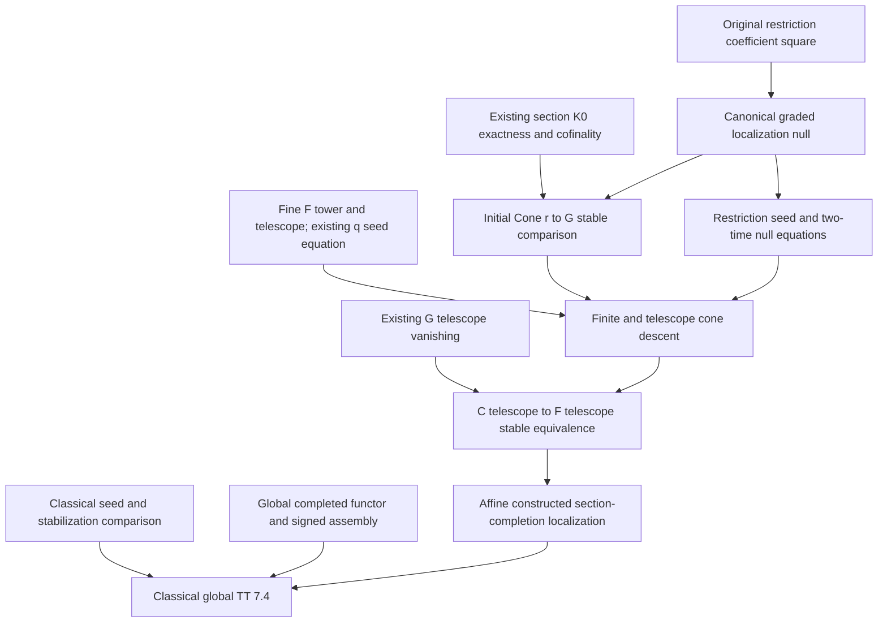
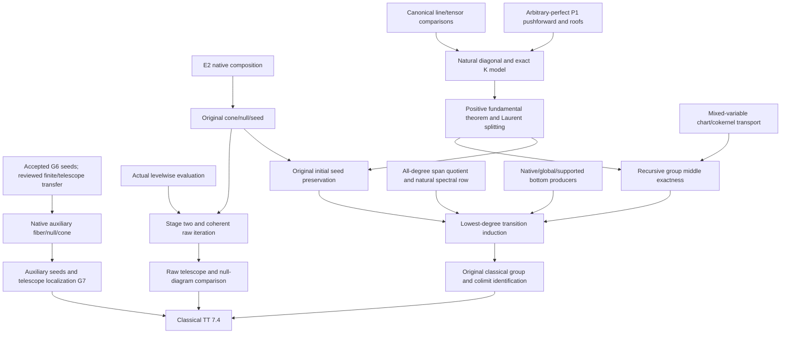

# Thomason–Trobaugh localization roadmap

Source basis: `4444574cd12bdaab888bd65c79ffba79ce0640ce` (0.5.0), Lean 4.34.1,
with the pinned dependencies and identified uncommitted mathematical additions.
The remaining-work investigation below was reconciled on 2026-10-13 against
the entry research rules at `9d92bce487400dcc5f8ed43dc31aaa64a6cb0e9b`.
This roadmap records
proof obligations and their actual consumers. Planned assertions are not library
theorems until their source proofs and corresponding interfaces are accepted.

## Target and current distance

The classical target is Thomason–Trobaugh, Theorem 7.4, printed pp. 365–366.
For qcqs `X`, an open immersion `j : U → X` with quasi-compact `U`, and
`Y = X − U`, it asserts the canonical nonconnective fiber sequence

```text
Kᴮ(X on Y) → Kᴮ(X) → Kᴮ(U).
```

It also includes auxiliary closed support `Z` with quasi-compact complement:

```text
Kᴮ(X on Y ∩ Z) → Kᴮ(X on Z) → Kᴮ(U on U ∩ Z).
```

Original images confirm that Sections 6.4, 6.6(a), 7.0 and 7.5(a) retain the
initial comparison in degrees `n ≥ 0`, including zero. Source:
R. W. Thomason and T. Trobaugh, *Higher Algebraic K-Theory of Schemes and of
Derived Categories*, The Grothendieck Festschrift III, Progress in Mathematics
88 (1990), 247–435,
[DOI](https://doi.org/10.1007/978-0-8176-4576-2_10),
[original paper](https://www.sas.rochester.edu/mth/sites/doug-ravenel/otherpapers/Thomason-Trobaugh.pdf).

Three targets must be distinguished:

1. **Implemented connective localization.** The canonical relative/open
   comparison is bijective in positive degrees, injective at zero, and retains
   the actual K₀ image and original boundary. Supported naturality, excision and
   connective Mayer–Vietoris are also present.
2. **Affine constructed section-completion localization.** The original
   coarse-to-fine telescope restriction is now stable in every integer degree.
   The supported telescope cone compares to the actual fine full-open section
   completion, and the same constructed whole null gives the stable supported
   fiber comparison with its original signed boundary. Coefficient maps and
   the original seed, inclusion and cylinder data are retained.
3. **Classical, global TT localization.** Identifying the completed objects
   with classical `Kᴮ`, preserving nonnegative groups, and completing global
   supported localization remain substantial separate branches. The native
   global coarse-to-fine section-completion comparison and basic supported
   fiber sequence are now supplied. Auxiliary-supported localization and
   classical identification remain separate.

The affine constructed transfer, native global completion comparison and basic
global supported localization are supplied. Completed geometric evaluation,
classical identification and auxiliary-supported localization still have distinct
mathematical obligations; file or theorem counts do not measure their distance.

## Verified proof checkpoints

The following additions have passed pinned leaf compilation and independent
ordinary source review. All use the standard heartbeat budget except the one
explained declaration-local E1 normalization allowance recorded below. Package
integration and downstream completion comparisons have separately scoped checks.

| New owner | Proved scope |
| --- | --- |
| [FullOpenSectionRestrictionDiagram](../../Quillen/AlgebraicGeometry/PerfectComplexes/BoundedFlat/FullOpenSectionRestrictionDiagram.lean) | Original restriction components form strict Model/prespectrum coefficient transformations without compactness or flatness premises |
| [FullOpenSectionGradingNull](../../Quillen/AlgebraicGeometry/PerfectComplexes/BoundedFlat/FullOpenSectionGradingNull.lean) | Genuine evaluated weak-image witnesses make zero-to-restricted-section maps weak; their reversed whole tracks construct the coefficient-natural null of the actual r and q |
| [FullOpenSectionRestrictionSeed](../../Quillen/AlgebraicGeometry/PerfectComplexes/Affine/FullOpenSectionRestrictionSeed.lean) | Original categorical restriction preserves the actual ambient forward unit and its restriction to the open, with no supplied compatibility premise |
| [FullOpenSectionGradingNullSeed](../../Quillen/AlgebraicGeometry/PerfectComplexes/Affine/FullOpenSectionGradingNullSeed.lean) | The actual canonical null commutes with those original unit actions at both independent times, including the unchanged level-zero loop coordinate |
| [FullOpenSectionGradingNullBassSeed](../../Quillen/AlgebraicGeometry/PerfectComplexes/Affine/FullOpenSectionGradingNullBassSeed.lean) | Every canonical localization-null time slice preserves the actual original Bass seeds; the resulting whole based-loop equation retains the independent output-loop coordinate |
| [StableKMap](../../Quillen/Waldhausen/SConstruction/Iterated/StableKMap.lean) | The original direct-Model K-map corresponds to its nonnegative stable map; injectivity, surjectivity and negative connectivity transport through the actual level-one comparison |
| [FullOpenSectionConeStable](../../Quillen/AlgebraicGeometry/PerfectComplexes/BoundedFlat/FullOpenSectionConeStable.lean) | For the actual r and q, every genuinely typed specified null gives an all-integer stable cone descent; K₀ image exactness and the degree-one kernel are discharged internally |
| [FullOpenSectionBassTower](../../Quillen/AlgebraicGeometry/PerfectComplexes/Affine/FullOpenSectionBassTower.lean), [telescope](../../Quillen/AlgebraicGeometry/PerfectComplexes/Affine/FullOpenSectionBassTelescope.lean) | Actual fine stages, seed transitions, telescope, original inclusions, topology and finite stable representatives |
| [FullOpenSectionBassGradingTower](../../Quillen/AlgebraicGeometry/PerfectComplexes/Affine/FullOpenSectionBassGradingTower.lean), [telescope grading](../../Quillen/AlgebraicGeometry/PerfectComplexes/Affine/FullOpenSectionBassGradingTelescope.lean) | Actual finite and telescope q maps, original coefficient/cylinder/initial faces; signed zero map follows from G∞ vanishing |
| [FullOpenSectionBassRestrictionTower](../../Quillen/AlgebraicGeometry/PerfectComplexes/Affine/FullOpenSectionBassRestrictionTower.lean) | Literal iterated r, genuine finite Model cone excision and all-integer stable finite cone descent using the same prescribed null |
| [FullOpenSectionBassRestrictionCofiber](../../Quillen/AlgebraicGeometry/PerfectComplexes/Affine/FullOpenSectionBassRestrictionCofiber.lean) | The same null preserves every finite transition and forms the original telescope null; its cone descent is stable, and graded vanishing makes the unchanged r∞ stable in every integer degree |
| [FullOpenSectionBassLocalization](../../Quillen/AlgebraicGeometry/PerfectComplexes/Affine/FullOpenSectionBassLocalization.lean) | The actual supported telescope cone compares stably to the fine full-open completion; the same postcomposed null gives the stable supported fiber map and original signed connecting identity |
| [FullOpenSectionSpectrumComparison](../../Quillen/AlgebraicGeometry/PerfectComplexes/BoundedFlat/FullOpenSectionSpectrumComparison.lean) | Actual direct section spectrum evaluates stably to the explicitly lifted bounded-flat original spectrum; compact U gives the perfect comparison, with original K-equations and chosen-zero normalization retained |
| [ScalarCofiberKOneNormalization](../../Quillen/AlgebraicGeometry/PerfectComplexes/ScalarCofiberKOneNormalization.lean) | Explicit inverse-prefix/cancellation normalization matches the inverse original component equivalence; scalar and polynomial-coordinate boundary classes are inverse forward-square classes |
| [SupportedOpen/ConeComparison](../../Quillen/AlgebraicGeometry/PerfectComplexes/SupportedOpen/ConeComparison.lean), [ExcisionSpectrum](../../Quillen/AlgebraicGeometry/PerfectComplexes/SupportedOpen/ExcisionSpectrum.lean) | Original global auxiliary-support coarse cone stability and signed boundary, and actual normalized cover support-excision stability |
| [CoefficientBaseChange](../../Quillen/AlgebraicGeometry/Scheme/CoefficientBaseChange.lean), [CoefficientSections](../../Quillen/AlgebraicGeometry/PerfectComplexes/BoundedFlat/CoefficientSections.lean) | Native joint scheme/coefficient fibers and strict fine Model diagram, actual evaluation, one global zero and exact literally zero-preserving reindexing; no global grading or completion claim |
| [CoefficientOpenSections](../../Quillen/AlgebraicGeometry/PerfectComplexes/BoundedFlat/CoefficientOpenSections.lean), [CoefficientOpenGrading](../../Quillen/AlgebraicGeometry/PerfectComplexes/BoundedFlat/CoefficientOpenGrading.lean) | Actual global coarse/fine/graded coefficient Models, literal zero-preserving r and q, evaluation and image grading; the graded coefficient diagram requires compact source and ambient schemes, without flatness or affineness |
| [CoefficientOpenCofinality](../../Quillen/AlgebraicGeometry/PerfectComplexes/BoundedFlat/CoefficientOpenCofinality.lean), [CoefficientOpenKZeroExact](../../Quillen/AlgebraicGeometry/PerfectComplexes/BoundedFlat/CoefficientOpenKZeroExact.lean) | Original global r cofinality, honest image(r₀)=kernel(q₀), actual q₀ surjectivity and positive graded K-vanishing, retaining each theorem's precise weaker hypotheses |
| [CoefficientOpenNull](../../Quillen/AlgebraicGeometry/PerfectComplexes/BoundedFlat/CoefficientOpenNull.lean), [CoefficientOpenConeStable](../../Quillen/AlgebraicGeometry/PerfectComplexes/BoundedFlat/CoefficientOpenConeStable.lean) | Same joint-zero canonical null and actual coefficient-natural initial Cone(r)→G stable in every integer degree for qcqs Q and compact P; no completion claim |
| [CoefficientPolynomialLaurent](../../Quillen/AlgebraicGeometry/Scheme/CoefficientPolynomialLaurent.lean), [CoefficientSectionUnits](../../Quillen/AlgebraicGeometry/PerfectComplexes/BoundedFlat/CoefficientSectionUnits.lean), [CoefficientOpenBassSeed](../../Quillen/AlgebraicGeometry/PerfectComplexes/BoundedFlat/CoefficientOpenBassSeed.lean), [CoefficientOpenSeedCompatibility](../../Quillen/AlgebraicGeometry/PerfectComplexes/BoundedFlat/CoefficientOpenSeedCompatibility.lean) | Original native products/charts/forward units, all three coefficient-natural seeds, actual r/q seed squares and every canonical N time-slice square; the generic [StrictLaurentSeed](../../Quillen/KTheory/Bass/StrictLaurentSeed.lean) retains source-leg cylinders and prescribed concatenation |
| [CoefficientSectionSpectrumComparison](../../Quillen/AlgebraicGeometry/PerfectComplexes/BoundedFlat/CoefficientSectionSpectrumComparison.lean), [CoefficientSectionEvaluationNaturality](../../Quillen/AlgebraicGeometry/PerfectComplexes/BoundedFlat/CoefficientSectionEvaluationNaturality.lean) | Original native evaluation, actual zero normalization and K₀ equations; whole joint-arrow homotopies and genuine localized natural isomorphisms, with compactness exactly for perfect stability; no seed/telescope comparison |
| [CoefficientOpenBassTower](../../Quillen/AlgebraicGeometry/PerfectComplexes/BoundedFlat/CoefficientOpenBassTower.lean), [CoefficientOpenBassTelescope](../../Quillen/AlgebraicGeometry/PerfectComplexes/BoundedFlat/CoefficientOpenBassTelescope.lean) | Literal global C/F/G stages, original transitions and the same whole null; actual graded seed contraction gives signed G∞ vanishing and original r∞ stability for qcqs Q and compact P, without classical identification |
| [CoefficientSupportedSections](../../Quillen/AlgebraicGeometry/PerfectComplexes/BoundedFlat/CoefficientSupportedSections.lean), [CoefficientSupportedOpenModels](../../Quillen/AlgebraicGeometry/PerfectComplexes/BoundedFlat/CoefficientSupportedOpenModels.lean) | Actual supported joint sections, native C_Z/F_Z/r_Z and intersection-support fiber Models, with geometric weak-class correspondence and literal zeros; supported grading, cofinality and completion remain separate |
| [SupportedOpen/GrothendieckPullback](../../Quillen/AlgebraicGeometry/PerfectComplexes/SupportedOpen/GrothendieckPullback.lean), [ImageQuotientPullback](../../Quillen/AlgebraicGeometry/PerfectComplexes/SupportedOpen/ImageQuotientPullback.lean), [CoefficientSupportedOpenGrading](../../Quillen/AlgebraicGeometry/PerfectComplexes/BoundedFlat/CoefficientSupportedOpenGrading.lean) | Original supported K₀ pullback and actual relative-image witnesses give quotient descent and native G_Z/q_Z; pointwise grading has no compactness premise, while coefficient action needs compact P/Q; cofinality and completion remain separate |
| [CoefficientSectionEvaluationUnit](../../Quillen/AlgebraicGeometry/PerfectComplexes/BoundedFlat/CoefficientSectionEvaluationUnit.lean), [unit pasting](../../Quillen/AlgebraicGeometry/PerfectComplexes/BoundedFlat/CoefficientSectionEvaluationUnitPasting.lean), [CoefficientLaurentEvaluation](../../Quillen/AlgebraicGeometry/PerfectComplexes/BoundedFlat/CoefficientLaurentEvaluation.lean) | Evaluation preserves the actual forward unit and original relative Laurent tracks, squares and endpoints with independent coordinates; source-leg, seed, iterate and telescope comparison remain separate |
| [ScalarLaurentClassComparison](../../Quillen/AlgebraicGeometry/PerfectComplexes/ScalarLaurentClassComparison.lean), [NativeLaurentClassComparison](../../Quillen/AlgebraicGeometry/PerfectComplexes/NativeLaurentClassComparison.lean) | Original normalized scalar class restricts to the intrinsic unit-automorphism K₁ class; for every scheme the native rank-one forward class is [T] and the cofiber class is [T]⁻¹, retaining the actual restriction rebase and component transport |
| [ProjectiveLine/NativeTwoSummands](../../Quillen/AlgebraicGeometry/PerfectComplexes/ProjectiveLine/NativeTwoSummands.lean) | Native O/O(−1) define the original exact two-summand functor; both original chart K-maps add the two pullbacks for every n≥0, including zero; no K-bijectivity assertion |
| [CoefficientSupportedOpenCofinality](../../Quillen/AlgebraicGeometry/PerfectComplexes/BoundedFlat/CoefficientSupportedOpenCofinality.lean), [KZeroExact](../../Quillen/AlgebraicGeometry/PerfectComplexes/BoundedFlat/CoefficientSupportedOpenKZeroExact.lean), [Null](../../Quillen/AlgebraicGeometry/PerfectComplexes/BoundedFlat/CoefficientSupportedOpenNull.lean), [ConeStable](../../Quillen/AlgebraicGeometry/PerfectComplexes/BoundedFlat/CoefficientSupportedOpenConeStable.lean) | Actual auxiliary-supported r_Z cofinality, honest K₀ image/kernel and q_Z₀ surjectivity, coefficient-natural canonical null and all-integer initial cone descent; subsequent seeds and finite/telescope transfer have their own scope |
| [CoefficientSupportedOpenBassSeed](../../Quillen/AlgebraicGeometry/PerfectComplexes/BoundedFlat/CoefficientSupportedOpenBassSeed.lean), [SeedCompatibility](../../Quillen/AlgebraicGeometry/PerfectComplexes/BoundedFlat/CoefficientSupportedOpenSeedCompatibility.lean) | Original supported forward Laurent actions, all three seeds, literal r_Z/q_Z seed squares and every canonical-null time-slice square; the recovered independent verdict matches the current source bytes |
| [CoefficientSupportedOpenBassTower](../../Quillen/AlgebraicGeometry/PerfectComplexes/BoundedFlat/CoefficientSupportedOpenBassTower.lean), [BassTelescope](../../Quillen/AlgebraicGeometry/PerfectComplexes/BoundedFlat/CoefficientSupportedOpenBassTelescope.lean) | Literal supported finite/telescope stages, original whole null, graded signed vanishing and stable original r_Z∞; strict builds, independent ordinary review, four-origin foundation audit and scoped facade/client integration passed |
| [CoefficientFullOpenBassLocalization](../../Quillen/AlgebraicGeometry/PerfectComplexes/BoundedFlat/CoefficientFullOpenBassLocalization.lean) and its Models/Seed/Tower/Telescope dependencies | Basic native global support completion: the actual supported-forget cone and same-null fiber compare stably to F∞ for qcqs ambient Q and compact P, retaining original inclusion and signed boundary; no auxiliary-supported or classical identification claim |
| [CoefficientSectionEvaluationSourceLeg](../../Quillen/AlgebraicGeometry/PerfectComplexes/BoundedFlat/CoefficientSectionEvaluationSourceLeg.lean) | Actual raw native chart/source-leg tracks, fine-span evaluation and two-time raw-cone interchange; normalized fine-to-raw chart-composition, seed and telescope comparisons remain open |
| [NativePerfectProjection](../../Quillen/AlgebraicGeometry/PerfectComplexes/ProjectiveLine/NativePerfectProjection.lean), [NativePerfectGeneration](../../Quillen/AlgebraicGeometry/PerfectComplexes/ProjectiveLine/NativePerfectGeneration.lean) | Original native flat-base-change mate on all intrinsic perfect inputs; affine perfect coefficients have an objectwise chosen positive projection isomorphism and actual O(−1) projection vanishing; no perfect pushforward or P¹ generation assertion |
| [PolynomialZeroSection](../../Quillen/AlgebraicGeometry/PerfectComplexes/Bass/PolynomialZeroSection.lean), [supported variant](../../Quillen/AlgebraicGeometry/PerfectComplexes/Bass/SupportedPolynomialZeroSection.lean) and their scheme/pair producers | Actual zero evaluation splits projection pullback and the original common corner in every recursive negative degree and every nonnegative perfect K degree, including zero; the original chart difference kills that corner, without claiming middle exactness or stabilization |
| [ConeStableVanishing](../../Quillen/Topology/Prespectrum/ConeStableVanishing.lean), [cone/fiber converse](../../Quillen/Topology/Prespectrum/ConeDescStableEquivalence.lean) | Genuine cone excision plus signed cone vanishing detects the original arrow; stable cone descent gives the same whole-null stable fiber lift |

The original restriction seed square and whole canonical-null seed square are
constructed without supplied compatibility premises. Their actual finite
transition equations give the compatible telescope null, and the proved finite
cone comparisons transfer to the original telescope cone descent. Signed graded
vanishing then proves the original coarse-to-fine restriction stable; composing
the supported coarse comparison gives affine section-completion localization.
The original null, chosen zeros and signed boundary are unchanged. The affine
proof family has strict default-budget builds and independent ordinary source
review; final facade, client and audit integration has its own checked scope.
The affine and G1–G4 proofs retain the standard budget. E1's concrete lifted
normalization isomorphism retains one explained finite declaration-local
1,200,000-heartbeat allowance after a failed standard-budget check; package
defaults remain 200,000. Finite higher scratch budgets remain available for
proof iteration, followed by cost normalization after correctness. These
constructions do not identify classical Kᴮ. G5 now supplies the original global
coarse-to-fine coefficient completion comparison; auxiliary-supported localization and
completed geometric evaluation remain separate obligations.

## Actual affine objects

Fix `R : CommRingCat.{u}`, `j : U ⟶ Spec R` with `[IsOpenImmersion j]`.
Coefficients are arbitrary `a : Under R`, with arbitrary coefficient arrows.
Retain `[CompactSpace U]` for quotient grading and the initial full-open stable
comparison; add no flatness, noetherian, regularity or affineness assumption on U.
Models and prespectra are in universe `u + 1`.

| Symbol | Actual source object |
| --- | --- |
| `C` | `boundedFlatAffineSectionOpenPrespectrumFunctor j`, coarse relative-open sections |
| `F` | `boundedFlatAffineFullOpenSectionPrespectrumFunctor j`, fine full-open sections |
| `G` | `boundedFlatAffineFullOpenGradedSectionPrespectrumFunctor j`, quotient-graded sections |
| `rₐ` | `prespectrumMap (boundedFlatAffineSectionFullOpenModelMap j a)` |
| `q` | `boundedFlatAffineFullOpenSectionGradingPrespectrumTransformation j` |

`q` is not asserted to be a stable equivalence. The required comparison is

```text
Cone(rₐ) → G(a), using a constructed null Nₐ of rₐ ≫ qₐ.
```

The chosen coefficient pullback open remains `openSpace j a`. At the identity
algebra it is related to U by the original projection isomorphism; it is not
silently replaced by a definitionally equal open.

## Existing load-bearing interfaces

| Owner | Available result |
| --- | --- |
| [FullOpenSectionRestrictionModel](../../Quillen/AlgebraicGeometry/PerfectComplexes/BoundedFlat/FullOpenSectionRestrictionModel.lean) | Original exact restriction Model map with literal preservation of its whole chosen zero |
| [FullOpenSectionKZeroExact](../../Quillen/AlgebraicGeometry/PerfectComplexes/BoundedFlat/FullOpenSectionKZeroExact.lean) | Original restriction K₀ image equals the kernel of the original fine-to-graded K₀ map |
| [FullOpenSectionKZeroValue](../../Quillen/AlgebraicGeometry/PerfectComplexes/BoundedFlat/FullOpenSectionKZeroValue.lean) | Surjectivity of that fine-to-graded K₀ map, without restriction-surjectivity |
| [FullOpenSectionRestrictionCofinality](../../Quillen/AlgebraicGeometry/PerfectComplexes/BoundedFlat/FullOpenSectionRestrictionCofinality.lean) | Actual restriction injective at zero and bijective in positive degrees |
| [FullOpenGradedSectionStable](../../Quillen/AlgebraicGeometry/PerfectComplexes/BoundedFlat/FullOpenGradedSectionStable.lean) | Actual G has zero stable groups in every nonzero degree |
| [FullOpenSectionBassSeedChangeWeak](../../Quillen/AlgebraicGeometry/PerfectComplexes/Affine/FullOpenSectionBassSeedChangeWeak.lean) | Exact coefficient-natural equation `seedF ≫ B(q) = q ≫ seedG` |
| [FullOpenGradedSectionBassTelescope](../../Quillen/AlgebraicGeometry/PerfectComplexes/Affine/FullOpenGradedSectionBassTelescope.lean) | Actual G telescope has zero stable groups in every integer degree |
| [SupportedSectionBassTelescopeOpenCofiber](../../Quillen/AlgebraicGeometry/PerfectComplexes/Affine/SupportedSectionBassTelescopeOpenCofiber.lean) | Supported-forget telescope cone stably identifies with C telescope, preserving the signed boundary |
| [SectionBassStableColimit](../../Quillen/AlgebraicGeometry/PerfectComplexes/Affine/SectionBassStableColimit.lean) | Original telescope stable groups are the canonical coefficient-natural colimit |
| [SectionBassTelescopeSelfMap](../../Quillen/AlgebraicGeometry/PerfectComplexes/Affine/SectionBassTelescopeSelfMap.lean) | Actual telescope → its Bass image is a stable equivalence in every signed degree |

The raw-perfect objectwise deficit comparison is a different map and model.
It supplies no replacement for the section diagram, its original null, or its
seed compatibility. Diagonal bottom-group isomorphisms identify stage i at
degree −i; they do not identify the subsequent telescope group.

## Proof dependency plan



### Construction invariants

The coefficient transformations r and q, canonical null N, original Laurent
units and Bass seeds belong to one coherent choice of C/F/G and section zeros.
The two-time interchange and whole seed equation retain those exact tracks.
The initial cone comparison uses the honest K₀ image quotient, restriction K₀
injectivity at degree one, and positive cofinality. Its generic null parameter
is discharged by this same constructed N before the telescope application.

Finite Model excision and T1 are supplied by the actual stages; no uniform
whole-telescope connectivity or fixed-degree seed stabilization is assumed.
Separate proof authors use disjoint sources and private compiler outputs;
facade and package integration is serialized on a fixed candidate.

### Constructed affine completion

1. `FullOpenSectionBassRestrictionTower` instantiates
   `modelDiagramIterateCofiberDesc_isStableEquivalence` on C,F,G
   and the original r,q,N, retaining the actual finite cone descent.
2. `FullOpenSectionBassRestrictionCofiber` uses
   `strictDiagramIterateNull_transition` to obtain the whole null equation
   for every original finite transition. Both seed squares and N's time-slice
   square are proved, and actual Models supply finite-stage T1.
3. The same owner applies `Telescope.coneDesc_isStableEquivalence` to the actual tower maps and
   compatible nulls. The proved G telescope vanishing transfers to the canonical
   cone of `r∞` and makes this same original restriction stable.
4. `FullOpenSectionBassLocalization` composes the proved stable
   `r∞ : C∞ → F∞` with the already implemented
   supported-cone → C∞ comparison, retaining the original inclusion face, fiber
   lift and signed boundary of the resulting localization sequence.

Neither fixed-degree finite-seed stabilization nor classical negative-group
identification is required for this constructed section-completion result.

## Concrete remaining-work plan

The 2026-10-13 investigation separates construction, geometric realization,
and classical identification. The critical classical path is the genuine
projective-line K-equivalence and Laurent boundary calculation, followed by
initial-seed preservation, recursive chart exactness, and preservation at the
lowest transition degree. E2 has a second substantial prerequisite: a coherent
producer of the original raw geometric iterates. G7 can advance independently
of these classical calculations.

### Reconciled starting point

G1–G5 and E1 retain their accepted scope. The recovered G6 seed verdict matches
the current `CoefficientSupportedOpenBassSeed` and `SeedCompatibility` bytes;
these original supported seeds and whole-null seed squares are accepted.
The new `CoefficientSupportedOpenBassTower` and `BassTelescope` have strict
200,000-heartbeat builds and a current four-origin audit covering 115
declarations, including private/generated helpers. Independent ordinary review
accepts their original finite/telescope constructions and stable r_Z∞. The new
leaves are enrolled and the affected facades and existing Consumer root compile
strictly. Basic G7, the initial auxiliary-supported cone,
raw source-leg movement, affine perfect-coefficient projection calculations,
and polynomial zero-evaluation splitting retain their separately reconciled
review scopes.

The recovered facade/consumer integration passed for its fixed source snapshot.
Later new leaves are outside that snapshot. Neither its successful builds nor
its foundation audits establish a new classical comparison or a full release.
The polynomial zero-evaluation splitting is distinct from the still-needed
zero-locus pushforward/class calculation in the Laurent boundary proof.

### S. Finish auxiliary-supported constructed localization (G6–G7)

Let `f : P → Q` be the actual open arrow over `Spec R`, `T ⊂ Q` the open
complement of the auxiliary closed support, and `a : Under R`. Retain the
original coefficient fibers and projection pullbacks. Write `T_a` for the
pullback of `T` and `V_a = T_a ∪ range(f_a)`.

| Step | Exact product and route | Required inputs and acceptance |
| --- | --- | --- |
| S1: G6 finite/telescope transfer | Literal `B^i(C_Z/F_Z/G_Z)`, original transitions, r_i/q_i and iterated canonical N_i; whole null-transition equation; signed G_Z∞ vanishing; original Cone(r_Z∞)→G_Z∞ and r_Z∞ stable. | Accepted, audited, enrolled and scoped-integrated. Graded coefficient data require compact P,Q. Final cone/r∞ stability additionally requires quasi-separated Q and compact T. Preserve every original finite and cylinder face. |
| S2: native auxiliary fiber | Construct sections vanishing on V_a, the literal forget map into sections vanishing on T_a, the identity change of weakness to C_Z, and the canonical reversed zero-to-image null. | Use `CoefficientSupportedOpenModels`, actual `ιOfLE`, original evaluation, and `SupportedOpen/ConeComparison`. Transport the geometric auxiliary acyclic cone through exact evaluation equivalences. The initial native comparison needs no compactness premise. The basic unsupported ambient support sequence cannot replace this construction. |
| S3: auxiliary seeds and completion | Lift the same ambient forward Laurent unit to the V_a-supported fiber; prove forget/changeWeak seed squares and every canonical-null time-slice square. Form the actual finite towers and telescope null, then compare Cone(forget∞)→C_Z∞. | Prove component preservation through the original inclusion functors. Use whole identity-action interchange, finite Model excision/T1 and telescope cone descent; retain separate null time and telescope height. No supplied compatibility or localization input. |
| S4: final constructed auxiliary sequence | Postcompose S3 with the original r_Z∞. Produce the same-null stable fiber lift for Fiber_Z∞→A_Z∞→F_Z∞ and its signed connecting identity. | Compact P,Q,T and quasi-separated Q for the final stable comparison; retain weaker hypotheses on the projection/boundary identities where possible. Independent review covers the actual support union, all three maps, null, and signed boundary. |

S2 is the immediate G7 milestone. Native literal forget/changeWeak maps and
their null have a scratch proof, without an accepted initial cone yet.
Geometric support properties choose independent zero objects: carry their
actual normalization isomorphisms and prove whole-null coherence, rather than
asserting these zeros equal. The selected alternative is to transport the
supported JointData to the same native nested weak structure, prove its
second-endpoint, extension and two-out-of-three properties, and identify the
V_a-supported fiber with the native acyclic category before applying fibration.
That route retains the native joint zero and still needs its actual producer.
S3/S4 may be developed conditionally; acceptance waits for S2's actual proof.
This package closes constructed
section-completion localization, with no classical Kᴮ claim.

### E. Compare to the original raw geometric completion (E2)

Use the actual normalized evaluation `e_i`, section reindexing `S_f`, original
geometric pullback `P_f`, and evaluation natural isomorphism `κ_f`. Let
`β(f,g)` be the original normalized geometric composition isomorphism. The
first target is the component equation

```text
κ_(f≫g)(x); β(f,g)(E_i x)
  = transportS(x); κ_g(S_f x); P_g(κ_f(x)).
```

`transportS` is the named strict section-reindexing composition equality.
Conjugate the existing Grothendieck/normalized/small-model composition formulas
by the actual evaluation normalization isomorphisms. A checked generic
specialization is available, but its concrete native bridge remains unproved.
Direct dependent unfolding has timed out even with a finite 2,000,000 budget.
The selected repair uses explicit equality transports and a generic pasting
cancellation lemma, retaining a clear explicit theorem type and the same maps.

| Step | Exact product | Proof route and acceptance |
| --- | --- | --- |
| E2-C: composition and chart descent | The native equation above, relative comparison of split versus whiskered composition tracks, and Hc: cFine;eLaurent ≃ spanEvaluation;cRaw. | `CoefficientSectionEvaluationNaturality`, `CompositionTrack`, normalized/small-model pasting, and `HomotopyPushout.descSquareHomotopy`. Prove both chart faces and the moving cylinder face with independent comparison/track times. No caller-supplied coherence. |
| E2-N: original source null | The actual whole-square cone map C and `Nold ≃ L ⋆ Nnew`, where Nold is the fine source null postcomposed with C, Nnew the original raw source null precomposed with e, and L the existing Laurent evaluation movement. | Use C's literal inclusion/cylinder equations, the positive-chart relative composition, and `CoefficientSectionEvaluationSourceLeg`'s cone boundary. Reassociate/cancel only through relative homotopies; retain the original positive source leg. |
| E2-S: original one-step seed | A whole pointed homotopy `seedFine; loop(C) ≃ e; seedRaw`. | Combine E2-N with the accepted unit-pasting square using conjugation naturality. Prove the actual loop-coordinate equation. Stable-group equality alone does not supply this comparison. |
| E2-W: actual levelwise equivalences | Original normalized e and actual span evaluation weak at every level; after C exists, its actual cone/loop evaluation weak at every level. | Reuse `ExactModelEquivalence.level_isWeakHomotopyEquivalence` and whole-square pushout/cone preservation. Prove the needed point HEP, T1 and loop-point conditions for these actual objects. E2-W can start beside E2-C. |
| E2-I: coherent raw iterates | Raw_0 and Raw_1 remain the existing raw objects. Construct Raw_2 with its original coefficient/chart maps, then an all-n producer of Raw_n, raw transitions, E_n and transition homotopies J_n. | First establish the full second-stage moving-square/composition faces. Then prove preservation of the required finite coherent diagram under span/cone/loop operations. Determine and realize the higher faces actually needed; a structure merely assuming them does not close this step. |
| E2-T: telescope and boundary | The original fine-to-raw telescope map, all stage/initial/cylinder equations, coefficient/restriction naturality and the signed boundary comparison. | Apply `Telescope.mapOfHomotopies` to the proved E_n/J_n; use stagewise equivalences and actual T1 to prove all-signed stability. Moving-square and relative-transition faces from E2-I supply naturality/boundary. |

The current raw native API has a one-step cone and seed, without a whole raw
tower. `strictDiagramIterate` requires a literal prespectrum-valued functor and
strict transformations; raw geometric pullbacks instead have prescribed
comparison tracks. It cannot be applied directly to these raw maps. Naming the
strict section tower as the raw tower would change the comparison target.

The bounded-flat evaluation/composition and actual fine seed/tower signatures
retain arbitrary `f : P → Q`: Lean omits the unused open-immersion instance.
Open immersion belongs to localization consumers; compactness belongs to the
perfect/stable comparisons that actually need it. Extend the final E2 package
to every ambient, open, and supported row consumed by B3, with the same choices.

### P. Prove the necessary projective-line K-equivalence (B1)

Start on the actual P¹ over an arbitrary commutative ring R, including the
zero ring. The target is the existing `nativeTwoSummandKMap`, in every
nonnegative degree including zero, induced by

```text
Φ(A,B) = p* A ⊕ (O(-1) ⊗ p* B).
G(E)   = (Rp* E, Rp*(E ⊗ O(-1))[1]).
```

The candidate K-inverse G needs a genuine exact-model realization. Φ is not
generally an equivalence of perfect derived categories: cross-Hom between its two
summands need not vanish. Generation therefore feeds a K-additivity proof,
not ordinary equivalence/approximation of this two-summand functor.

| Step | Exact product and current owner | Acceptance and dependency |
| --- | --- | --- |
| P1: canonical line/tensor comparisons | Natural p₁*(E⊗L)≅p₁*E⊗p₁*L, specified L⊗Q≅O, and the needed unit/associativity comparisons for the actual tautological lines. | Construct the pullback-tensor mate from `modulePushforwardTensorMap`; prove inversion using actual line trivializations and restriction compatibility. Glue L⊗Q through its inverse transition functions. Independent of perfect pushforward. |
| P2: arbitrary-perfect projection | For every intrinsic perfect K on P¹, prove Rp*K perfect over Spec R. Existing `BoundedDerivedPushforward` only covers explicitly bounded vector-bundle terms. | Selected route: P¹-specific nonnoetherian strictification, then that finite-term theorem. First prove a finite attachment lowering the local strict amplitude, then terminate at a finite locally free syzygy and identify the original derived object. No extra bounded-vector-bundle or noetherian hypothesis may remain. |
| P3: natural diagonal generation | Identify the existing projected incidence triangle, initially for vector bundles, as p*Rp*(E⊗L)→Q⊗p*Rp*E→E⊗Q; tensor by L and rotate to p*G₀(E)→E→L⊗p*G₁(E). | P1 supplies the first endpoint; existing self-base-change/projection formula supply the second. Retain incidence, quotient and connecting maps. Extend degreewise/totalize and descend through genuine roofs for all intrinsic perfect objects; P2 supplies perfect coefficients. |
| P4: original K-inverse | Realize G and the diagonal sequence as exact/cofibration-compatible functors on a proved model of the original Perfect category; apply Waldhausen additivity. | Construct natural bounded-complex Čech comparison and the necessary weak-arrow/roof model equivalence. Normalize the positive projection by its canonical adjunction unit, prove O(-1) vanishing and Rp*(O(-2)⊗p*A)[1]≅A, then both original K-map composites, including zero. |
| P5: native qcqs and supports | Transport the affine construction through `nativeAffineIso`, glue projection perfection on an affine base cover, and prove both coefficient functors preserve the actual inverse-image support. | Use canonical base change for the required open/flat maps. Arbitrary-base-map naturality needs its own tor-independent/perfect comparison; it is not supplied by current flat-base-change scope. |

P2's first finite-attachment target uses a termwise quasi-coherent,
bounded-below representative with local strict models in a finite interval
[a,b]. For a<b, find a finite-type quasi-coherent submodule of the b-cycles
surjecting onto Hᵇ, cover it by a finite sum of powers of the actual line,
and construct V[-b]→K whose cone has local strict amplitude [a,b−1]. Prove
that amplitude assertion, not only cohomology vanishing. At a=b the remaining
single cohomology sheaf must be finite locally free. Supply the cone and
quasi-isomorphism verifications omitted by the source sketch. Relevant source
anchors are [Stacks 0F8E](https://stacks.math.columbia.edu/tag/0F8E),
[0F8F](https://stacks.math.columbia.edu/tag/0F8F) and
[0GMM](https://stacks.math.columbia.edu/tag/0GMM); use finite-type
quasicoherence rather than coherence over a possibly noncoherent R.

Two concrete restrictions govern this route. `Scheme.Regular.ResolutionProperty`
assumes local noetherianity and cannot supply P2 unchanged. Global direct
chain representatives also fail: for nonzero R, H¹(P¹_R,O(-2))≅R, whereas
literal chain maps O[0]→O(-2)[1] vanish. The Čech quotient is
R[T,T⁻¹]/(R[T]+T⁻²R[T⁻¹]), detected by the T⁻¹ coefficient; see
[Stacks 01XT](https://stacks.math.columbia.edu/tag/01XT). P4 needs genuine
roofs, with source replacement when necessary. Object strictification alone
does not prove the K-model comparison.

A second viable P2 route is finite domination of the homotopy Čech complex
of two bounded projective chart complexes glued by a Laurent homotopy
equivalence. Existing `LaurentModuleCech` treats a literal module isomorphism,
so this is a new theorem rather than a termwise reuse. General proper-perfect
pushforward or dg-Morita routes require broader missing infrastructure; reserve
them for a concrete failure of the selected P¹-specific route.

After P4/P5, construct the original positive fundamental sequences and natural
Laurent splitting. Pin the boundary calculation for the original [T] operation,
including the cofiber's inverse orientation and the zero-locus class. The
already accepted Laurent K₁ class and chart formulas do not supply this
splitting. Keep all Nil contributions in the two chart images/quotient.

### B. Identify the original groups and colimit legs (B2)

Use E_i=B^i(E₀), t_i=B^i(η), and N_i the already defined original group
Bass recursion. Let a_d be the common-corner map and Δ_d the original
positive-minus-inverse chart difference on π_d(E).

| Step | New theorem product | Exact consumer and acceptance |
| --- | --- | --- |
| B2-A: all-degree span quotient | Actual polynomial zero evaluation splits a_d in every signed degree. The original pushout LES therefore gives π_d(span(E))≅coker(a_d). | Transport the second chart by −1: the representative map is the difference of the original inclusions and its comparison is Δ_d. Kill the hidden ker(a_(d−1)) term by the actual retraction. Existing bottom-generation proofs cover only the lowest degree. |
| B2-B: natural spectral Bass row | Prove `0→coker(Δ_(d+1))→π_d(BE)→ker(Δ_d)/im(a_d)→0`. | The left arrow is the original Laurent cone inclusion and signed loop shift. Encoding may first use the kernel of the induced coker(a_d)→Laurent map. Prove naturality for actual B(f); instantiate point-set excision from the finite Model geometry. |
| B2-C: recursive chart middle exactness | For every i, prove image(a(N_i))=kernel(Δ(N_i)), with original quotient maps and a constructed natural splitting of each Laurent quotient. | B1 supplies positive fundamental rows and h₀. Degree-zero middle exactness is a retract of the degree-one row over an independent Laurent variable. Prove mixed-variable geometric transports and commuting cokernel projections; descend h through the other variable, cancel the original epimorphic quotient, and transfer exactness through the resulting retract. Right exactness alone is insufficient. |
| B2-D: original initial seed | Prove π_d(η) invertible for every d≥0, including zero. | Identify the actual Laurent loop/seed with the B1 operation via E2-S or an equally explicit direct section calculation. Combine the spectral row, classical boundary splitting and K₀ middle exactness. An auxiliary normalized group splitting must not replace the original seed. |
| B2-E: exact lowest transition | Inductively prove π_d(t_i) invertible for d≥−i. | Apply B2-B to t_(i−1). For d≥1−i both end terms are controlled in degrees d,d+1. At d=−i the left term uses degree 1−i; source right term vanishes by connectivity, target right term by the bottom N_i comparison and B2-C. This includes the equality d=−i. |
| B2-F: original stage-i leg | In degree −i, invert the tail starting at i and retain its canonical inclusion equation. Compose with the actual telescope-colimit comparison. | Prove bijectivity of the existing original negative-class map, not just an abstract group isomorphism. The transition from i must be included; stability only from i+1 fails even for ℤ --×2→ ℤ --id→ … . Nonnegative preservation uses the stage-zero leg. |
| B2-G: native/global/supported producers | Build N_i(X_a,Z_a)≅π_(−i)(E_i(a)) and original negative maps for every consumed native family. | Current `SectionBassBottomComparison`, `NegativeMap` and `StableColimit` producers are affine. Use actual native polynomial/Laurent/chart isomorphisms and `DiagramTransport`; preserve coefficient/scheme maps, support forget/enlargement and open restriction. Do not declare different chosen pullbacks equal. |

B2-A/B, mixed-variable transports for B2-C, and B2-G can start independently
of the unresolved B1 calculations. Abstract results may carry their genuine
inputs explicitly; the native B2 conclusion waits until those inputs are
constructed. No retained premise named after desired localization, seed
preservation or stabilization may be used to declare classical closure.

### F. Classical model and final diagram transport (B3)

Specify the classical model by the original raw perfect/bounded-flat-perfect
spectrum, native polynomial/Laurent squares, original cone/loop stages and
forward Laurent transitions, followed by their homotopy colimit (TT 6.4).
If an ordinary colimit is used, prove its cofibration-replacement comparison.
E2 must produce the actual comparison to this model; a renamed section
completion is insufficient. B2's original class maps must agree with these
spectrum maps in every nonnegative and negative degree.

For T=X−Z and Y=X−U, compare the whole G7 null diagram with the raw diagram
on (X,Y∩Z), (X,Z), (U,U∩Z). Their acyclicity opens are U∪T, T, U∩T.
Under qcqs X and quasi-compact U,T, construct all three stable comparison
maps, the original support-enlargement/restriction squares, and coherence with
the same whole canonical null. Then transport the actual stable fiber lift
and prove, in each signed degree, the original boundary equation

```text
c_support,(n−1) ∘ boundary_section
  = boundary_classical ∘ c_open,n.
```

The classical boundary is the boundary of the specified raw null diagram;
defining a conjugate boundary without identifying it does not close B3.
Obtain the basic sequence by Z=X. State the library's actual stable
fiber-sequence notion; all-signed stability is not a levelwise homotopy
equivalence claim. This final milestone requires G7, completed E2 and B2,
with no remaining target-specific localization hypothesis.

### Parallel allocation and decision points



Start four focused proof products after this plan: G7's native auxiliary cone,
E2-C's explicit transport/pasting bridge, P1's line/tensor maps beside P2's
finite-attachment/roof investigation, and B2-A/B's generic spectral row.
E2-W is another independent short product when its full transfer cost is
worthwhile. Mixed-variable and global-bottom products follow once their
interfaces are fixed; do not populate every possible branch at once.

Use bounded mathematics at Sol 6.1/max for supported transfer, tensor/line
comparisons, topology and fixed spectral-row obligations. Retain Astra/max for
the complex native evaluation/iteration and nonnoetherian perfect/roof issues.
The principal retains route selection and synthesis. Assign disjoint new
sources, keep each mathematical author through its compile/repair loop, and
leave shared facades/documentation to serial integration. Create only complete
useful source leaves, not empty proposed modules.

At each coherent milestone, check exact sources, actual assumptions/maps,
strict builds and private-origin foundation coverage; independently review
uncovered mathematical claims and consumers. Reuse matched unchanged coverage.
Regenerate/enroll the accepted leaves, then build affected facades and meaningful
clients. Final classical closure has a separate whole-library boundary:
`bash scripts/check.sh --rehash`, including the full QuillenTest facade and both
explicit axiom audits. Passing that pipeline does not supply absent B1/E2/B2
proofs. Local commits require their separately authorized, checked scope;
they do not mark these remaining proofs complete.

Continue the selected route while it yields useful evidence. A failed direct
conversion triggers a generic transport repair; failure of the P¹ attachment
mechanism triggers the precisely stated finite-domination alternative. Revisit
the plan on a changed theorem scope, missing required coherence, or a genuine
counterexample, with the actual affected dependents identified. The independent
signed Mayer–Vietoris global-assembly route remains an alternative, not an extra
prerequisite of the direct native coefficient construction.

## Acceptance and maintained boundaries

Use the pinned mathlib standards, preserve Authors and package heartbeat
defaults, and normalize finite proof-iteration budgets after correctness checks.
Retain explicit hypotheses and actual canonical maps. Keep tentative derivations and
failed probes in scratch; admit complete useful proofs into their natural source
owners incrementally. No placeholders, new axioms or hidden localization inputs.

Each substantial milestone needs exact source/statement correspondence and
independent ordinary review. Check affected modules and meaningful clients;
run the complete pipeline at the integration boundary. Compiler success and
foundation audits do not identify a construction with classical Kᴮ.

Update the [perfect-complex guide](../topics/PerfectComplexes.md),
[spectrum guide](../topics/SpectraAndBass.md) and
[scope reference](../reference/Scope.md) when their actual frontier changes.
Do not replace this roadmap's planned steps by claims of completed TT localization.
