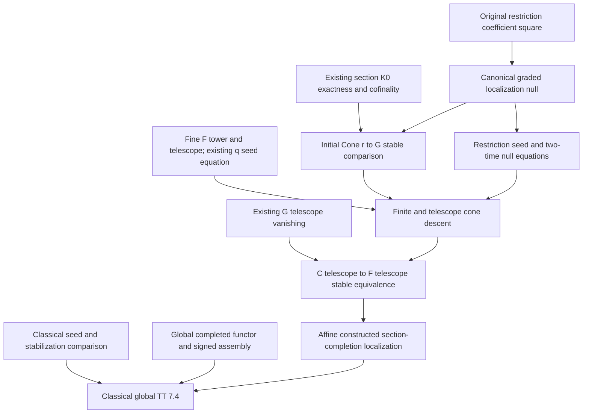
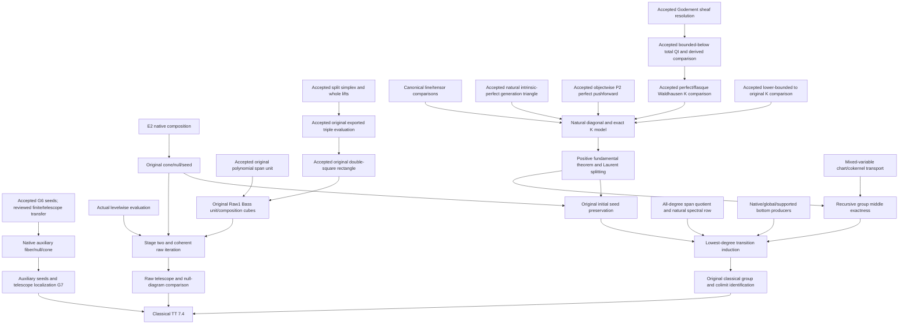

# Thomason–Trobaugh localization roadmap

Continuation source basis: locally checkpointed
`9398bbaa072dee2486e9eb1a8872d0eb46acf7d6`, Lean 4.34.1 and the pinned
dependencies, with the identified 0.7.0 source integration and uncommitted
mathematical leaves. The checkpoint includes `QuillenTest`, native
auxiliary-supported completion localization and intrinsic-perfect P¹
strictification/pushforward. The native spectral-row leaves have separate
matched source review and strict-build coverage.
The current continuation was reconciled on 2026-10-14 against the entry
research rules at `080a7cd38b9be40fce85191cc3b2304bc3c4a662`.
This roadmap records
proof obligations and their actual consumers. Planned assertions are not library
theorems until their source proofs and corresponding interfaces are accepted.

## Target and current distance

The classical target is Thomason–Trobaugh, Theorem 7.4, printed pp. 365–366.
For qcqs `X`, an open immersion `j : U → X` with quasi-compact `U`, and
`Y = X − U`, it asserts the canonical nonconnective fiber sequence

```text
Kᴮ(X on Y) → Kᴮ(X) → Kᴮ(U).
```

It also includes auxiliary closed support `Z` with quasi-compact complement:

```text
Kᴮ(X on Y ∩ Z) → Kᴮ(X on Z) → Kᴮ(U on U ∩ Z).
```

Sections 6.4, 6.6(a), 7.0 and 7.5(a) retain the
initial comparison in degrees `n ≥ 0`, including zero. Source:
R. W. Thomason and T. Trobaugh, *Higher Algebraic K-Theory of Schemes and of
Derived Categories*, The Grothendieck Festschrift III, Progress in Mathematics
88 (1990), 247–435,
[DOI](https://doi.org/10.1007/978-0-8176-4576-2_10),
[original paper](https://www.sas.rochester.edu/mth/sites/doug-ravenel/otherpapers/Thomason-Trobaugh.pdf).

Three targets must be distinguished:

1. **Implemented connective localization.** The canonical relative/open
   comparison is bijective in positive degrees, injective at zero, and retains
   the actual K₀ image and original boundary. Supported naturality, excision and
   connective Mayer–Vietoris are also present.
2. **Affine constructed section-completion localization.** The original
   coarse-to-fine telescope restriction is now stable in every integer degree.
   The supported telescope cone compares to the actual fine full-open section
   completion, and the same constructed whole null gives the stable supported
   fiber comparison with its original signed boundary. Coefficient maps and
   the original seed, inclusion and cylinder data are retained.
3. **Classical, global TT localization.** Identifying the completed objects
   with classical `Kᴮ`, preserving nonnegative groups, and completing global
   supported localization remain substantial separate branches. The native
   global coarse-to-fine section-completion comparison and both basic and
   auxiliary-supported fiber sequences are now supplied. Completed geometric
   evaluation and classical identification remain separate.

The affine constructed transfer, native global completion comparison and
global localization with auxiliary support are supplied. Completed geometric
evaluation and classical identification still have distinct mathematical
obligations; file or theorem counts do not measure their distance.

## Verified proof checkpoints

The following additions have passed pinned leaf compilation and independent
ordinary source review. All use the standard heartbeat budget except the one
explained declaration-local E1 normalization allowance recorded below. Package
integration and downstream completion comparisons have separately scoped checks.

| New owner | Proved scope |
| --- | --- |
| [FullOpenSectionRestrictionDiagram](../../Quillen/AlgebraicGeometry/PerfectComplexes/BoundedFlat/FullOpenSectionRestrictionDiagram.lean) | Original restriction components form strict Model/prespectrum coefficient transformations without compactness or flatness premises |
| [FullOpenSectionGradingNull](../../Quillen/AlgebraicGeometry/PerfectComplexes/BoundedFlat/FullOpenSectionGradingNull.lean) | Genuine evaluated weak-image witnesses make zero-to-restricted-section maps weak; their reversed whole tracks construct the coefficient-natural null of the actual r and q |
| [FullOpenSectionRestrictionSeed](../../Quillen/AlgebraicGeometry/PerfectComplexes/Affine/FullOpenSectionRestrictionSeed.lean) | Original categorical restriction preserves the actual ambient forward unit and its restriction to the open, with no supplied compatibility premise |
| [FullOpenSectionGradingNullSeed](../../Quillen/AlgebraicGeometry/PerfectComplexes/Affine/FullOpenSectionGradingNullSeed.lean) | The actual canonical null commutes with those original unit actions at both independent times, including the unchanged level-zero loop coordinate |
| [FullOpenSectionGradingNullBassSeed](../../Quillen/AlgebraicGeometry/PerfectComplexes/Affine/FullOpenSectionGradingNullBassSeed.lean) | Every canonical localization-null time slice preserves the actual original Bass seeds; the resulting whole based-loop equation retains the independent output-loop coordinate |
| [StableKMap](../../Quillen/Waldhausen/SConstruction/Iterated/StableKMap.lean) | The original direct-Model K-map corresponds to its nonnegative stable map; injectivity, surjectivity and negative connectivity transport through the actual level-one comparison |
| [FullOpenSectionConeStable](../../Quillen/AlgebraicGeometry/PerfectComplexes/BoundedFlat/FullOpenSectionConeStable.lean) | For the actual r and q, every genuinely typed specified null gives an all-integer stable cone descent; K₀ image exactness and the degree-one kernel are discharged internally |
| [FullOpenSectionBassTower](../../Quillen/AlgebraicGeometry/PerfectComplexes/Affine/FullOpenSectionBassTower.lean), [telescope](../../Quillen/AlgebraicGeometry/PerfectComplexes/Affine/FullOpenSectionBassTelescope.lean) | Actual fine stages, seed transitions, telescope, original inclusions, topology and finite stable representatives |
| [FullOpenSectionBassGradingTower](../../Quillen/AlgebraicGeometry/PerfectComplexes/Affine/FullOpenSectionBassGradingTower.lean), [telescope grading](../../Quillen/AlgebraicGeometry/PerfectComplexes/Affine/FullOpenSectionBassGradingTelescope.lean) | Actual finite and telescope q maps, original coefficient/cylinder/initial faces; signed zero map follows from G∞ vanishing |
| [FullOpenSectionBassRestrictionTower](../../Quillen/AlgebraicGeometry/PerfectComplexes/Affine/FullOpenSectionBassRestrictionTower.lean) | Literal iterated r, genuine finite Model cone excision and all-integer stable finite cone descent using the same prescribed null |
| [FullOpenSectionBassRestrictionCofiber](../../Quillen/AlgebraicGeometry/PerfectComplexes/Affine/FullOpenSectionBassRestrictionCofiber.lean) | The same null preserves every finite transition and forms the original telescope null; its cone descent is stable, and graded vanishing makes the unchanged r∞ stable in every integer degree |
| [FullOpenSectionBassLocalization](../../Quillen/AlgebraicGeometry/PerfectComplexes/Affine/FullOpenSectionBassLocalization.lean) | The actual supported telescope cone compares stably to the fine full-open completion; the same postcomposed null gives the stable supported fiber map and original signed connecting identity |
| [FullOpenSectionSpectrumComparison](../../Quillen/AlgebraicGeometry/PerfectComplexes/BoundedFlat/FullOpenSectionSpectrumComparison.lean) | Actual direct section spectrum evaluates stably to the explicitly lifted bounded-flat original spectrum; compact U gives the perfect comparison, with original K-equations and chosen-zero normalization retained |
| [ScalarCofiberKOneNormalization](../../Quillen/AlgebraicGeometry/PerfectComplexes/ScalarCofiberKOneNormalization.lean) | Explicit inverse-prefix/cancellation normalization matches the inverse original component equivalence; scalar and polynomial-coordinate boundary classes are inverse forward-square classes |
| [SupportedOpen/ConeComparison](../../Quillen/AlgebraicGeometry/PerfectComplexes/SupportedOpen/ConeComparison.lean), [ExcisionSpectrum](../../Quillen/AlgebraicGeometry/PerfectComplexes/SupportedOpen/ExcisionSpectrum.lean) | Original global auxiliary-support coarse cone stability and signed boundary, and actual normalized cover support-excision stability |
| [CoefficientBaseChange](../../Quillen/AlgebraicGeometry/Scheme/CoefficientBaseChange.lean), [CoefficientSections](../../Quillen/AlgebraicGeometry/PerfectComplexes/BoundedFlat/CoefficientSections.lean) | Native joint scheme/coefficient fibers and strict fine Model diagram, actual evaluation, one global zero and exact literally zero-preserving reindexing; no global grading or completion claim |
| [CoefficientOpenSections](../../Quillen/AlgebraicGeometry/PerfectComplexes/BoundedFlat/CoefficientOpenSections.lean), [CoefficientOpenGrading](../../Quillen/AlgebraicGeometry/PerfectComplexes/BoundedFlat/CoefficientOpenGrading.lean) | Actual global coarse/fine/graded coefficient Models, literal zero-preserving r and q, evaluation and image grading; the graded coefficient diagram requires compact source and ambient schemes, without flatness or affineness |
| [CoefficientOpenCofinality](../../Quillen/AlgebraicGeometry/PerfectComplexes/BoundedFlat/CoefficientOpenCofinality.lean), [CoefficientOpenKZeroExact](../../Quillen/AlgebraicGeometry/PerfectComplexes/BoundedFlat/CoefficientOpenKZeroExact.lean) | Original global r cofinality, honest image(r₀)=kernel(q₀), actual q₀ surjectivity and positive graded K-vanishing, retaining each theorem's precise weaker hypotheses |
| [CoefficientOpenNull](../../Quillen/AlgebraicGeometry/PerfectComplexes/BoundedFlat/CoefficientOpenNull.lean), [CoefficientOpenConeStable](../../Quillen/AlgebraicGeometry/PerfectComplexes/BoundedFlat/CoefficientOpenConeStable.lean) | Same joint-zero canonical null and actual coefficient-natural initial Cone(r)→G stable in every integer degree for qcqs Q and compact P; no completion claim |
| [CoefficientPolynomialLaurent](../../Quillen/AlgebraicGeometry/Scheme/CoefficientPolynomialLaurent.lean), [CoefficientSectionUnits](../../Quillen/AlgebraicGeometry/PerfectComplexes/BoundedFlat/CoefficientSectionUnits.lean), [CoefficientOpenBassSeed](../../Quillen/AlgebraicGeometry/PerfectComplexes/BoundedFlat/CoefficientOpenBassSeed.lean), [CoefficientOpenSeedCompatibility](../../Quillen/AlgebraicGeometry/PerfectComplexes/BoundedFlat/CoefficientOpenSeedCompatibility.lean) | Original native products/charts/forward units, all three coefficient-natural seeds, actual r/q seed squares and every canonical N time-slice square; the generic [StrictLaurentSeed](../../Quillen/KTheory/Bass/StrictLaurentSeed.lean) retains source-leg cylinders and prescribed concatenation |
| [CoefficientSectionSpectrumComparison](../../Quillen/AlgebraicGeometry/PerfectComplexes/BoundedFlat/CoefficientSectionSpectrumComparison.lean), [CoefficientSectionEvaluationNaturality](../../Quillen/AlgebraicGeometry/PerfectComplexes/BoundedFlat/CoefficientSectionEvaluationNaturality.lean) | Original native evaluation, actual zero normalization and K₀ equations; whole joint-arrow homotopies and genuine localized natural isomorphisms, with compactness exactly for perfect stability; no seed/telescope comparison |
| [CoefficientOpenBassTower](../../Quillen/AlgebraicGeometry/PerfectComplexes/BoundedFlat/CoefficientOpenBassTower.lean), [CoefficientOpenBassTelescope](../../Quillen/AlgebraicGeometry/PerfectComplexes/BoundedFlat/CoefficientOpenBassTelescope.lean) | Literal global C/F/G stages, original transitions and the same whole null; actual graded seed contraction gives signed G∞ vanishing and original r∞ stability for qcqs Q and compact P, without classical identification |
| [CoefficientSupportedSections](../../Quillen/AlgebraicGeometry/PerfectComplexes/BoundedFlat/CoefficientSupportedSections.lean), [CoefficientSupportedOpenModels](../../Quillen/AlgebraicGeometry/PerfectComplexes/BoundedFlat/CoefficientSupportedOpenModels.lean) | Actual supported joint sections, native C_Z/F_Z/r_Z and intersection-support fiber Models, with geometric weak-class correspondence and literal zeros; supported grading, cofinality and completion remain separate |
| [SupportedOpen/GrothendieckPullback](../../Quillen/AlgebraicGeometry/PerfectComplexes/SupportedOpen/GrothendieckPullback.lean), [ImageQuotientPullback](../../Quillen/AlgebraicGeometry/PerfectComplexes/SupportedOpen/ImageQuotientPullback.lean), [CoefficientSupportedOpenGrading](../../Quillen/AlgebraicGeometry/PerfectComplexes/BoundedFlat/CoefficientSupportedOpenGrading.lean) | Original supported K₀ pullback and actual relative-image witnesses give quotient descent and native G_Z/q_Z; pointwise grading has no compactness premise, while coefficient action needs compact P/Q; cofinality and completion remain separate |
| [CoefficientSectionEvaluationUnit](../../Quillen/AlgebraicGeometry/PerfectComplexes/BoundedFlat/CoefficientSectionEvaluationUnit.lean), [unit pasting](../../Quillen/AlgebraicGeometry/PerfectComplexes/BoundedFlat/CoefficientSectionEvaluationUnitPasting.lean), [CoefficientLaurentEvaluation](../../Quillen/AlgebraicGeometry/PerfectComplexes/BoundedFlat/CoefficientLaurentEvaluation.lean) | Evaluation preserves the actual forward unit and original relative Laurent tracks, squares and endpoints with independent coordinates; source-leg, seed, iterate and telescope comparison remain separate |
| [ScalarLaurentClassComparison](../../Quillen/AlgebraicGeometry/PerfectComplexes/ScalarLaurentClassComparison.lean), [NativeLaurentClassComparison](../../Quillen/AlgebraicGeometry/PerfectComplexes/NativeLaurentClassComparison.lean) | Original normalized scalar class restricts to the intrinsic unit-automorphism K₁ class; for every scheme the native rank-one forward class is [T] and the cofiber class is [T]⁻¹, retaining the actual restriction rebase and component transport |
| [ProjectiveLine/NativeTwoSummands](../../Quillen/AlgebraicGeometry/PerfectComplexes/ProjectiveLine/NativeTwoSummands.lean) | Native O/O(−1) define the original exact two-summand functor; both original chart K-maps add the two pullbacks for every n≥0, including zero; no K-bijectivity assertion |
| [CoefficientSupportedOpenCofinality](../../Quillen/AlgebraicGeometry/PerfectComplexes/BoundedFlat/CoefficientSupportedOpenCofinality.lean), [KZeroExact](../../Quillen/AlgebraicGeometry/PerfectComplexes/BoundedFlat/CoefficientSupportedOpenKZeroExact.lean), [Null](../../Quillen/AlgebraicGeometry/PerfectComplexes/BoundedFlat/CoefficientSupportedOpenNull.lean), [ConeStable](../../Quillen/AlgebraicGeometry/PerfectComplexes/BoundedFlat/CoefficientSupportedOpenConeStable.lean) | Actual auxiliary-supported r_Z cofinality, honest K₀ image/kernel and q_Z₀ surjectivity, coefficient-natural canonical null and all-integer initial cone descent; subsequent seeds and finite/telescope transfer have their own scope |
| [CoefficientSupportedOpenBassSeed](../../Quillen/AlgebraicGeometry/PerfectComplexes/BoundedFlat/CoefficientSupportedOpenBassSeed.lean), [SeedCompatibility](../../Quillen/AlgebraicGeometry/PerfectComplexes/BoundedFlat/CoefficientSupportedOpenSeedCompatibility.lean) | Original supported forward Laurent actions, all three seeds, literal r_Z/q_Z seed squares and every canonical-null time-slice square; the recovered independent verdict matches the current source bytes |
| [CoefficientSupportedOpenBassTower](../../Quillen/AlgebraicGeometry/PerfectComplexes/BoundedFlat/CoefficientSupportedOpenBassTower.lean), [BassTelescope](../../Quillen/AlgebraicGeometry/PerfectComplexes/BoundedFlat/CoefficientSupportedOpenBassTelescope.lean) | Literal supported finite/telescope stages, original whole null, graded signed vanishing and stable original r_Z∞; strict builds, independent ordinary review, four-origin foundation audit and scoped facade/client integration passed |
| [CoefficientFullOpenBassLocalization](../../Quillen/AlgebraicGeometry/PerfectComplexes/BoundedFlat/CoefficientFullOpenBassLocalization.lean) and its Models/Seed/Tower/Telescope dependencies | Basic native global support completion: the actual supported-forget cone and same-null fiber compare stably to F∞ for qcqs ambient Q and compact P, retaining original inclusion and signed boundary; no auxiliary-supported or classical identification claim |
| [CoefficientSectionEvaluationSourceLeg](../../Quillen/AlgebraicGeometry/PerfectComplexes/BoundedFlat/CoefficientSectionEvaluationSourceLeg.lean) | Actual raw native chart/source-leg tracks, fine-span evaluation and two-time raw-cone interchange; normalized fine-to-raw chart-composition, seed and telescope comparisons remain open |
| [NativePerfectProjection](../../Quillen/AlgebraicGeometry/PerfectComplexes/ProjectiveLine/NativePerfectProjection.lean), [NativePerfectGeneration](../../Quillen/AlgebraicGeometry/PerfectComplexes/ProjectiveLine/NativePerfectGeneration.lean) | Original native flat-base-change mate on all intrinsic perfect inputs; affine perfect coefficients have an objectwise chosen positive projection isomorphism and actual O(−1) projection vanishing; no perfect pushforward or P¹ generation assertion |
| [PolynomialZeroSection](../../Quillen/AlgebraicGeometry/PerfectComplexes/Bass/PolynomialZeroSection.lean), [supported variant](../../Quillen/AlgebraicGeometry/PerfectComplexes/Bass/SupportedPolynomialZeroSection.lean) and their scheme/pair producers | Actual zero evaluation splits projection pullback and the original common corner in every recursive negative degree and every nonnegative perfect K degree, including zero; the original chart difference kills that corner, without claiming middle exactness or stabilization |
| [ConeStableVanishing](../../Quillen/Topology/Prespectrum/ConeStableVanishing.lean), [cone/fiber converse](../../Quillen/Topology/Prespectrum/ConeDescStableEquivalence.lean) | Genuine cone excision plus signed cone vanishing detects the original arrow; stable cone descent gives the same whole-null stable fiber lift |
| [CoefficientSectionEvaluationTopology](../../Quillen/AlgebraicGeometry/PerfectComplexes/BoundedFlat/CoefficientSectionEvaluationTopology.lean) | Original normalized evaluation is levelwise homotopy equivalent and the actual moving span evaluation is completely weak, including level zero; original span/cone/loop HEP and T1, without extra compactness/flatness/open assumptions; Hc/C and seed comparison remain separate |
| [CoefficientSectionEvaluationComposition](../../Quillen/AlgebraicGeometry/PerfectComplexes/BoundedFlat/CoefficientSectionEvaluationComposition.lean) | Actual normalized evaluation pasting, relative comparison to the original split composition track, and Hc with both original chart faces and its moving cylinder face at independent times; no openness, compactness, flatness or caller-supplied coherence. Original cone/source-null/seed and all raw iteration remain separate |
| [LineTensorCompatibility](../../Quillen/AlgebraicGeometry/Scheme/ProjectiveLine/LineTensorCompatibility.lean), [PullbackTensorCompatibility](../../Quillen/AlgebraicGeometry/Scheme/ProjectiveLine/PullbackTensorCompatibility.lean) | The actual determinant gives L⊗Q≅O with both original chart signs +1; the canonical pullback-tensor mate is a natural isomorphism for the actual tautological line, arbitrary scheme morphisms and arbitrary module sheaves |
| [FiniteAttachment](../../Quillen/AlgebraicGeometry/PerfectComplexes/ProjectiveLine/FiniteAttachment.lean) | Actual smaller strict chart windows from a given finite locally free top attachment epi, finite top affine homology, and the terminal cycle-to-single quasi-isomorphism under the explicit lower term bound; the global epi/QC-replacement/perfect-pushforward producers remain separate |
| [TwoChartStableSpan](../../Quillen/KTheory/Bass/TwoChartStableSpan.lean), [TwoChartStableSequence](../../Quillen/KTheory/Bass/TwoChartStableSequence.lean) | Original signed span quotient, natural all-integer Bass short exact row, and its right cycles/image quotient under an actual plus retraction and the stated original-map cone/collapse stability inputs; geometric realization and classical seed preservation remain separate |
| [CoefficientSupportedFiberLocalizationModels](../../Quillen/AlgebraicGeometry/PerfectComplexes/BoundedFlat/CoefficientSupportedFiberLocalizationModels.lean), [seed](../../Quillen/AlgebraicGeometry/PerfectComplexes/BoundedFlat/CoefficientSupportedFiberBassSeed.lean), [tower](../../Quillen/AlgebraicGeometry/PerfectComplexes/BoundedFlat/CoefficientSupportedFiberBassTower.lean), [telescope](../../Quillen/AlgebraicGeometry/PerfectComplexes/BoundedFlat/CoefficientSupportedFiberBassTelescope.lean), [localization](../../Quillen/AlgebraicGeometry/PerfectComplexes/BoundedFlat/CoefficientSupportedFullOpenBassLocalization.lean) | Actual auxiliary-supported native fiber, same joint zero, original Laurent seeds, whole null and finite/telescope cone comparison; postcomposition with original r_Z∞ gives the same-null stable fiber lift and signed boundary. Structural comparison needs only the open immersion; final fine stability needs compact P,Q,T and quasi-separated Q. No classical Kᴮ identification |
| [ProjectiveLine/Strictification](../../Quillen/AlgebraicGeometry/PerfectComplexes/ProjectiveLine/Strictification.lean), [NativePerfectPushforward](../../Quillen/AlgebraicGeometry/PerfectComplexes/ProjectiveLine/NativePerfectPushforward.lean) | Actual global top-cycle epimorphism, finite induction/reassembly and strict derived model for bounded-below termwise-quasicoherent locally perfect inputs on P¹ over arbitrary R; actual Rp preserves perfection for those representatives. The arbitrary intrinsic-perfect QC-representative producer remains outside this accepted scope |
| [QuasicoherentRepresentative](../../Quillen/AlgebraicGeometry/PerfectComplexes/ProjectiveLine/QuasicoherentRepresentative.lean), [IntrinsicPerfectPushforward](../../Quillen/AlgebraicGeometry/PerfectComplexes/ProjectiveLine/IntrinsicPerfectPushforward.lean) | Genuine bounded termwise-QC model, global strict model and perfection of actual Rp for every intrinsic perfect D+ input on twoChartLine R over arbitrary R, including the zero ring; no supplied replacement or noetherian premise. This is objectwise, without a natural exact roof model or K-equivalence |

The original restriction seed square and whole canonical-null seed square are
constructed without supplied compatibility premises. Their actual finite
transition equations give the compatible telescope null, and the proved finite
cone comparisons transfer to the original telescope cone descent. Signed graded
vanishing then proves the original coarse-to-fine restriction stable; composing
the supported coarse comparison gives affine section-completion localization.
The original null, chosen zeros and signed boundary are unchanged. The affine
proof family has strict default-budget builds and independent ordinary source
review; final facade, client and audit integration has its own checked scope.
The affine and G1–G4 proofs retain the standard budget. E1's concrete lifted
normalization isomorphism retains one explained finite declaration-local
1,200,000-heartbeat allowance after a failed standard-budget check; package
defaults remain 200,000. Finite higher scratch budgets remain available for
proof iteration, followed by cost normalization after correctness. These
constructions do not identify classical Kᴮ. G5 now supplies the original global
coarse-to-fine coefficient completion comparison. The auxiliary-supported
fiber/null localization is now independently accepted; completed geometric
evaluation and classical identification remain separate obligations.

## Actual affine objects

Fix `R : CommRingCat.{u}`, `j : U ⟶ Spec R` with `[IsOpenImmersion j]`.
Coefficients are arbitrary `a : Under R`, with arbitrary coefficient arrows.
Retain `[CompactSpace U]` for quotient grading and the initial full-open stable
comparison; add no flatness, noetherian, regularity or affineness assumption on U.
Models and prespectra are in universe `u + 1`.

| Symbol | Actual source object |
| --- | --- |
| `C` | `boundedFlatAffineSectionOpenPrespectrumFunctor j`, coarse relative-open sections |
| `F` | `boundedFlatAffineFullOpenSectionPrespectrumFunctor j`, fine full-open sections |
| `G` | `boundedFlatAffineFullOpenGradedSectionPrespectrumFunctor j`, quotient-graded sections |
| `rₐ` | `prespectrumMap (boundedFlatAffineSectionFullOpenModelMap j a)` |
| `q` | `boundedFlatAffineFullOpenSectionGradingPrespectrumTransformation j` |

`q` is not asserted to be a stable equivalence. The required comparison is

```text
Cone(rₐ) → G(a), using a constructed null Nₐ of rₐ ≫ qₐ.
```

The chosen coefficient pullback open remains `openSpace j a`. At the identity
algebra it is related to U by the original projection isomorphism; it is not
silently replaced by a definitionally equal open.

## Existing load-bearing interfaces

| Owner | Available result |
| --- | --- |
| [FullOpenSectionRestrictionModel](../../Quillen/AlgebraicGeometry/PerfectComplexes/BoundedFlat/FullOpenSectionRestrictionModel.lean) | Original exact restriction Model map with literal preservation of its whole chosen zero |
| [FullOpenSectionKZeroExact](../../Quillen/AlgebraicGeometry/PerfectComplexes/BoundedFlat/FullOpenSectionKZeroExact.lean) | Original restriction K₀ image equals the kernel of the original fine-to-graded K₀ map |
| [FullOpenSectionKZeroValue](../../Quillen/AlgebraicGeometry/PerfectComplexes/BoundedFlat/FullOpenSectionKZeroValue.lean) | Surjectivity of that fine-to-graded K₀ map, without restriction-surjectivity |
| [FullOpenSectionRestrictionCofinality](../../Quillen/AlgebraicGeometry/PerfectComplexes/BoundedFlat/FullOpenSectionRestrictionCofinality.lean) | Actual restriction injective at zero and bijective in positive degrees |
| [FullOpenGradedSectionStable](../../Quillen/AlgebraicGeometry/PerfectComplexes/BoundedFlat/FullOpenGradedSectionStable.lean) | Actual G has zero stable groups in every nonzero degree |
| [FullOpenSectionBassSeedChangeWeak](../../Quillen/AlgebraicGeometry/PerfectComplexes/Affine/FullOpenSectionBassSeedChangeWeak.lean) | Exact coefficient-natural equation `seedF ≫ B(q) = q ≫ seedG` |
| [FullOpenGradedSectionBassTelescope](../../Quillen/AlgebraicGeometry/PerfectComplexes/Affine/FullOpenGradedSectionBassTelescope.lean) | Actual G telescope has zero stable groups in every integer degree |
| [SupportedSectionBassTelescopeOpenCofiber](../../Quillen/AlgebraicGeometry/PerfectComplexes/Affine/SupportedSectionBassTelescopeOpenCofiber.lean) | Supported-forget telescope cone stably identifies with C telescope, preserving the signed boundary |
| [SectionBassStableColimit](../../Quillen/AlgebraicGeometry/PerfectComplexes/Affine/SectionBassStableColimit.lean) | Original telescope stable groups are the canonical coefficient-natural colimit |
| [SectionBassTelescopeSelfMap](../../Quillen/AlgebraicGeometry/PerfectComplexes/Affine/SectionBassTelescopeSelfMap.lean) | Actual telescope → its Bass image is a stable equivalence in every signed degree |

The raw-perfect objectwise deficit comparison is a different map and model.
It supplies no replacement for the section diagram, its original null, or its
seed compatibility. Diagonal bottom-group isomorphisms identify stage i at
degree −i; they do not identify the subsequent telescope group.

## Proof dependency plan



### Construction invariants

The coefficient transformations r and q, canonical null N, original Laurent
units and Bass seeds belong to one coherent choice of C/F/G and section zeros.
The two-time interchange and whole seed equation retain those exact tracks.
The initial cone comparison uses the honest K₀ image quotient, restriction K₀
injectivity at degree one, and positive cofinality. Its generic null parameter
is discharged by this same constructed N before the telescope application.

Finite Model excision and T1 are supplied by the actual stages; no uniform
whole-telescope connectivity or fixed-degree seed stabilization is assumed.
Separate proof authors use disjoint sources and private compiler outputs;
facade and package integration is serialized on a fixed candidate.

### Constructed affine completion

1. `FullOpenSectionBassRestrictionTower` instantiates
   `modelDiagramIterateCofiberDesc_isStableEquivalence` on C,F,G
   and the original r,q,N, retaining the actual finite cone descent.
2. `FullOpenSectionBassRestrictionCofiber` uses
   `strictDiagramIterateNull_transition` to obtain the whole null equation
   for every original finite transition. Both seed squares and N's time-slice
   square are proved, and actual Models supply finite-stage T1.
3. The same owner applies `Telescope.coneDesc_isStableEquivalence` to the actual tower maps and
   compatible nulls. The proved G telescope vanishing transfers to the canonical
   cone of `r∞` and makes this same original restriction stable.
4. `FullOpenSectionBassLocalization` composes the proved stable
   `r∞ : C∞ → F∞` with the already implemented
   supported-cone → C∞ comparison, retaining the original inclusion face, fiber
   lift and signed boundary of the resulting localization sequence.

Neither fixed-degree finite-seed stabilization nor classical negative-group
identification is required for this constructed section-completion result.

## Concrete remaining-work plan

The 2026-10-13 investigation separates construction, geometric realization,
and classical identification. The critical classical path is the genuine
projective-line K-equivalence and Laurent boundary calculation, followed by
initial-seed preservation, recursive chart exactness, and preservation at the
lowest transition degree. E2 has a second substantial prerequisite: a coherent
producer of the original raw geometric iterates. G7 can advance independently
of these classical calculations.

### Reconciled starting point

G1–G5 and E1 retain their accepted scope. The recovered G6 seed verdict matches
the current `CoefficientSupportedOpenBassSeed` and `SeedCompatibility` bytes;
these original supported seeds and whole-null seed squares are accepted.
The new `CoefficientSupportedOpenBassTower` and `BassTelescope` have strict
200,000-heartbeat builds and a current four-origin audit covering 115
declarations, including private/generated helpers. Independent ordinary review
accepts their original finite/telescope constructions and stable r_Z∞. The new
leaves are enrolled and the affected facades and existing Consumer root compile
strictly. Basic G7, the initial auxiliary-supported cone,
raw source-leg movement, affine perfect-coefficient projection calculations,
and polynomial zero-evaluation splitting retain their separately reconciled
review scopes.

The recovered facade/consumer integration passed for its fixed source snapshot.
Later new leaves are outside that snapshot. Neither its successful builds nor
its foundation audits establish a new classical comparison or a full release.
The polynomial zero-evaluation splitting is distinct from the still-needed
zero-locus pushforward/class calculation in the Laurent boundary proof.

Six further fixed leaves now have independent ordinary mathematical acceptance,
strict source builds and exhaustive origin coverage of 323 declarations,
including private/generated helpers. This closes E2-W, the canonical P1
line/tensor prerequisites, conditional P2 finite-attachment tools, and the
conditional B2-A/B structural interface. Their exact conditions remain below;
none supplies an unconstructed geometric producer. Facade enrollment and
consumer integration have their own current boundary.

### S. Finish auxiliary-supported constructed localization (G6–G7)

Let `f : P → Q` be the actual open arrow over `Spec R`, `T ⊂ Q` the open
complement of the auxiliary closed support, and `a : Under R`. Retain the
original coefficient fibers and projection pullbacks. Write `T_a` for the
pullback of `T` and `V_a = T_a ∪ range(f_a)`.

| Step | Exact product and route | Required inputs and acceptance |
| --- | --- | --- |
| S1: G6 finite/telescope transfer | Literal `B^i(C_Z/F_Z/G_Z)`, original transitions, r_i/q_i and iterated canonical N_i; whole null-transition equation; signed G_Z∞ vanishing; original Cone(r_Z∞)→G_Z∞ and r_Z∞ stable. | Accepted, audited, enrolled and scoped-integrated. Graded coefficient data require compact P,Q. Final cone/r∞ stability additionally requires quasi-separated Q and compact T. Preserve every original finite and cylinder face. |
| S2: native auxiliary fiber | Accepted sections vanishing on V_a, literal forget into sections vanishing on T_a, identity change of weakness to C_Z, and canonical reversed zero-to-image null. | `CoefficientSupportedFiberLocalizationModels` produces native JointData, second-endpoint, extension and two-out-of-three inputs, and identifies the fiber with the acyclic category of the same native weak structure. Its same-null initial cone comparison is accepted without compactness or separation assumptions. Native private-origin trust and enrollment are separate checks. |
| S3: auxiliary seeds and completion | Accepted same ambient forward Laurent unit on the V_a-supported fiber, forget/changeWeak seed squares and every canonical-null time-slice square; actual finite towers and telescope null; stable Cone(forget∞)→C_Z∞. | Original inclusion functors, whole identity-action interchange, finite Model excision/T1 and telescope cone descent; separate null time and telescope height. Only the original open immersion is required. No supplied compatibility or localization input. |
| S4: final constructed auxiliary sequence | Accepted postcomposition with original r_Z∞, same-null stable fiber lift for Fiber_Z∞→A_Z∞→F_Z∞, projection and signed connecting identity. | Compact P,Q,T and quasi-separated Q for final fine stability; projection/boundary identities retain only the open immersion. Independent review covers actual support union, all three maps, whole null and signed boundary. |

S2's native route is now independently accepted. It retains the same joint
zero throughout the fiber, native acyclic equivalence, fibration inputs and
every level/time value of the canonical null. It does not identify independently
chosen geometric zeros. Independent ordinary review also accepts the four
downstream S3/S4 leaves at their exact strict production source hashes, with
the same seeds, transition null, telescope faces and signed boundary. A current
eight-origin audit covers this five-leaf family, the two P2 leaves below and
E2-C: 356 declarations, including all private/generated origins, use only the
standard three axioms. Enrollment, three affected facades and the Consumer
root pass strict checks; a fresh QuillenTest/Axioms replay checks 48,401 project
declarations. This closes constructed
section-completion localization with auxiliary support, with no classical Kᴮ
claim.

### E. Compare to the original raw geometric completion (E2)

Use the actual normalized evaluation `e_i`, section reindexing `S_f`, original
geometric pullback `P_f`, and evaluation natural isomorphism `κ_f`. Let
`β(f,g)` be the original normalized geometric composition isomorphism. The
first target is the component equation

```text
κ_(f≫g)(x); β(f,g)(E_i x)
  = transportS(x); κ_g(S_f x); P_g(κ_f(x)).
```

`transportS` is the named strict section-reindexing composition equality.
The accepted E2-C proof conjugates the actual
Grothendieck/normalized/small-model composition formulas by the evaluation
normalization isomorphisms. Explicit equality transports and a generic pasting
cancellation lemma supply the native bridge at the default 200,000 budget.
The component equation is recoverable from the exported natural-transformation
equation; both zero normalizations and the original geometric split track are
retained. The production source differs from the reviewed source only by
independently checked spacing/line wrapping. Its exact strong native build,
129-origin private-inclusive audit and affected-facade integration passed.

| Step | Exact product | Proof route and acceptance |
| --- | --- | --- |
| E2-C: composition and chart descent | Accepted native equation above, relative comparison of split versus whiskered composition tracks, and Hc: cFine;eLaurent ≃ spanEvaluation;cRaw. | `CoefficientSectionEvaluationComposition` proves both actual chart faces and the moving cylinder face with independent comparison/track times. No caller-supplied coherence; no openness, compactness or flatness assumptions. Source-null and seed comparisons are separate E2-N/S obligations. |
| E2-N: original source null | Accepted actual whole-square cone map C and `Nold ≃ L ⋆ Nnew`, where Nold is the fine source null postcomposed with C, Nnew the original raw source null precomposed with e, and L the existing Laurent evaluation movement. | `CoefficientSectionEvaluationSeedComparison` constructs C's literal inclusion/cylinder faces and relative null pasting from the positive-chart composition and original source-leg contraction. The original positive source leg and split track are retained. |
| E2-S: original one-step seed | Accepted whole pointed homotopy `seedFine; loop(C) ≃ e; seedRaw`. | The same leaf combines actual null pasting with the original Laurent unit square and conjugation naturality. It proves the loop-coordinate equation with independent comparison, loop and structure times; no initial-seed invertibility is asserted. |
| E2-W: actual levelwise equivalences | Accepted original e level homotopy equivalence, actual span evaluation completely weak/stable, literal span/cone/loop point HEP/T1 and levelwise weakness of the original cone evaluation C. | `CoefficientSectionEvaluationTopology` preserves the exact forward evaluation map; `CoefficientSectionEvaluationSeedComparison` applies the whole-square cone theorem to the constructed C and Hc. All-iterate equivalence still needs the genuine raw producer. |
| E2-I: coherent raw iterates | Raw_0 and Raw_1 remain the existing raw objects. Construct Raw_2 with its original coefficient/chart maps, then an all-n producer of Raw_n, raw transitions, E_n and transition homotopies J_n. | First establish the full second-stage moving-square/composition faces. Then prove preservation of the required finite coherent diagram under span/cone/loop operations. Determine and realize the higher faces actually needed; a structure merely assuming them does not close this step. |
| E2-T: telescope and boundary | The original fine-to-raw telescope map, all stage/initial/cylinder equations, coefficient/restriction naturality and the signed boundary comparison. | Apply `Telescope.mapOfHomotopies` to the proved E_n/J_n; use stagewise equivalences and actual T1 to prove all-signed stability. Moving-square and relative-transition faces from E2-I supply naturality/boundary. |

Independent ordinary review accepts the original cone/null/seed leaf at its
current production hash, including all relative-track and coordinate faces.
The native source build and private-inclusive library audit cover it. The
upstream composition repair only names two unchanged private propositions,
retains their original proof bodies and passes default-budget incremental
compilation, all 15 environment linters and the repaired-closure axiom audit.
No package budget increase or linter exemption is used.

`NerveSimplexFamily`, `SimplexFamily` and `SimplexFaces` now construct the
genuine higher family with exact original triangle faces and independent
structure time, under their explicit coherent-chain/weak-component inputs.
This does not supply the still-missing native coefficient cube.

The original Raw1 coefficient arrows are supplied by `CoefficientBassMap`.
`CoefficientBassCoherence` and `CoefficientBassSpanComposition` now retain
actual coefficient tracks and the whole original polynomial-span composition.
`CoefficientBassCompositionCharts` constructs both complete plus/minus chart
squares, including the fixed span homotopy's terminal pause.
`SimplexPrespectrum` and `SimplexIsomorphism` give parameter filling/common-chain
machinery. `NormalizedPullbackSimplex` supplies the genuine normalized geometric
tetrahedron. The accepted `BinaryNormalizationSimplex`, `SplitTripleSimplex`
and `SplitTripleParameters` add the four actual binary-normalization intermediates
in one eight-slot simplex and identify six complete displayed-component triangle
faces at every level. The whole-lift calculus retains native whiskering,
reassociation, contraction, rotation and the actual three-side square collapse.
`TripleNativeEvaluation` now proves the assembled scalar evaluation equal
to the EXPORTED `boundedFlatTripleTrackComparison` for arbitrary scheme maps,
every level and both original times. The six whole native surface equations
retain the right-hand source transport, full degree-zero loop and independent
structure coordinate. Faithful constructor/source-cast factorizations in
`CompositionTrack` and `NormalizationPasting` preserve their entire original
values and parameters. `DoubleSquareMergedSimplex` supplies one actual
18-node diagram, six complete shared nodes and three full original faces.
`DoubleSquareRectangleNative`, `DoubleSquareOriginalRectangle` and
`DoubleSquareRectangleFaces` identify one scalar rectangle with the literal
original double-square comparison on every level, both times and every input,
including the original geometric route faces and continuous `ThreeSideSquare`
collapse. `ScalarChartPause` supplies the generic native terminal pause from
its explicit boundary and three side-path lifts. Its native helper is named
`rectangleRotate` to preserve the existing distinct rotation interface.
`BassChartScalarFaces` now discharges all pause premises for both actual
coefficient charts. `BassCommonChartSimplex` preserves both complete native
chart surfaces in a common 35-simplex. The exact generic composition in
[`RealizationSimplexComposition`](../../Quillen/Waldhausen/SConstruction/Iterated/RealizationSimplexComposition.lean)
uses the actual realization-product homeomorphism and monotone grid, retaining
independent family parameters, degree-zero loops and structure time.
`BassLaurentBottomFace` realizes the full prescribed bottom L(r,cylinder(t,x))
through its actual 15-node grid.
[`BassSharedNodes`](../../Quillen/AlgebraicGeometry/PerfectComplexes/BoundedFlat/BassSharedNodes.lean)
proves all six anchored reference and complete dependent-node equalities.
`BassMergedBoundarySimplex` retains both whole chart surfaces and the full bottom
in one 44-simplex; `BassMergedScalarBoundary` proves the literal shared
plus/bottom and minus/bottom edge equations at the original speeds.
These results have independent ordinary review, native public-root interfaces
and a complete 281-declaration canonical-origin audit.
[`BassH0Native`](../../Quillen/AlgebraicGeometry/PerfectComplexes/BoundedFlat/BassH0Native.lean)
now realizes the WHOLE original H0 cylinder face in one actual 30-simplex,
retaining both full projection rectangles, five full shared outer nodes,
original source transports and native pasting/collapse.
[`BassH0ScalarEdges`](../../Quillen/AlgebraicGeometry/PerfectComplexes/BoundedFlat/BassH0ScalarEdges.lean)
identifies all four scalar boundary paths at their original speeds. Original
point, degree-zero loop and independent structure coordinates are retained.
Independent mathematical/native-retention review, public-root interfaces and
the complete 111-origin audit passed. The two scalar rotation names have
definitionally equal entire homotopy data; the distinct proof-helper origin
is explicitly retained. A joint H0/chart/bottom family, whole H1/M surfaces
and the genuine interior cube remain separate.

`CoefficientBassWholeLawCriterion` gives the exact null-square criterion for
cone homotopies with a prescribed original inclusion track.
`CoefficientBassInteriorCube` displays the six-face cube sufficient for the
selected chart-preserving composition route and its complete original
comparison/cone/loop consumers. That cube remains unconstructed; its necessity
for every possible whole cone law is not asserted.
`CoefficientPolynomialUnit` and `CoefficientPolynomialSpanUnit` now construct
the actual original polynomial unit square and whole original-span identity,
retaining both chart tracks without a pause and the entire cylinder.
`CoefficientBassUnitCharts` constructs both original Laurent chart unit squares.
`CoefficientBassUnitInteriorCube` gives the exact six-face sufficient input and
its Bass comparison-square consumer; the cube itself is still absent. Thus the
whole original Bass comparison/cone/step identity remains open, even though its
polynomial-span unit premise is now supplied.

The current raw native API has a one-step cone and seed, without a whole raw
tower. `strictDiagramIterate` requires a literal prespectrum-valued functor and
strict transformations; raw geometric pullbacks instead have prescribed
comparison tracks. It cannot be applied directly to these raw maps. Naming the
strict section tower as the raw tower would change the comparison target.

The bounded-flat evaluation/composition and actual fine seed/tower signatures
retain arbitrary `f : P → Q`: Lean omits the unused open-immersion instance.
Open immersion belongs to localization consumers; compactness belongs to the
perfect/stable comparisons that actually need it. Extend the final E2 package
to every ambient, open, and supported row consumed by B3, with the same choices.

### P. Prove the necessary projective-line K-equivalence (B1)

The K-theory framework follows TT 3.4--3.5: actual complicial/Waldhausen
complex models, with derived categories used for homological comparisons.
This selected rank-two proof is a direct arbitrary-ring diagonal-generation
route. TT 4.3--4.4 instead first reduces the projective-bundle theorem to
noetherian schemes and develops the regular-sheaf Quillen argument; see the
[original proof, printed pp. 329--330](https://www.sas.rochester.edu/mth/sites/doug-ravenel/otherpapers/Thomason-Trobaugh.pdf#page=83).
The local proof implementation therefore differs, while the target remains the
original two-summand map. The explicit raw-track/cube work below records the
chosen Lean model's required comparisons, rather than a verbatim transcription
of the source proof.

Start on the actual P¹ over an arbitrary commutative ring R, including the
zero ring. The target is the existing `nativeTwoSummandKMap`, in every
nonnegative degree including zero, induced by

```text
Φ(A,B) = p* A ⊕ (O(-1) ⊗ p* B).
G(E)   = (Rp* E, Rp*(E ⊗ O(-1))[1]).
```

The candidate K-inverse G needs a genuine exact-model realization. Φ is not
generally an equivalence of perfect derived categories: cross-Hom between its two
summands need not vanish. Generation therefore feeds a K-additivity proof,
not ordinary equivalence/approximation of this two-summand functor.

| Step | Exact product and current owner | Acceptance and dependency |
| --- | --- | --- |
| P1: canonical line/tensor comparisons | Accepted natural p₁*(E⊗L)≅p₁*E⊗p₁*L and specified determinant pairing L⊗Q≅O, retaining actual unit/braiding/chart comparisons. | `PullbackTensorCompatibility` proves the literal canonical mate for any f and any other module sheaf; `LineTensorCompatibility` proves both chart multiplication equations with +1. The accepted P3 endpoint and contraction proofs use these actual maps; perfect pushforward remains a separate input. |
| P2: arbitrary-perfect projection | Accepted genuine QC and strict models, and actual Rp perfection, for every intrinsic perfect D+ input on twoChartLine R. | `QuasicoherentRepresentative` constructs the original derived replacement; `IntrinsicPerfectPushforward` composes it with the accepted strictification and original Rp. No supplied replacement, noetherian or bounded-vector-bundle premise remains. This closes objectwise P2 over arbitrary R. The accepted P3 uses it to test original mate invertibility and coefficient perfectness; the P4 K-inverse remains separate. |
| P3: natural diagonal generation | Accepted natural distinguished triangle p*G₀(K)→K→L⊗p*G₁(K), with G₀=Rp*K and G₁=Rp*(K⊗L)[1], for every intrinsic-perfect D+ input over arbitrary R, including zero. | `OriginalPerfectGeneration` retains the original self-base-change/projection endpoint maps, incidence/quotient/connecting naturality on genuine roofs, specified determinant contractions and units, negative shifted incidence, full original bundle-single correspondence and perfect coefficients. Independent complex ordinary review, native public-root interfaces and the complete 283-declaration origin audit passed. P3 is closed in this affine two-chart scope; the exact original K-inverse is P4. |
| P4: original K-inverse | Actual exact flasque model, G and Phi, original native K-map correspondence, and K(G)∘K(Phi)=id are supplied for arbitrary affine R and every natural degree, including zero. | `FlasqueGPhiMatrix` assembles the four actual entries using the original units, O(-1) vanishing, determinant-normalized Euler sequence, signed shift, proved strict-source K-map surjectivity and unchanged product K-equivalence. `FlasqueTensorDiagonalAdditivity` supplies the actual tensor-diagonal conflation and K(Gamma E2)=K(Gamma E1)*K(Gamma E3); `FlasquePhiColumns` supplies the signed original column formula. Combine the three actual natural endpoint weak spans to prove K(Phi)∘K(G)=id. |
| P5: native qcqs and supports | Transport the affine construction through `nativeAffineIso`, glue projection perfection on an affine base cover, and prove both coefficient functors preserve the actual inverse-image support. | Use canonical base change for the required open/flat maps. Arbitrary-base-map naturality needs its own tor-independent/perfect comparison; it is not supplied by current flat-base-change scope. |

P2's accepted strictification uses a termwise quasi-coherent, bounded-below
representative with local strict models in a finite interval [a,b]. For a<b,
finite generators of the actual top homology on both affine charts lift to
cycle sections. The chart denominator and graph-gluing construction extends
them through powers of the actual line and supplies a finite vector-bundle
map V[-b]→K epimorphic on Hᵇ. Its actual cone has strict chart amplitude
[a,b−1]. At a=b the genuine terminal cycles are finite locally free; finite
reassembly identifies a strict global derived model. These actual cone and
quasi-isomorphism verifications are accepted without noetherian assumptions.
The intrinsic-QC producer is now independently accepted and production-checked.
It uses bounded affine counits, their original derived-unit maps, the literal
lifted signed two-chart Čech arrow and its rotated triangle to construct a
bounded termwise-QC model of the original input. The intrinsic consumer obtains
its actual global strict model and perfect Rp image. A private-inclusive
two-origin audit checks 63 declarations with standard-three axioms; the
affected facades/Consumer compile and a fresh QuillenTest/Axioms replay checks
48,464 declarations. These objectwise derived isomorphisms do not supply P4's
exact/natural roof model.

The accepted `PerfectComplexes/BoundedBelowComparison` computes the original
locally-perfect K-groups from actual complexes with lower-bounded terms on every
quasi-compact scheme, including the original K-map in degree zero. It constructs
opposite App2 using the actual good-truncation unit and cocylinder factorization,
then transfers weakness through native S-duality. This applies to `twoChartLine R`
for arbitrary R. P4 can therefore use a proved lower-bounded source comparison;
the exact perfect/flasque Waldhausen model and its original K-map comparison
are now supplied. The actual exact G₀/G₁ and product G are also supplied;
the two-summand K-additivity inverse remains separate.

Relevant source
anchors are [Stacks 0F8E](https://stacks.math.columbia.edu/tag/0F8E),
[0F8F](https://stacks.math.columbia.edu/tag/0F8F) and
[0GMM](https://stacks.math.columbia.edu/tag/0GMM); use finite-type
quasicoherence rather than coherence over a possibly noncoherent R.

The vector-bundle P3 endpoint comparisons, coefficient naturality and exact
line tensor/rotation are now supplied by `DiagonalGenerationEndpoints`,
`DiagonalGenerationNaturality` and `DiagonalLineRotation`. They retain the
original incidence triangle and its negative shifted incidence; nested line
contraction, the corrected roof representative and arbitrary coefficient-complex
extension remain separate.

The all-coefficient route also has accepted native stalk prerequisites.
`PushforwardModuleStalk` and `ClosedPushforwardExactness` identify the actual
on-image module stalks and off-image zero stalks, proving exact closed-immersion
pushforward on all module sheaves. `SectionPushforwardModuleStalk` retains the
original projection/section ring retraction. `DiagonalRestrictedStalkExactness`
uses the quotient line's flat stalk to tensor the restricted original incidence
sequence with every coefficient module, without requiring that module to be
flat. `TensorStalkIso` and `TensorStalkNaturality` supply the original natural
sheaf tensor/stalk comparison. `ScalarExtensionTensor`, `SectionPullbackStalk`,
`SectionPullbackTensorStalk` and `SheafStalkShortExact` transfer the on/off-image
argument to `DiagonalAllCoefficientTensor`: both original global sequences
are short exact for arbitrary line/base module coefficients. The actual
closed-immersion projection arrow is now invertible for arbitrary modules
through `PullbackStalkUnit`, `ProjectionFormulaStalk` and
`ClosedImmersionProjectionFormula`; `DiagonalAllCoefficientPushforward`
retains the original section composite and old bundle isomorphism.
`DiagonalCoefficientFunctors` now realizes exactness of the three actual vertex
functors. `DiagonalComplexTensorTriangle` constructs the literal all-coefficient
complex short exact sequence and its canonical D+ triangle, then localizes the
whole triangle functor through genuine quasi-isomorphisms and roofs. Its
incidence, quotient and connecting arrows retain their original maps and signs.
`DiagonalComplexProjectedTriangle` identifies the projected third vertex
naturally with R(− tensor Q), using the actual closed projection formula,
installed exact units and original diagonal/second-projection section comparison.
`DiagonalComplexSingleComparison` recovers the whole original vector-bundle
single triangle. These results hold for arbitrary bounded-below module
coefficients over every R, including zero. The accepted full P3 family
now identifies the original endpoints naturally on intrinsic-perfect inputs,
contracts the actual nested line tensors and performs the signed rotation.
`OriginalPerfectGeneration` supplies p*Rp*K→K→L⊗p*(Rp*(K⊗L)[1]), with perfect
coefficients, original connecting-map naturality and full bundle-single
correspondence. The exact original two-summand K-inverse remains P4.

The accepted `Scheme/Sheaf/GodementFirst` constructs the actual first Godement
functor on all scheme module sheaves: the product of stalk skyscrapers, with
its natural monic germ unit, flasque values and exactness. Its explicit sections
are pointwise stalk products, and their exactness is proved directly rather
than inferred from arbitrary sheaf products. `GodementResolution` now constructs
the exact natural cokernel functor, its iterates, the augmented flasque sheaf
resolution and the original germ augmentation quasi-isomorphism. The resolution
functor preserves short exact sequences. The accepted ten-source total family
now supplies the actual natural totalization on all lower-bounded complexes
of arbitrary module sheaves on every scheme. `GodementComplex` retains the
same lower bound and has flasque terms; `GodementTotalExact` preserves
short exact sequences and degreewise monomorphisms. The original signed
stalk contraction and joint homology reflection prove the actual total
augmentation quasi-isomorphism in `GodementTotalQuasiIso`, whose naturality
also proves preservation of genuine weak arrows.
`GodementTotalDerivedComparison` constructs the natural installed-unit
comparison Q(f_*T(K))≅Rf_*(Q(K)) for every scheme map and every Plus input.
The whole family has ordinary independent review, strict native builds and
a complete 297-declaration defining-origin audit.
`FlasqueBoundedBelow` now constructs the actual full Waldhausen model of
lower-bounded locally perfect complexes with flasque terms, its literal
inclusion and exact Godement total functor, and both forward natural weak
units. `FlasqueBoundedBelowComparison` proves the two original K-map inverse
laws in every nonnegative degree, including zero, on every scheme; its literal
comparison to all perfect complexes requires quasi-compactness.
`FlasquePushforwardExact` proves actual sheaf and complex short-exact
preservation with flasque first terms, without bounds. These separately
reviewed source results supply the exact model and a pushforward foundation;
`FlasqueCoefficientZero`, `FlasqueCoefficientOperations` and
`FlasqueCoefficientOne` now supply the actual exact G₀=p_* and
G₁=p_*T(−⊗L)[1], with flasque-perfect values, original maps, lower bounds and
native shift signs. Their product is exact, and their natural comparisons
retain the installed derived units, actual augmentation and inclusion-shift
equations. Ordinary review, full-root interfaces and the complete 132-new-origin
audit passed. `FlasqueTwoSummands` and `FlasqueTwoSummandComparison` now supply
actual exact Phi=T_P(p*A coproduct (L tensor p*B)) and its original forward
weak unit/categorical coproduct comparison. `TautologicalCoefficientPullback`
preserves the original line inclusion and both chart trivializations under
arbitrary coefficient change. `NativeAffineTautological` and
`NativeAffineTwoSummands` compare the actual original native geometry, twist
and two-summand functor.
[`FlasqueNativePhiKMap`](../../Quillen/AlgebraicGeometry/PerfectComplexes/ProjectiveLine/FlasqueNativePhiKMap.lean)
retains the EXISTING original native two-summand K-map after literal model
inclusion and actual inverse affine pullback, with unchanged Product.KEquiv
and chosen-zero rebasing, for every R and every natural degree including zero.
Naturality is in coefficient-complex maps at each fixed R. Independent ordinary
review, current public-root interfaces and the complete 143-origin audit passed.
[`StrictPositiveRetraction`](../../Quillen/AlgebraicGeometry/PerfectComplexes/ProjectiveLine/StrictPositiveRetraction.lean)
now proves the canonical geometric unit followed by pushed actual total
augmentation is a genuine quasi-isomorphism on the original strict affine
coefficients. Its actual forward weak span proves the original positive
K-map equality. `StrictPositiveSourceComparison` proves the literal strictTotal
source K-map bijective in every natural degree, including zero, using the
original affine strict inclusion and proved lower-bounded/flasque comparisons.
There is no natural strictification premise. Independent ordinary review,
native root interfaces and the complete 42-origin audit passed.
[`FlasqueShift`](../../Quillen/AlgebraicGeometry/PerfectComplexes/FlasqueShift.lean)
now proves inversion for the actual signed model shift K-map on every scheme
and in every natural degree, including zero, through the original identity
cone, genuine cofibration/cofiber structure and weak-zero natural map.
`EulerSequence`, `EulerFunctors`, `EulerNegative`, `EulerAdditivity` and
`EulerMiddle` retain the original determinant-normalized Euler sequence after
coefficient tensor, actual totalization and ordinary projection. Its real
conflation gives K(E1)=K(E2)*K(E0), and its literal weak-zero middle gives
K(E1)=1.
[`EulerInverse`](../../Quillen/AlgebraicGeometry/PerfectComplexes/ProjectiveLine/EulerInverse.lean)
then proves K(E2[1])=K(E0) on every original strict affine source;
`EulerConnecting` separately preserves the original connecting isomorphism
and native shift sign. Outputs remain locally perfect/flasque, rather than
termwise strict. Independent ordinary review, original all-degree/zero-ring
interfaces and the complete 257-origin audit passed.
[`FlasqueGPhiMatrix`](../../Quillen/AlgebraicGeometry/PerfectComplexes/ProjectiveLine/FlasqueGPhiMatrix.lean)
now proves both the actual original product-category K(G)∘K(Phi)=id and
the literal composite KMap(Phi⋙G)=id. Its four entries retain the actual
positive units, negative vanishing, Euler comparison and signed shift; proved
strictTotal K-map surjectivity and the unchanged Product.KEquiv extend them
to every flasque coefficient input. Independent complex ordinary review,
24 original public-root examples and the complete 145-origin audit passed
over every R, including the zero ring, and every natural degree, including
zero. The opposite PhiG identity, its three original endpoint weak spans,
full P4 and the global/support extension remain separate.
[`FlasqueTensorDiagonalAdditivity`](../../Quillen/AlgebraicGeometry/PerfectComplexes/ProjectiveLine/FlasqueTensorDiagonalAdditivity.lean)
now gives K(Gamma E2)=K(Gamma E1)*K(Gamma E3) from the literal original
diagonal conflation after exact LEFT-L tensor and totalization.
[`FlasquePhiColumns`](../../Quillen/AlgebraicGeometry/PerfectComplexes/ProjectiveLine/FlasquePhiColumns.lean)
expresses actual K(Phi)(K(G)(x)) as the positive composite times the inverse
unshifted negative composite, using the original sum functor, product
coordinates and actual base shift. These four sources have independent
ordinary review, 29 original public-root examples and a complete 53-origin
audit. The three Gamma endpoint K-map identifications still supply the
remaining PhiG step; no connecting-arrow or full inverse follows from the
formula alone. No unbounded Godement augmentation is asserted.

Two concrete restrictions govern this route. `Scheme.Regular.ResolutionProperty`
assumes local noetherianity and cannot supply P2 unchanged. Global direct
chain representatives also fail: for nonzero R, H¹(P¹_R,O(-2))≅R, whereas
literal chain maps O[0]→O(-2)[1] vanish. The Čech quotient is
R[T,T⁻¹]/(R[T]+T⁻²R[T⁻¹]), detected by the T⁻¹ coefficient; see
[Stacks 01XT](https://stacks.math.columbia.edu/tag/01XT). P4 needs genuine
roofs, with source replacement when necessary. Object strictification alone
does not prove the K-model comparison.

A second viable P2 route is finite domination of the homotopy Čech complex
of two bounded projective chart complexes glued by a Laurent homotopy
equivalence. Existing `LaurentModuleCech` treats a literal module isomorphism,
so this is a new theorem rather than a termwise reuse. General proper-perfect
pushforward or dg-Morita routes require broader missing infrastructure; reserve
them for a concrete failure of the selected P¹-specific route.

After P4/P5, construct the original positive fundamental sequences and natural
Laurent splitting. Pin the boundary calculation for the original [T] operation,
including the cofiber's inverse orientation and the zero-locus class. The
already accepted Laurent K₁ class and chart formulas do not supply this
splitting. Keep all Nil contributions in the two chart images/quotient.

### B. Identify the original groups and colimit legs (B2)

Use E_i=B^i(E₀), t_i=B^i(η), and N_i the already defined original group
Bass recursion. Let a_d be the common-corner map and Δ_d the original
positive-minus-inverse chart difference on π_d(E).

| Step | New theorem product | Exact consumer and acceptance |
| --- | --- | --- |
| B2-A: all-degree span quotient | Accepted π_d(span(E))≅coker(a_d) for the actual finite coefficient Model families, with the original signed representative and comparison. | `ModelDiagramTwoChartStableSequence` constructs the strict polynomial-zero retraction, plus/right-inclusion excision and right-cone-collapse stability for any `F : Under R ⥤ Model`, stage i and coefficient a. `CoefficientTwoChartStableSequence` applies it to the native ambient, open, supported and auxiliary-supported families under their original constructor hypotheses. |
| B2-B: natural spectral Bass row | Accepted native `0→coker(Δ_(d+1))→π_d(BE)→ker(Δ_d)/im(a_d)→0` in every integer degree, with original coefficient-map naturality. | The native realization constructs the original comparison-cone excision as well as B2-A's data. It retains the Laurent cone inclusion, signed shift, cone boundary and right-quotient representatives. Its middle arrow is the original finite-diagram action B(g); no seed-transition equivalence or chart middle exactness is inferred. |
| B2-C: recursive chart middle exactness | For every i, prove image(a(N_i))=kernel(Δ(N_i)), with original quotient maps and a constructed natural splitting of each Laurent quotient. | B1 supplies positive fundamental rows and h₀. Degree-zero middle exactness is a retract of the degree-one row over an independent Laurent variable. Prove mixed-variable geometric transports and commuting cokernel projections; descend h through the other variable, cancel the original epimorphic quotient, and transfer exactness through the resulting retract. Right exactness alone is insufficient. |
| B2-D: original initial seed | Prove π_d(η) invertible for every d≥0, including zero. | Identify the actual Laurent loop/seed with the B1 operation via E2-S or an equally explicit direct section calculation. Combine the spectral row, classical boundary splitting and K₀ middle exactness. An auxiliary normalized group splitting must not replace the original seed. |
| B2-E: exact lowest transition | Inductively prove π_d(t_i) invertible for d≥−i. | Apply B2-B to t_(i−1). For d≥1−i both end terms are controlled in degrees d,d+1. At d=−i the left term uses degree 1−i; source right term vanishes by connectivity, target right term by the bottom N_i comparison and B2-C. This includes the equality d=−i. |
| B2-F: original stage-i leg | In degree −i, invert the tail starting at i and retain its canonical inclusion equation. Compose with the actual telescope-colimit comparison. | Prove bijectivity of the existing original negative-class map, not just an abstract group isomorphism. The transition from i must be included; stability only from i+1 fails even for ℤ --×2→ ℤ --id→ … . Nonnegative preservation uses the stage-zero leg. |
| B2-G: native/global/supported producers | Compact ambient native fibers now have N_i(X_a)≅π_(−i)(E_i(a)), naturally in coefficient arrows, with the original Laurent quotient. The original native telescope class map and geometric scheme/product/chart squares are also supplied. The finite comparison and original negative-class telescope map now preserve scheme restriction between compact endpoints. Supported original-group comparisons and canonical colimit identification remain separate. | `CoefficientBassKZeroComparison`, `CoefficientPolynomialLaurentTransport`, `CoefficientBassOriginalNegativeComparison`, `CoefficientBassNegativeMap`, `CoefficientPolynomialLaurentSchemeNaturality`, `CoefficientBassOriginalNegativeNaturality`, `CoefficientBassSchemeRestrictionTelescope` and `CoefficientBassNegativeMapNaturality` retain original K₀/evaluation, genuine products, quotients, Laurent tracks, seeds and every stage/cylinder face. Extend through actual support forget/enlargement and scheme/open restriction maps; retain every original quotient and inclusion. Do not declare different chosen pullbacks equal. |

B2-A/B's structural hypotheses are now realized for the original native
finite coefficient Models. Independent ordinary review accepts both new leaves
at their current source hashes; their strict source builds use the standard
200,000-heartbeat budget. Native family hypotheses are unchanged, with no new
affineness, compactness or quasi-separatedness premise. This closes the native
spectral-row realization, while B2-C's chart middle exactness, B2-D's original
seed preservation and B2-E/F's lowest-transition and canonical-leg assertions
remain distinct obligations. Mixed-variable transports for B2-C and B2-G can
advance independently of the unresolved B1 calculations. No retained premise
named after desired localization, seed preservation or stabilization may be
used to declare classical closure.

### F. Classical model and final diagram transport (B3)

Specify the classical model by the original raw perfect/bounded-flat-perfect
spectrum, native polynomial/Laurent squares, original cone/loop stages and
forward Laurent transitions, followed by their homotopy colimit (TT 6.4).
If an ordinary colimit is used, prove its cofibration-replacement comparison.
E2 must produce the actual comparison to this model; a renamed section
completion is insufficient. B2's original class maps must agree with these
spectrum maps in every nonnegative and negative degree.

For T=X−Z and Y=X−U, compare the whole G7 null diagram with the raw diagram
on (X,Y∩Z), (X,Z), (U,U∩Z). Their acyclicity opens are U∪T, T, U∩T.
Under qcqs X and quasi-compact U,T, construct all three stable comparison
maps, the original support-enlargement/restriction squares, and coherence with
the same whole canonical null. Then transport the actual stable fiber lift
and prove, in each signed degree, the original boundary equation

```text
c_support,(n−1) ∘ boundary_section
  = boundary_classical ∘ c_open,n.
```

The classical boundary is the boundary of the specified raw null diagram;
defining a conjugate boundary without identifying it does not close B3.
Obtain the basic sequence by Z=X. State the library's actual stable
fiber-sequence notion; all-signed stability is not a levelwise homotopy
equivalence claim. This final milestone requires G7, completed E2 and B2,
with no remaining target-specific localization hypothesis.

### Parallel allocation and decision points



Continue focused proof products after the accepted prerequisites:
E2-I's genuine raw second-stage coherence, P3/P4's diagonal/roof investigation
and B2-C/G's mixed-variable and native bottom-group producers. E2-C/N/S/W,
full same-null G7 localization, P1's canonical tensor/line comparisons,
complete objectwise P2 intrinsic-perfect strictification/pushforward and
B2-A/B's native spectral row are accepted inputs. Their exact enrollment and
affected-client checks passed without a dependency rebuild. Mixed-variable and
global-bottom products follow once their interfaces are fixed; do not populate
every possible branch at once.

Use bounded mathematics at Sol 6.1/max for supported transfer, tensor/line
comparisons, topology and fixed spectral-row obligations. Retain Astra/max for
the complex native evaluation/iteration and nonnoetherian perfect/roof issues.
The principal retains route selection and synthesis. Assign disjoint new
sources, keep each mathematical author through its compile/repair loop, and
leave shared facades/documentation to serial integration. Create only complete
useful source leaves, not empty proposed modules.

At each coherent milestone, check exact sources, actual assumptions/maps,
strict builds and private-origin foundation coverage; independently review
uncovered mathematical claims and consumers. Reuse matched unchanged coverage.
Regenerate/enroll the accepted leaves, then build affected facades and meaningful
clients. Final classical closure has a separate whole-library boundary:
`bash scripts/check.sh --rehash`, including the full QuillenTest facade and both
explicit axiom audits. Passing that pipeline does not supply absent B1/E2/B2
proofs. Local commits require their separately authorized, checked scope;
they do not mark these remaining proofs complete.

Continue the selected route while it yields useful evidence. A failed direct
conversion triggers a generic transport repair; failure of the P¹ attachment
mechanism triggers the precisely stated finite-domination alternative. Revisit
the plan on a changed theorem scope, missing required coherence, or a genuine
counterexample, with the actual affected dependents identified. The independent
signed Mayer–Vietoris global-assembly route remains an alternative, not an extra
prerequisite of the direct native coefficient construction.

## Acceptance and maintained boundaries

Use the pinned mathlib standards, preserve Authors and package heartbeat
defaults, and normalize finite proof-iteration budgets after correctness checks.
Retain explicit hypotheses and actual canonical maps. Keep tentative derivations and
failed probes in scratch; admit complete useful proofs into their natural source
owners incrementally. No placeholders, new axioms or hidden localization inputs.

Each substantial milestone needs exact source/statement correspondence and
independent ordinary review. Check affected modules and meaningful clients;
run the complete pipeline at the integration boundary. Compiler success and
foundation audits do not identify a construction with classical Kᴮ.

Update the [perfect-complex guide](../topics/PerfectComplexes.md),
[spectrum guide](../topics/SpectraAndBass.md) and
[scope reference](../reference/Scope.md) when their actual frontier changes.
Do not replace this roadmap's planned steps by claims of completed TT localization.
