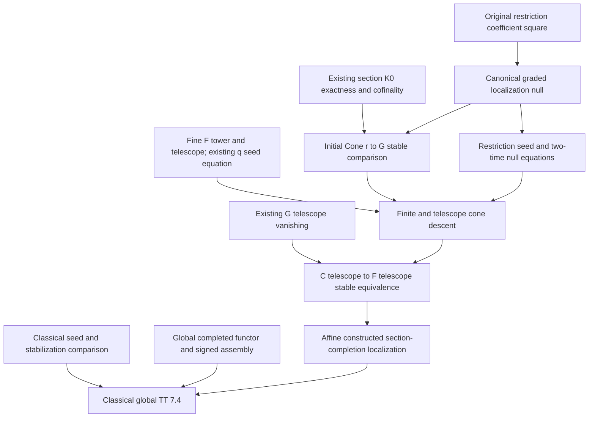
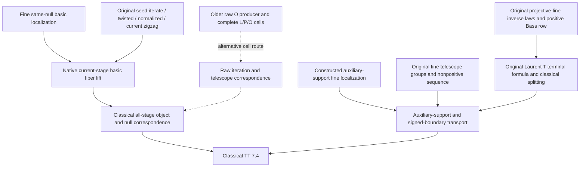

# Thomason–Trobaugh localization roadmap

The current-stage source addition starts from
`fd1d66a707d2d658bc5aa556b9f03506e56dee7c`, with Lean 4.34.1 and the
unchanged pinned mathlib/Aglib dependencies. Its selected source correspondence,
independent review and incremental validation belong to
[the current-stage evidence](evidence/TTCurrentStageLocalization.json).
The source archive is
`quillen-tt-complete-buildable-sources-20261018T0354Z.zip`.

The earlier
[recovered-comparison evidence](evidence/TTRecoveredComparisons.json) retains
its baseline-16cc1d0 integration scope and the then-open finite/all-stage
comparison obligations. It distinguishes reconstructed sources from original
archived bytes and does not claim historical recovery for reconstructions.
The [fine-completion and raw-pasting evidence](evidence/TTFineCompletionAndRawPasting.json)
retains its baseline-492454 scope, and the
[seed-iteration evidence](evidence/TTBassSeedIteration.json) its earlier
one-step boundary. Reuse these records at their actual source and checked
scope; the current-stage record supplies the new route's correspondence.

This roadmap records proof obligations and their actual consumers. Planned
assertions are not library theorems until their source proofs and corresponding
interfaces are accepted.

## Target and current distance

The classical target is Thomason–Trobaugh, Theorem 7.4, printed pp. 365–366.
For qcqs `X`, an open immersion `j : U → X` with quasi-compact `U`, and
`Y = X − U`, it asserts the canonical nonconnective fiber sequence

```text
Kᴮ(X on Y) → Kᴮ(X) → Kᴮ(U).
```

It also includes auxiliary closed support `Z` with quasi-compact complement:

```text
Kᴮ(X on Y ∩ Z) → Kᴮ(X on Z) → Kᴮ(U on U ∩ Z).
```

Sections 6.4, 6.6(a), 7.0 and 7.5(a) retain the
initial comparison in degrees `n ≥ 0`, including zero. Source:
R. W. Thomason and T. Trobaugh, *Higher Algebraic K-Theory of Schemes and of
Derived Categories*, The Grothendieck Festschrift III, Progress in Mathematics
88 (1990), 247–435,
[DOI](https://doi.org/10.1007/978-0-8176-4576-2_10),
[original paper](https://www.sas.rochester.edu/mth/sites/doug-ravenel/otherpapers/Thomason-Trobaugh.pdf).

Four targets must be distinguished:

1. **Implemented connective localization.** The canonical relative/open
   comparison is bijective in positive degrees, injective at zero, and retains
   the actual K₀ image and original boundary. Supported naturality, excision and
   connective Mayer–Vietoris are also present.
2. **Affine constructed section-completion localization.** The original
   coarse-to-fine telescope restriction is now stable in every integer degree.
   The supported telescope cone compares to the actual fine full-open section
   completion, and the same constructed whole null gives the stable supported
   fiber comparison with its original signed boundary. Coefficient maps and
   the original seed, inclusion and cylinder data are retained.
3. **Native current-stage full-open localization.** For an open immersion
   `f : P ⟶ Q`, compact `P,Q` and quasi-separated `Q`, the actual
   `currentLift f (op integerBase)` is stable in every signed degree. The
   original scalar seeds and full-open null are retained through the stable
   zigzag `I → T ← N ← C` described below; no generic equivariance premise
   remains at this endpoint.
4. **Classical, global TT localization.** Identifying the completed objects
   with classical `Kᴮ` and identifying its original null diagram remain
   separate branches. Original nonnegative and recursive negative groups
   are now identified with the fine completion under the stated qcqs and
   compact-open hypotheses below. The native
   global coarse-to-fine section-completion comparison and both basic and
   auxiliary-supported fiber sequences are now supplied. The older raw-cell
   evaluation route and classical identification retain their separate
   boundaries.

The affine constructed transfer, native global completion comparison and
global localization with auxiliary support are supplied. The actual fine
transition/inclusion range and original-group nonpositive localization
sequence are also supplied. The new route additionally proves the native
current-stage same-null basic endpoint. Classical all-stage object/null-diagram
identification, auxiliary-support transport and the signed boundary retain
distinct obligations. The older raw-cell producer remains a separate route;
its missing O four-cube is not a premise of this native endpoint.

## Verified proof checkpoints

The following additions have passed pinned leaf compilation and independent
ordinary source review. All use the standard heartbeat budget except the one
explained declaration-local E1 normalization allowance recorded below. Package
integration and downstream completion comparisons have separately scoped checks.

| New owner | Proved scope |
| --- | --- |
| [FullOpenSectionRestrictionDiagram](../../Quillen/AlgebraicGeometry/PerfectComplexes/BoundedFlat/FullOpenSectionRestrictionDiagram.lean) | Original restriction components form strict Model/prespectrum coefficient transformations without compactness or flatness premises |
| [FullOpenSectionGradingNull](../../Quillen/AlgebraicGeometry/PerfectComplexes/BoundedFlat/FullOpenSectionGradingNull.lean) | Genuine evaluated weak-image witnesses make zero-to-restricted-section maps weak; their reversed whole tracks construct the coefficient-natural null of the actual r and q |
| [FullOpenSectionRestrictionSeed](../../Quillen/AlgebraicGeometry/PerfectComplexes/Affine/FullOpenSectionRestrictionSeed.lean) | Original categorical restriction preserves the actual ambient forward unit and its restriction to the open, with no supplied compatibility premise |
| [FullOpenSectionGradingNullSeed](../../Quillen/AlgebraicGeometry/PerfectComplexes/Affine/FullOpenSectionGradingNullSeed.lean) | The actual canonical null commutes with those original unit actions at both independent times, including the unchanged level-zero loop coordinate |
| [FullOpenSectionGradingNullBassSeed](../../Quillen/AlgebraicGeometry/PerfectComplexes/Affine/FullOpenSectionGradingNullBassSeed.lean) | Every canonical localization-null time slice preserves the actual original Bass seeds; the resulting whole based-loop equation retains the independent output-loop coordinate |
| [StableKMap](../../Quillen/Waldhausen/SConstruction/Iterated/StableKMap.lean) | The original direct-Model K-map corresponds to its nonnegative stable map; injectivity, surjectivity and negative connectivity transport through the actual level-one comparison |
| [FullOpenSectionConeStable](../../Quillen/AlgebraicGeometry/PerfectComplexes/BoundedFlat/FullOpenSectionConeStable.lean) | For the actual r and q, every genuinely typed specified null gives an all-integer stable cone descent; K₀ image exactness and the degree-one kernel are discharged internally |
| [FullOpenSectionBassTower](../../Quillen/AlgebraicGeometry/PerfectComplexes/Affine/FullOpenSectionBassTower.lean), [telescope](../../Quillen/AlgebraicGeometry/PerfectComplexes/Affine/FullOpenSectionBassTelescope.lean) | Actual fine stages, seed transitions, telescope, original inclusions, topology and finite stable representatives |
| [FullOpenSectionBassGradingTower](../../Quillen/AlgebraicGeometry/PerfectComplexes/Affine/FullOpenSectionBassGradingTower.lean), [telescope grading](../../Quillen/AlgebraicGeometry/PerfectComplexes/Affine/FullOpenSectionBassGradingTelescope.lean) | Actual finite and telescope q maps, original coefficient/cylinder/initial faces; signed zero map follows from G∞ vanishing |
| [FullOpenSectionBassRestrictionTower](../../Quillen/AlgebraicGeometry/PerfectComplexes/Affine/FullOpenSectionBassRestrictionTower.lean) | Literal iterated r, genuine finite Model cone excision and all-integer stable finite cone descent using the same prescribed null |
| [FullOpenSectionBassRestrictionCofiber](../../Quillen/AlgebraicGeometry/PerfectComplexes/Affine/FullOpenSectionBassRestrictionCofiber.lean) | The same null preserves every finite transition and forms the original telescope null; its cone descent is stable, and graded vanishing makes the unchanged r∞ stable in every integer degree |
| [FullOpenSectionBassLocalization](../../Quillen/AlgebraicGeometry/PerfectComplexes/Affine/FullOpenSectionBassLocalization.lean) | The actual supported telescope cone compares stably to the fine full-open completion; the same postcomposed null gives the stable supported fiber map and original signed connecting identity |
| [FullOpenSectionSpectrumComparison](../../Quillen/AlgebraicGeometry/PerfectComplexes/BoundedFlat/FullOpenSectionSpectrumComparison.lean) | Actual direct section spectrum evaluates stably to the explicitly lifted bounded-flat original spectrum; compact U gives the perfect comparison, with original K-equations and chosen-zero normalization retained |
| [ScalarCofiberKOneNormalization](../../Quillen/AlgebraicGeometry/PerfectComplexes/ScalarCofiberKOneNormalization.lean) | Explicit inverse-prefix/cancellation normalization matches the inverse original component equivalence; scalar and polynomial-coordinate boundary classes are inverse forward-square classes |
| [SupportedOpen/ConeComparison](../../Quillen/AlgebraicGeometry/PerfectComplexes/SupportedOpen/ConeComparison.lean), [ExcisionSpectrum](../../Quillen/AlgebraicGeometry/PerfectComplexes/SupportedOpen/ExcisionSpectrum.lean) | Original global auxiliary-support coarse cone stability and signed boundary, and actual normalized cover support-excision stability |
| [CoefficientBaseChange](../../Quillen/AlgebraicGeometry/Scheme/CoefficientBaseChange.lean), [CoefficientSections](../../Quillen/AlgebraicGeometry/PerfectComplexes/BoundedFlat/CoefficientSections.lean) | Native joint scheme/coefficient fibers and strict fine Model diagram, actual evaluation, one global zero and exact literally zero-preserving reindexing; no global grading or completion claim |
| [CoefficientOpenSections](../../Quillen/AlgebraicGeometry/PerfectComplexes/BoundedFlat/CoefficientOpenSections.lean), [CoefficientOpenGrading](../../Quillen/AlgebraicGeometry/PerfectComplexes/BoundedFlat/CoefficientOpenGrading.lean) | Actual global coarse/fine/graded coefficient Models, literal zero-preserving r and q, evaluation and image grading; the graded coefficient diagram requires compact source and ambient schemes, without flatness or affineness |
| [CoefficientOpenCofinality](../../Quillen/AlgebraicGeometry/PerfectComplexes/BoundedFlat/CoefficientOpenCofinality.lean), [CoefficientOpenKZeroExact](../../Quillen/AlgebraicGeometry/PerfectComplexes/BoundedFlat/CoefficientOpenKZeroExact.lean) | Original global r cofinality, honest image(r₀)=kernel(q₀), actual q₀ surjectivity and positive graded K-vanishing, retaining each theorem's precise weaker hypotheses |
| [CoefficientOpenNull](../../Quillen/AlgebraicGeometry/PerfectComplexes/BoundedFlat/CoefficientOpenNull.lean), [CoefficientOpenConeStable](../../Quillen/AlgebraicGeometry/PerfectComplexes/BoundedFlat/CoefficientOpenConeStable.lean) | Same joint-zero canonical null and actual coefficient-natural initial Cone(r)→G stable in every integer degree for qcqs Q and compact P; no completion claim |
| [CoefficientPolynomialLaurent](../../Quillen/AlgebraicGeometry/Scheme/CoefficientPolynomialLaurent.lean), [CoefficientSectionUnits](../../Quillen/Aglib/AlgebraicGeometry/Modules/PerfectComplexes/BoundedFlat/CoefficientSectionUnits.lean), [CoefficientOpenBassSeed](../../Quillen/AlgebraicGeometry/PerfectComplexes/BoundedFlat/CoefficientOpenBassSeed.lean), [CoefficientOpenSeedCompatibility](../../Quillen/AlgebraicGeometry/PerfectComplexes/BoundedFlat/CoefficientOpenSeedCompatibility.lean) | Original native products/charts/forward units, all three coefficient-natural seeds, actual r/q seed squares and every canonical N time-slice square; the generic [StrictLaurentSeed](../../Quillen/KTheory/Bass/StrictLaurentSeed.lean) retains source-leg cylinders and prescribed concatenation |
| [CoefficientSectionSpectrumComparison](../../Quillen/AlgebraicGeometry/PerfectComplexes/BoundedFlat/CoefficientSectionSpectrumComparison.lean), [CoefficientSectionEvaluationNaturality](../../Quillen/AlgebraicGeometry/PerfectComplexes/BoundedFlat/CoefficientSectionEvaluationNaturality.lean) | Original native evaluation, actual zero normalization and K₀ equations; whole joint-arrow homotopies and genuine localized natural isomorphisms, with compactness exactly for perfect stability; no seed/telescope comparison |
| [CoefficientOpenBassTower](../../Quillen/AlgebraicGeometry/PerfectComplexes/BoundedFlat/CoefficientOpenBassTower.lean), [CoefficientOpenBassTelescope](../../Quillen/AlgebraicGeometry/PerfectComplexes/BoundedFlat/CoefficientOpenBassTelescope.lean) | Literal global C/F/G stages, original transitions and the same whole null; actual graded seed contraction gives signed G∞ vanishing and original r∞ stability for qcqs Q and compact P, without classical identification |
| [CoefficientSupportedSections](../../Quillen/AlgebraicGeometry/PerfectComplexes/BoundedFlat/CoefficientSupportedSections.lean), [CoefficientSupportedOpenModels](../../Quillen/AlgebraicGeometry/PerfectComplexes/BoundedFlat/CoefficientSupportedOpenModels.lean) | Actual supported joint sections, native C_Z/F_Z/r_Z and intersection-support fiber Models, with geometric weak-class correspondence and literal zeros; supported grading, cofinality and completion remain separate |
| [SupportedOpen/GrothendieckPullback](../../Quillen/AlgebraicGeometry/PerfectComplexes/SupportedOpen/GrothendieckPullback.lean), [ImageQuotientPullback](../../Quillen/AlgebraicGeometry/PerfectComplexes/SupportedOpen/ImageQuotientPullback.lean), [CoefficientSupportedOpenGrading](../../Quillen/AlgebraicGeometry/PerfectComplexes/BoundedFlat/CoefficientSupportedOpenGrading.lean) | Original supported K₀ pullback and actual relative-image witnesses give quotient descent and native G_Z/q_Z; pointwise grading has no compactness premise, while coefficient action needs compact P/Q; cofinality and completion remain separate |
| [CoefficientSectionEvaluationUnit](../../Quillen/AlgebraicGeometry/PerfectComplexes/BoundedFlat/CoefficientSectionEvaluationUnit.lean), [unit pasting](../../Quillen/AlgebraicGeometry/PerfectComplexes/BoundedFlat/CoefficientSectionEvaluationUnitPasting.lean), [CoefficientLaurentEvaluation](../../Quillen/AlgebraicGeometry/PerfectComplexes/BoundedFlat/CoefficientLaurentEvaluation.lean) | Evaluation preserves the actual forward unit and original relative Laurent tracks, squares and endpoints with independent coordinates; source-leg, seed, iterate and telescope comparison remain separate |
| [ScalarLaurentClassComparison](../../Quillen/AlgebraicGeometry/PerfectComplexes/ScalarLaurentClassComparison.lean), [NativeLaurentClassComparison](../../Quillen/AlgebraicGeometry/PerfectComplexes/NativeLaurentClassComparison.lean) | Original normalized scalar class restricts to the intrinsic unit-automorphism K₁ class; for every scheme the native rank-one forward class is [T] and the cofiber class is [T]⁻¹, retaining the actual restriction rebase and component transport |
| [ProjectiveLine/NativeTwoSummands](../../Quillen/AlgebraicGeometry/PerfectComplexes/ProjectiveLine/NativeTwoSummands.lean) | Native O/O(−1) define the original exact two-summand functor; both original chart K-maps add the two pullbacks for every n≥0, including zero; no K-bijectivity assertion |
| [CoefficientSupportedOpenCofinality](../../Quillen/AlgebraicGeometry/PerfectComplexes/BoundedFlat/CoefficientSupportedOpenCofinality.lean), [KZeroExact](../../Quillen/AlgebraicGeometry/PerfectComplexes/BoundedFlat/CoefficientSupportedOpenKZeroExact.lean), [Null](../../Quillen/AlgebraicGeometry/PerfectComplexes/BoundedFlat/CoefficientSupportedOpenNull.lean), [ConeStable](../../Quillen/AlgebraicGeometry/PerfectComplexes/BoundedFlat/CoefficientSupportedOpenConeStable.lean) | Actual auxiliary-supported r_Z cofinality, honest K₀ image/kernel and q_Z₀ surjectivity, coefficient-natural canonical null and all-integer initial cone descent; subsequent seeds and finite/telescope transfer have their own scope |
| [CoefficientSupportedOpenBassSeed](../../Quillen/AlgebraicGeometry/PerfectComplexes/BoundedFlat/CoefficientSupportedOpenBassSeed.lean), [SeedCompatibility](../../Quillen/AlgebraicGeometry/PerfectComplexes/BoundedFlat/CoefficientSupportedOpenSeedCompatibility.lean) | Original supported forward Laurent actions, all three seeds, literal r_Z/q_Z seed squares and every canonical-null time-slice square; the recovered independent verdict matches the current source bytes |
| [CoefficientSupportedOpenBassTower](../../Quillen/AlgebraicGeometry/PerfectComplexes/BoundedFlat/CoefficientSupportedOpenBassTower.lean), [BassTelescope](../../Quillen/AlgebraicGeometry/PerfectComplexes/BoundedFlat/CoefficientSupportedOpenBassTelescope.lean) | Literal supported finite/telescope stages, original whole null, graded signed vanishing and stable original r_Z∞; strict builds, independent ordinary review, four-origin foundation audit and scoped facade/client integration passed |
| [CoefficientFullOpenBassLocalization](../../Quillen/AlgebraicGeometry/PerfectComplexes/BoundedFlat/CoefficientFullOpenBassLocalization.lean) and its Models/Seed/Tower/Telescope dependencies | Basic native global support completion: the actual supported-forget cone and same-null fiber compare stably to F∞ for qcqs ambient Q and compact P, retaining original inclusion and signed boundary; no auxiliary-supported or classical identification claim |
| [CoefficientSectionEvaluationSourceLeg](../../Quillen/AlgebraicGeometry/PerfectComplexes/BoundedFlat/CoefficientSectionEvaluationSourceLeg.lean) | Actual raw native chart/source-leg tracks, fine-span evaluation and two-time raw-cone interchange; normalized fine-to-raw chart-composition, seed and telescope comparisons remain open |
| [NativePerfectProjection](../../Quillen/AlgebraicGeometry/PerfectComplexes/ProjectiveLine/NativePerfectProjection.lean), [NativePerfectGeneration](../../Quillen/AlgebraicGeometry/PerfectComplexes/ProjectiveLine/NativePerfectGeneration.lean) | Original native flat-base-change mate on all intrinsic perfect inputs; affine perfect coefficients have an objectwise chosen positive projection isomorphism and actual O(−1) projection vanishing; no perfect pushforward or P¹ generation assertion |
| [PolynomialZeroSection](../../Quillen/AlgebraicGeometry/PerfectComplexes/Bass/PolynomialZeroSection.lean), [supported variant](../../Quillen/AlgebraicGeometry/PerfectComplexes/Bass/SupportedPolynomialZeroSection.lean) and their scheme/pair producers | Actual zero evaluation splits projection pullback and the original common corner in every recursive negative degree and every nonnegative perfect K degree, including zero; the original chart difference kills that corner, without claiming middle exactness or stabilization |
| [ConeStableVanishing](../../Quillen/Topology/Prespectrum/ConeStableVanishing.lean), [cone/fiber converse](../../Quillen/Topology/Prespectrum/ConeDescStableEquivalence.lean) | Genuine cone excision plus signed cone vanishing detects the original arrow; stable cone descent gives the same whole-null stable fiber lift |
| [CoefficientSectionEvaluationTopology](../../Quillen/AlgebraicGeometry/PerfectComplexes/BoundedFlat/CoefficientSectionEvaluationTopology.lean) | Original normalized evaluation is levelwise homotopy equivalent and the actual moving span evaluation is completely weak, including level zero; original span/cone/loop HEP and T1, without extra compactness/flatness/open assumptions; Hc/C and seed comparison remain separate |
| [CoefficientSectionEvaluationComposition](../../Quillen/AlgebraicGeometry/PerfectComplexes/BoundedFlat/CoefficientSectionEvaluationComposition.lean) | Actual normalized evaluation pasting, relative comparison to the original split composition track, and Hc with both original chart faces and its moving cylinder face at independent times; no openness, compactness, flatness or caller-supplied coherence. Original cone/source-null/seed and all raw iteration remain separate |
| [LineTensorCompatibility](../../Quillen/AlgebraicGeometry/Scheme/ProjectiveLine/LineTensorCompatibility.lean), [PullbackTensorCompatibility](../../Quillen/AlgebraicGeometry/Scheme/ProjectiveLine/PullbackTensorCompatibility.lean) | The actual determinant gives L⊗Q≅O with both original chart signs +1; the canonical pullback-tensor mate is a natural isomorphism for the actual tautological line, arbitrary scheme morphisms and arbitrary module sheaves |
| [FiniteAttachment](../../Quillen/AlgebraicGeometry/PerfectComplexes/ProjectiveLine/FiniteAttachment.lean) | Actual smaller strict chart windows from a given finite locally free top attachment epi, finite top affine homology, and the terminal cycle-to-single quasi-isomorphism under the explicit lower term bound; the global epi/QC-replacement/perfect-pushforward producers remain separate |
| [TwoChartStableSpan](../../Quillen/KTheory/Bass/TwoChartStableSpan.lean), [TwoChartStableSequence](../../Quillen/KTheory/Bass/TwoChartStableSequence.lean) | Original signed span quotient, natural all-integer Bass short exact row, and its right cycles/image quotient under an actual plus retraction and the stated original-map cone/collapse stability inputs; geometric realization and classical seed preservation remain separate |
| [CoefficientSupportedFiberLocalizationModels](../../Quillen/AlgebraicGeometry/PerfectComplexes/BoundedFlat/CoefficientSupportedFiberLocalizationModels.lean), [seed](../../Quillen/AlgebraicGeometry/PerfectComplexes/BoundedFlat/CoefficientSupportedFiberBassSeed.lean), [tower](../../Quillen/AlgebraicGeometry/PerfectComplexes/BoundedFlat/CoefficientSupportedFiberBassTower.lean), [telescope](../../Quillen/AlgebraicGeometry/PerfectComplexes/BoundedFlat/CoefficientSupportedFiberBassTelescope.lean), [localization](../../Quillen/AlgebraicGeometry/PerfectComplexes/BoundedFlat/CoefficientSupportedFullOpenBassLocalization.lean) | Actual auxiliary-supported native fiber, same joint zero, original Laurent seeds, whole null and finite/telescope cone comparison; postcomposition with original r_Z∞ gives the same-null stable fiber lift and signed boundary. Structural comparison needs only the open immersion; final fine stability needs compact P,Q,T and quasi-separated Q. No classical Kᴮ identification |
| [ProjectiveLine/Strictification](../../Quillen/AlgebraicGeometry/PerfectComplexes/ProjectiveLine/Strictification.lean), [NativePerfectPushforward](../../Quillen/AlgebraicGeometry/PerfectComplexes/ProjectiveLine/NativePerfectPushforward.lean) | Actual global top-cycle epimorphism, finite induction/reassembly and strict derived model for bounded-below termwise-quasicoherent locally perfect inputs on P¹ over arbitrary R; actual Rp preserves perfection for those representatives. The arbitrary intrinsic-perfect QC-representative producer remains outside this accepted scope |
| [QuasicoherentRepresentative](../../Quillen/AlgebraicGeometry/PerfectComplexes/ProjectiveLine/QuasicoherentRepresentative.lean), [IntrinsicPerfectPushforward](../../Quillen/AlgebraicGeometry/PerfectComplexes/ProjectiveLine/IntrinsicPerfectPushforward.lean) | Genuine bounded termwise-QC model, global strict model and perfection of actual Rp for every intrinsic perfect D+ input on twoChartLine R over arbitrary R, including the zero ring; no supplied replacement or noetherian premise. This is objectwise, without a natural exact roof model or K-equivalence |

The original restriction seed square and whole canonical-null seed square are
constructed without supplied compatibility premises. Their actual finite
transition equations give the compatible telescope null, and the proved finite
cone comparisons transfer to the original telescope cone descent. Signed graded
vanishing then proves the original coarse-to-fine restriction stable; composing
the supported coarse comparison gives affine section-completion localization.
The original null, chosen zeros and signed boundary are unchanged. The affine
proof family has strict default-budget builds and independent ordinary source
review; final facade, client and audit integration has its own checked scope.
The affine and G1–G4 proofs retain the standard budget. E1's concrete lifted
normalization isomorphism retains one explained finite declaration-local
1,200,000-heartbeat allowance after a failed standard-budget check; package
defaults remain 200,000. Finite higher scratch budgets remain available for
proof iteration, followed by cost normalization after correctness. These
constructions do not identify classical Kᴮ. G5 now supplies the original global
coarse-to-fine coefficient completion comparison. The auxiliary-supported
fiber/null localization is now independently accepted; completed geometric
evaluation and classical identification remain separate obligations.

## Current fine completion and raw-pasting interfaces

For qcqs `P.left`, `CoefficientBassFineRangeInvertibility` proves the original
ambient stage-i transition invertible in every degree `d ≥ -i`.
`CoefficientBassFineTelescopeComparison` proves that range for the actual
stage inclusion, and identifies the original recursive negative groups with
the same fine telescope through their existing finite-bottom comparisons.
`CoefficientBassConnectiveTelescopeComparison` uses the original connective
evaluation and stage-zero inclusion. All comparison maps are natural on
`Under R` and retain the original Laurent quotient.

For an open immersion `f : P ⟶ Q` with compact `P.left` and qcqs `Q.left`,
the supported FineRangeInvertibility, FineTelescopeComparison and
ConnectiveTelescopeComparison owners supply the same range and original
negative/connective group comparisons. Their degree-zero forward maps agree.
The finite-bottom supported comparison and its original forget-support square
need only compact ambient `Q.left`; the telescope theorems use the stronger
hypotheses above. `CoefficientSupportedNegativeTelescopeForget` preserves
that original square and its Laurent representatives through actual inclusions.

`CoefficientFullOpenBassRestriction` identifies the fine full-open row,
action, seed and telescope with the ambient construction on the open scheme.
Its localization map equals original scheme restriction on each cylinder
using only the open immersion. The original open-pair theorems in
`Bass.SupportedLocalizationExactness` and `Bass.SupportedLocalizationBoundary`
then give recurring nonpositive exactness for qcqs ambient and compact
removed open. The fixed boundary is transported from the same-null signed
fine cone sequence. The existing geometric K₁-to-supported-K₀ boundary joins
at the literal K₀ groups by exactness. Equality of the geometric and fine
boundaries and arbitrary-pair pullback naturality of the transported boundary
remain open. These distinctions are part of the current ordinary review scope.

The raw first stage has actual whole identity and composition producers in
`CoefficientBassUnitCubeConsumers` and `MWholeCubeConsumers`. Parameterized
pushout/cone descent and whole-family recovery are supplied. The selected
polynomial three-cube has all six scalar faces and compact native evaluation;
the actual Laurent and two polynomial native cells enter the full original
target cone, with both complete height-zero attachments. The overlap four-cube
with eight prescribed faces and compatible L/P/O quotient attachments remain
the next source-cell obligation. They are required for actual second-stage
`PlusPasting`/`MinusPasting`, before coherent raw iteration and its telescope.

## Global restriction and finite interchange

The global-section comparison uses actual cocartesian sections over all
schemes, with the original geometric pseudofunctor and chosen-zero family.
It restricts along the coefficient base-product functor to the existing
coefficient-first Models. This construction is separate from the finite
normalization route below.

| Interface | Supplied construction and conditions |
| --- | --- |
| [SectionChangeIndex](../../Quillen/Aglib/CategoryTheory/FiberedCategory/SectionChangeIndex.lean) and Laws/Zero/Unit | Arbitrary index restriction, literal evaluation/reindexing and preservation of the same global zero and evaluation-lifted identity actions. Waldhausen adapters retain exact fiber transitions and their explicit small/large/mixed universe bounds. |
| [GlobalSectionChangeIndex](../../Quillen/AlgebraicGeometry/PerfectComplexes/BoundedFlat/GlobalSectionChangeIndex.lean), [GlobalSectionChangeIndexLaws](../../Quillen/AlgebraicGeometry/PerfectComplexes/BoundedFlat/GlobalSectionChangeIndexLaws.lean), [GlobalSectionUnit](../../Quillen/AlgebraicGeometry/PerfectComplexes/BoundedFlat/GlobalSectionUnit.lean), [GlobalSectionLaurentAction](../../Quillen/AlgebraicGeometry/PerfectComplexes/BoundedFlat/GlobalSectionLaurentAction.lean) | Actual `Schemeᵒᵖ ⥤ Model.{u+1}`, original scalar units, coefficient restriction and exact categorical inverse; no compactness premise. |
| [GlobalSupportedModels](../../Quillen/AlgebraicGeometry/PerfectComplexes/BoundedFlat/GlobalSupportedModels.lean), [GlobalOpenModels](../../Quillen/AlgebraicGeometry/PerfectComplexes/BoundedFlat/GlobalOpenModels.lean), [GlobalFullOpenModels](../../Quillen/AlgebraicGeometry/PerfectComplexes/BoundedFlat/GlobalFullOpenModels.lean) | Actual supported, coarse-open and fine-open rows, exact zero-preserving maps and strict restriction/evaluation squares for an open immersion. |
| [GlobalSectionTelescope](../../Quillen/AlgebraicGeometry/PerfectComplexes/BoundedFlat/GlobalSectionTelescope.lean), [GlobalLocalizationTelescopeStable](../../Quillen/AlgebraicGeometry/PerfectComplexes/BoundedFlat/GlobalLocalizationTelescopeStable.lean) | Ambient, supported and coarse finite/telescope restrictions are stable, preserving the actual `B^i(seed)` transitions, inclusions and cylinders. Supported/coarse rows retain the open immersion. |
| [GlobalSectionLocalizationNull](../../Quillen/AlgebraicGeometry/PerfectComplexes/BoundedFlat/GlobalSectionLocalizationNull.lean), [GlobalSectionLocalizationNullSeed](../../Quillen/AlgebraicGeometry/PerfectComplexes/BoundedFlat/GlobalSectionLocalizationNullSeed.lean), [GlobalSectionLocalizationFiniteNull](../../Quillen/AlgebraicGeometry/PerfectComplexes/BoundedFlat/GlobalSectionLocalizationFiniteNull.lean), [GlobalSectionLocalizationTelescopeNull](../../Quillen/AlgebraicGeometry/PerfectComplexes/BoundedFlat/GlobalSectionLocalizationTelescopeNull.lean) | The original reversed zero-to-supported-section null, its every-time seed equation and the same finite/telescope null under restriction. |
| [GlobalSectionCoarseFiber](../../Quillen/AlgebraicGeometry/PerfectComplexes/BoundedFlat/GlobalSectionCoarseFiber.lean) | Actual coarse same-null `fiberMap` and its stable restriction comparison; only the open immersion. |
| [GlobalSectionFullOpenFiber](../../Quillen/AlgebraicGeometry/PerfectComplexes/BoundedFlat/GlobalSectionFullOpenFiber.lean) | Actual full-open same-null `fiberMap`; final stability requires compact P,Q and quasi-separated Q plus the open immersion. Structural whole-null/restriction identities need only the open immersion. |

The finite normalized comparison uses the actual loop strength `κ`, forward
pushout comparison `ρ` and strict-square cone comparison `χ`.
[LoopStable](../../Quillen/KTheory/Bass/LoopStable.lean), [PushoutStable](../../Quillen/KTheory/Bass/PushoutStable.lean) and
[SquareConeStable](../../Quillen/KTheory/Bass/SquareConeStable.lean) supply their stable finite Model
specializations. [FiniteConeTopology](../../Quillen/KTheory/Bass/FiniteConeTopology.lean) derives the
necessary topology and all-point growth for finite unlooped cones and loops.
[NormalizedStageMap](../../Quillen/KTheory/Bass/NormalizedStageMap.lean) then constructs stable
`B^i F → Ω^i C^i F` with the original fixed-order iterated `κ`.
The actual finite-loop cyclic/reversal words, transpose and new-loop slide
retain all input times and the residual Bass loop independently.

The geometric double-cone permutation is in
[GeometricConeTarget](../../Quillen/KTheory/Bass/GeometricConeTarget.lean) and its Cells/Involution/Naturality/
SchemeNaturality owners. All sixteen quotient-cell formulas, the actual
inverse and both naturality directions are supplied, including independent
`r,s,t,v` in the deepest cell. Its target uses the original inverse scheme
swaps. The generic strict-square/pushout and four-dimensional double-square
constructions retain the actual pointwise-cone target. The general
integer-base braid, scalar pullback, external-factor and external-track
equations keep their specified nested pullbacks without compactness.

The original finite comparison boundaries are now extended by the following
all-stage results. The historical
[recovered-comparison record](evidence/TTRecoveredComparisons.json) continues
to describe its earlier source closure, including the then-unselected
`FixedWords` candidate; the new candidate and its concrete Bass consumers
belong to [the current-stage record](evidence/TTCurrentStageLocalization.json).

## Native current-stage localization

For a scheme-indexed Model diagram and its actual Laurent track, let `I` be
the telescope with the original `B^i(seed)` transitions, `T` the
fixed-word twisted-normalized telescope, `N` the unpermuted normalized
telescope and `C` the current-stage telescope. The actual maps are

```text
I ──iteratedTwistedTelescopeMap──▶ T ◀──conjugacyTelescopeMap── N ◀──telescopeMap── C.
```

The current and iterated-seed transitions remain separately defined.
[SchemeCurrentStageTelescope](../../Quillen/KTheory/Bass/SchemeCurrentStageTelescope.lean),
[SchemeTwistedTelescope](../../Quillen/KTheory/Bass/SchemeTwistedTelescope.lean)
and [SchemeIteratedSeedTelescope](../../Quillen/KTheory/Bass/SchemeIteratedSeedTelescope.lean)
prove these maps stable for genuine Model input, retaining every original
inclusion and cylinder. The local geometric ingredients are now supplied:
`GeometricConeInterchange.permutation_equivariant` for the actual twice-cone
action; `GeometricChiPermutation.comparison` for the whole geometric chi
factorization; fixed-word equivariance and `wordAt_seed_square`; and
`SchemeIteratedSeedTransition.originalTransition_stageMap` for every original
seed-iterate adjacent square. Their focused owners and generic hypotheses are
in the [spectrum guide](../topics/SpectraAndBass.md#current-stage-and-iterated-seed-telescopes).

The perfect-complex application keeps the original integer-base product pair,
its actual supported full subcategory, original chosen zero and scalar track.
[ParameterLaurentNull](../../Quillen/AlgebraicGeometry/PerfectComplexes/BoundedFlat/ParameterLaurentNull.lean)
proves the two-time scalar/null interchange. The three-object comparisons
preserve actual support forgetting, full-open restriction and the whole
selected null. Integral Spec-row geometry, row Models, seed squares and
restriction/telescope squares compare the iterated-seed lift to the existing
fine localization lift in
[ParameterIteratedFullFiber](../../Quillen/AlgebraicGeometry/PerfectComplexes/BoundedFlat/ParameterIteratedFullFiber.lean).

The endpoint in
[ParameterCurrentFullFiber](../../Quillen/AlgebraicGeometry/PerfectComplexes/BoundedFlat/ParameterCurrentFullFiber.lean)
is the declaration
`Quillen.PerfectComplexes.ParameterFullCurrentNull.currentLift_integer_isStableEquivalence`.
It assumes exactly `[IsOpenImmersion f]`, `[CompactSpace P]`,
`[CompactSpace Q]` and `[QuasiSeparatedSpace Q]` and concludes
`IsStableEquivalence (currentLift f (op integerBase))`.
`currentLift_integer_signed_isIso f d` supplies the isomorphism for every
`d : ℤ`. The current-stage scalar seed is unchanged.
[GlobalParameterIdentityModels](../../Quillen/AlgebraicGeometry/PerfectComplexes/BoundedFlat/GlobalParameterIdentityModels.lean)
identifies the integer-parameter ambient and supported Models by the original
projection, preserving both maps. Those Model isomorphisms do not themselves
supply every classical stage/seed/null comparison or auxiliary-support signed
diagram. The theorem is therefore recorded at its native basic-pair scope.

The older raw O four-cube with its prescribed eight faces, half-height midpoint
and chosen earlier fillers remains a different target. Its three excluded
drafts and the conditional whole-value `NativeParameterEvaluation` interfaces
retain their historical scope. The current zigzag does not construct that
cube, and the native endpoint does not depend on it.

## Actual affine objects

Fix `R : CommRingCat.{u}`, `j : U ⟶ Spec R` with `[IsOpenImmersion j]`.
Coefficients are arbitrary `a : Under R`, with arbitrary coefficient arrows.
Retain `[CompactSpace U]` for quotient grading and the initial full-open stable
comparison; add no flatness, noetherian, regularity or affineness assumption on U.
Models and prespectra are in universe `u + 1`.

| Symbol | Actual source object |
| --- | --- |
| `C` | `boundedFlatAffineSectionOpenPrespectrumFunctor j`, coarse relative-open sections |
| `F` | `boundedFlatAffineFullOpenSectionPrespectrumFunctor j`, fine full-open sections |
| `G` | `boundedFlatAffineFullOpenGradedSectionPrespectrumFunctor j`, quotient-graded sections |
| `rₐ` | `prespectrumMap (boundedFlatAffineSectionFullOpenModelMap j a)` |
| `q` | `boundedFlatAffineFullOpenSectionGradingPrespectrumTransformation j` |

`q` is not asserted to be a stable equivalence. The required comparison is

```text
Cone(rₐ) → G(a), using a constructed null Nₐ of rₐ ≫ qₐ.
```

The chosen coefficient pullback open remains `openSpace j a`. At the identity
algebra it is related to U by the original projection isomorphism; it is not
silently replaced by a definitionally equal open.

## Existing load-bearing interfaces

| Owner | Available result |
| --- | --- |
| [FullOpenSectionRestrictionModel](../../Quillen/AlgebraicGeometry/PerfectComplexes/BoundedFlat/FullOpenSectionRestrictionModel.lean) | Original exact restriction Model map with literal preservation of its whole chosen zero |
| [FullOpenSectionKZeroExact](../../Quillen/AlgebraicGeometry/PerfectComplexes/BoundedFlat/FullOpenSectionKZeroExact.lean) | Original restriction K₀ image equals the kernel of the original fine-to-graded K₀ map |
| [FullOpenSectionKZeroValue](../../Quillen/AlgebraicGeometry/PerfectComplexes/BoundedFlat/FullOpenSectionKZeroValue.lean) | Surjectivity of that fine-to-graded K₀ map, without restriction-surjectivity |
| [FullOpenSectionRestrictionCofinality](../../Quillen/AlgebraicGeometry/PerfectComplexes/BoundedFlat/FullOpenSectionRestrictionCofinality.lean) | Actual restriction injective at zero and bijective in positive degrees |
| [FullOpenGradedSectionStable](../../Quillen/AlgebraicGeometry/PerfectComplexes/BoundedFlat/FullOpenGradedSectionStable.lean) | Actual G has zero stable groups in every nonzero degree |
| [FullOpenSectionBassSeedChangeWeak](../../Quillen/AlgebraicGeometry/PerfectComplexes/Affine/FullOpenSectionBassSeedChangeWeak.lean) | Exact coefficient-natural equation `seedF ≫ B(q) = q ≫ seedG` |
| [FullOpenGradedSectionBassTelescope](../../Quillen/AlgebraicGeometry/PerfectComplexes/Affine/FullOpenGradedSectionBassTelescope.lean) | Actual G telescope has zero stable groups in every integer degree |
| [SupportedSectionBassTelescopeOpenCofiber](../../Quillen/AlgebraicGeometry/PerfectComplexes/Affine/SupportedSectionBassTelescopeOpenCofiber.lean) | Supported-forget telescope cone stably identifies with C telescope, preserving the signed boundary |
| [SectionBassStableColimit](../../Quillen/AlgebraicGeometry/PerfectComplexes/Affine/SectionBassStableColimit.lean) | Original telescope stable groups are the canonical coefficient-natural colimit |
| [SectionBassTelescopeSelfMap](../../Quillen/AlgebraicGeometry/PerfectComplexes/Affine/SectionBassTelescopeSelfMap.lean) | Actual telescope → its Bass image is a stable equivalence in every signed degree |

The raw-perfect objectwise deficit comparison is a different map and model.
It supplies no replacement for the section diagram, its original null, or its
seed compatibility. Diagonal bottom-group isomorphisms alone identify stage i
at degree −i. The additional fine transition-range and telescope-inclusion
theorems above now identify the subsequent fine telescope groups under their
qcqs/compact-open hypotheses.

## Proof dependency plan



### Construction invariants

The coefficient transformations r and q, canonical null N, original Laurent
units and Bass seeds belong to one coherent choice of C/F/G and section zeros.
The two-time interchange and whole seed equation retain those exact tracks.
The initial cone comparison uses the honest K₀ image quotient, restriction K₀
injectivity at degree one, and positive cofinality. Its generic null parameter
is discharged by this same constructed N before the telescope application.

Finite Model excision and T1 are supplied by the actual stages; no uniform
whole-telescope connectivity or fixed-degree seed stabilization is assumed.
Separate proof authors use disjoint sources and private compiler outputs;
facade and package integration is serialized on a fixed candidate.

### Constructed affine completion

1. `FullOpenSectionBassRestrictionTower` instantiates
   `modelDiagramIterateCofiberDesc_isStableEquivalence` on C,F,G
   and the original r,q,N, retaining the actual finite cone descent.
2. `FullOpenSectionBassRestrictionCofiber` uses
   `strictDiagramIterateNull_transition` to obtain the whole null equation
   for every original finite transition. Both seed squares and N's time-slice
   square are proved, and actual Models supply finite-stage T1.
3. The same owner applies `Telescope.coneDesc_isStableEquivalence` to the actual tower maps and
   compatible nulls. The proved G telescope vanishing transfers to the canonical
   cone of `r∞` and makes this same original restriction stable.
4. `FullOpenSectionBassLocalization` composes the proved stable
   `r∞ : C∞ → F∞` with the already implemented
   supported-cone → C∞ comparison, retaining the original inclusion face, fiber
   lift and signed boundary of the resulting localization sequence.

Neither fixed-degree finite-seed stabilization nor classical negative-group
identification is required for this constructed section-completion result.

## Concrete remaining-work plan

The remaining work separates the native current-stage theorem from classical
object and null-diagram identification. The older raw geometric cell route
retains its own unfinished producer, while the new stable zigzag bypasses it
for the native basic-pair endpoint. Fine seed
preservation, recursive chart middle exactness, the equality case of the
transition range and canonical telescope legs are now supplied. The classical
Laurent `[T]` boundary formula and its O/O(-1) sign remain independent targets;
the completed fine group comparisons do not compute that geometric operation.

### Reconciled starting point

G1–G7 retain their constructed section-localization scope, including the
same-joint-zero auxiliary fiber and signed boundary. P1–P5 retain the original
projective-line maps and inverse laws described below. E2-C/N/S/W supplies
normalized one-step evaluation, its cone/null/seed comparison and actual
levelwise weakness; the original composition and identity cubes are supplied.
The fine ambient/supported groups and nonpositive exact sequence are now
available under the precise hypotheses above.

The [fine-completion evidence](evidence/TTFineCompletionAndRawPasting.json) retains
its historical integration scope. The
[recovered-comparison evidence](evidence/TTRecoveredComparisons.json) retains
the earlier finite-comparison package. The current
[current-stage evidence](evidence/TTCurrentStageLocalization.json) records the
new all-stage route, independent reviews and affected-scope validation. Reuse compatible earlier coverage at its actual scope;
compilation and origin audits do not supply a classical comparison. The
polynomial zero-evaluation splitting remains distinct from the unresolved
geometric zero-locus class and Laurent terminal-boundary calculation.

### S. Finish auxiliary-supported constructed localization (G6–G7)

Let `f : P → Q` be the actual open arrow over `Spec R`, `T ⊂ Q` the open
complement of the auxiliary closed support, and `a : Under R`. Retain the
original coefficient fibers and projection pullbacks. Write `T_a` for the
pullback of `T` and `V_a = T_a ∪ range(f_a)`.

| Step | Exact product and route | Required inputs and acceptance |
| --- | --- | --- |
| S1: G6 finite/telescope transfer | Literal `B^i(C_Z/F_Z/G_Z)`, original transitions, r_i/q_i and iterated canonical N_i; whole null-transition equation; signed G_Z∞ vanishing; original Cone(r_Z∞)→G_Z∞ and r_Z∞ stable. | Accepted, audited, enrolled and scoped-integrated. Graded coefficient data require compact P,Q. Final cone/r∞ stability additionally requires quasi-separated Q and compact T. Preserve every original finite and cylinder face. |
| S2: native auxiliary fiber | Accepted sections vanishing on V_a, literal forget into sections vanishing on T_a, identity change of weakness to C_Z, and canonical reversed zero-to-image null. | `CoefficientSupportedFiberLocalizationModels` produces native JointData, second-endpoint, extension and two-out-of-three inputs, and identifies the fiber with the acyclic category of the same native weak structure. Its same-null initial cone comparison is accepted without compactness or separation assumptions. Native private-origin trust and enrollment are separate checks. |
| S3: auxiliary seeds and completion | Accepted same ambient forward Laurent unit on the V_a-supported fiber, forget/changeWeak seed squares and every canonical-null time-slice square; actual finite towers and telescope null; stable Cone(forget∞)→C_Z∞. | Original inclusion functors, whole identity-action interchange, finite Model excision/T1 and telescope cone descent; separate null time and telescope height. Only the original open immersion is required. No supplied compatibility or localization input. |
| S4: final constructed auxiliary sequence | Accepted postcomposition with original r_Z∞, same-null stable fiber lift for Fiber_Z∞→A_Z∞→F_Z∞, projection and signed connecting identity. | Compact P,Q,T and quasi-separated Q for final fine stability; projection/boundary identities retain only the open immersion. Independent review covers actual support union, all three maps, whole null and signed boundary. |

S2's native route is now independently accepted. It retains the same joint
zero throughout the fiber, native acyclic equivalence, fibration inputs and
every level/time value of the canonical null. It does not identify independently
chosen geometric zeros. Independent ordinary review also accepts the four
downstream S3/S4 leaves at their exact strict production source hashes, with
the same seeds, transition null, telescope faces and signed boundary. A current
eight-origin audit covers this five-leaf family, the two P2 leaves below and
E2-C: 356 declarations, including all private/generated origins, use only the
standard three axioms. Enrollment, three affected facades and the Consumer
root pass strict checks; a fresh QuillenTest/Axioms replay checks 48,401 project
declarations. This closes constructed
section-completion localization with auxiliary support, with no classical Kᴮ
claim.

### E. Compare to the original raw geometric completion (E2)

This subsection retains the older raw-cell comparison target: the actual
bounded-flat/perfect geometric Bass construction, with its chosen pullbacks,
original normalization/composition tracks and independent comparison, loop and
structure coordinates. The strict fine section tower cannot be substituted
for that target. The native current-stage theorem above follows another
route and does not require this O-cell producer. If the raw route is used
for classical identification, its full stated correspondence is still needed.

| Interface | Available result and precise remaining consumer |
| --- | --- |
| E2-C/N/S/W: original one-step evaluation | `CoefficientSectionEvaluationComposition`, `CoefficientSectionEvaluationTopology` and `CoefficientSectionEvaluationSeedComparison` construct the normalized composition equation, both chart faces and moving cylinder, original source-null pasting, whole one-step seed homotopy and levelwise weak cone evaluation. No caller-supplied coherence, openness, compactness or flatness is added to these native identities. Perfect/stable comparisons retain their separate hypotheses. |
| Raw1 composition | `MWholeNativeCube` constructs the six original composition faces with twelve whole edges, basepoints, level-zero loops and independent structure time. `MWholeCubeConsumers` gives the original comparison, cone and parameter-looped step composition with its literal Laurent inclusion track. |
| Raw1 identity | `CoefficientBassUnitNativeCube.interiorCube` constructs the actual six-face original identity cube. `CoefficientBassUnitCubeConsumers` gives the whole comparison square, cone identity and `stepIdentity`; no unit filler remains to be supplied. |
| Objectwise second stage | `CoefficientBassActualSeedComparison.comparison` descends both actual mixed fillers to the original two-chart seed square. `CoefficientBassSeedIteration.stepMap` is its objectwise first-to-second parameter-looped map, with literal inclusion, cylinder and output-loop formulas. |
| Fixed chosen faces | The seed-carrier, chosen-cube and chosen-chart augmentation owners preserve earlier selected cubes, their entire chart squares, whole reference nodes and original clocks. `CoefficientBassSeedChosenSquareRange` preserves a supplied range condition; it does not prove the concrete chosen-boundary range. No functorial extension choice or recursive carrier for arbitrary raw cell trees is asserted. |
| Parameterized original quotient descent | `Topology.Prespectrum.PushoutConeFamily` accepts four typed L/P+/P−/O families with their quotient attachments, based values and independent structure laws. For any locally compact external parameter it descends the original pushout and reduced cone, commutes strictly with parameter restriction and then loops independently. `PushoutConeFamilyRecovery.ofFamily_desc` recovers the complete supplied family. `CoefficientBassCompositionCellDescent` recovers the original M cone/step composition. |
| Laurent and polynomial source cells | `CoefficientBassRaw1LaurentFamily` gives both entire Laurent relative comparisons. `CoefficientBassRaw1PolynomialCommonPasting` pastes three original cap cubes; its Sides, LaurentFace and Top owners supply all six scalar faces, including the unchanged eighteen-node Laurent bottom and original unreduced tip. `CoefficientBassRaw1PolynomialCommonPastingNative` retains arbitrary genuine polynomial input, based values and independent structure time. |
| Native target and lower attachments | `CoefficientBassRaw1LaurentNativeCell.family` and `CoefficientBassRaw1PolynomialNativeCells.plus/minus` are jointly continuous families into the full original target Bass cone. The polynomial cells have the original top, based and structure laws. `CoefficientBassRaw1PolynomialNativeAttachments.plus_zero/minus_zero` identifies each entire height-zero face with the Laurent family after the actual source chart map, independently of the target chart. |
| E2-I: remaining raw producer | Construct the O family with comparison, route, cone-height and overlap coordinates, all eight prescribed three-faces and whole intersections including the original half-height midpoint. Retain chosen old fillers and all L/P/O quotient attachments; assemble `PushoutConeFamily (I × I)`, recover both entire cone routes and loop to actual `PlusPasting`/`MinusPasting` for `CoefficientBassSecondCoefficientProjection`. Then supply second-stage identity/composition and full coefficient naturality of the seed before producing all raw stages and transition homotopies. |
| E2-T: remaining telescope comparison | From actual stage comparisons `E_n` and whole transition homotopies `J_n`, use `Telescope.mapOfHomotopies` and its T1 stable-equivalence theorem. Retain stage/initial/cylinder formulas, coefficient and restriction squares and the same-null signed boundary comparison. |

The one-step normalized composition uses actual evaluation maps `e_i`,
section reindexing `S_f`, geometric pullback `P_f`, evaluation isomorphism
`κ_f` and original normalized composition `β(f,g)`. Its component equation is

```text
κ_(f≫g)(x); β(f,g)(E_i x)
  = transportS(x); κ_g(S_f x); P_g(κ_f(x)).
```

`transportS` is the actual strict section-reindexing composition equality.
The cone/null/seed comparison retains both normalization choices and the
original geometric split track. Its whole loop-coordinate equation uses
independent comparison, loop and structure times. The constructed fine
initial seed is now connective-invertible under qcqs hypotheses; this does
not imply an all-stage raw producer.

The composition geometry is built from `SplitTripleSimplex` and
`TripleNativeEvaluation`, the common 18-node original double-square rectangle,
the shared H0/chart/bottom families, and `MWholeNative`'s actual 139-simplex.
Their chosen triangles, twelve whole shared edges, chart pauses and continuous
three-side collapse remain unchanged. The generic finite scalar extension is
owned by `SimplexCubeExtension` and `SimplexCubeFaces`. The separate unit
construction uses its own original faces and scalar extension. Their retained
prior review and compiler scopes are in [the cube evidence](evidence/TTBassCube.json);
the new source-cell progress is in
[the current evidence](evidence/TTFineCompletionAndRawPasting.json).

The current polynomial cube has complete scalar intersections; these must not
be listed as unproved. The unresolved higher overlap boundary is a different
object. The generic descent does not construct its geometric attachments,
and equality after native evaluation does not imply equality of the dependent
scalar reference nodes. Contractibility cannot repair an unclosed prescribed
boundary or replace a previously chosen whole filler. Retain genuine Laurent
and polynomial input domains rather than replacing them by images of the
common corner.

`strictDiagramIterate` requires a literal prespectrum-valued functor and
strict transformations. The raw maps have prescribed homotopy identity and
composition laws. This API cannot be applied directly to them to declare a
functorial raw second stage. A proposed induction on source-cell depth and
finite coefficient words remains a proof plan; no well-founded recursive
coherence theorem is asserted for that cell producer. A classical
identification through E2 must cover every ambient, open and
auxiliary-supported row required by its final diagram. This remaining
raw-cell work does not retract the native current-stage theorem above.

### P. Prove the necessary projective-line K-equivalence (B1)

The K-theory framework follows TT 3.4--3.5: actual complicial/Waldhausen
complex models, with derived categories used for homological comparisons.
This selected rank-two proof is a direct arbitrary-ring diagonal-generation
route. TT 4.3--4.4 instead first reduces the projective-bundle theorem to
noetherian schemes and develops the regular-sheaf Quillen argument; see the
[original proof, printed pp. 329--330](https://www.sas.rochester.edu/mth/sites/doug-ravenel/otherpapers/Thomason-Trobaugh.pdf#page=83).
The local proof implementation therefore differs, while the target remains the
original two-summand map. The explicit raw-track/cube work below records the
chosen Lean model's required comparisons, rather than a verbatim transcription
of the source proof.

Start on the actual P¹ over an arbitrary commutative ring R, including the
zero ring. The target is the existing `nativeTwoSummandKMap`, in every
nonnegative degree including zero, induced by

```text
Φ(A,B) = p* A ⊕ (O(-1) ⊗ p* B).
G(E)   = (Rp* E, Rp*(E ⊗ O(-1))[1]).
```

The actual K-inverse G is realized on the original exact flasque model. Φ is not
generally an equivalence of perfect derived categories: cross-Hom between its two
summands need not vanish. Generation therefore feeds a K-additivity proof,
not ordinary equivalence/approximation of this two-summand functor.

| Step | Exact product and current owner | Acceptance and dependency |
| --- | --- | --- |
| P1: canonical line/tensor comparisons | Accepted natural p₁*(E⊗L)≅p₁*E⊗p₁*L and specified determinant pairing L⊗Q≅O, retaining actual unit/braiding/chart comparisons. | `PullbackTensorCompatibility` proves the literal canonical mate for any f and any other module sheaf; `LineTensorCompatibility` proves both chart multiplication equations with +1. The accepted P3 endpoint and contraction proofs use these actual maps; perfect pushforward remains a separate input. |
| P2: arbitrary-perfect projection | Accepted genuine QC and strict models, and actual Rp perfection, for every intrinsic perfect D+ input on twoChartLine R. | `QuasicoherentRepresentative` constructs the original derived replacement; `IntrinsicPerfectPushforward` composes it with the accepted strictification and original Rp. No supplied replacement, noetherian or bounded-vector-bundle premise remains. This closes objectwise P2 over arbitrary R. The accepted P3 tests original mate invertibility and coefficient perfectness; P4 now uses these actual comparisons to close the affine K-inverse. |
| P3: natural diagonal generation | Accepted natural distinguished triangle p*G₀(K)→K→L⊗p*G₁(K), with G₀=Rp*K and G₁=Rp*(K⊗L)[1], for every intrinsic-perfect D+ input over arbitrary R, including zero. | `OriginalPerfectGeneration` retains the original self-base-change/projection endpoint maps, incidence/quotient/connecting naturality on genuine roofs, specified determinant contractions and units, negative shifted incidence, full original bundle-single correspondence and perfect coefficients. Independent complex ordinary review, native public-root interfaces and the complete 283-declaration origin audit passed. P3 is closed in this affine two-chart scope; P4 now supplies the exact original K-inverse. |
| P4: original K-inverse | Both actual original model K-map composites are identity for every affine R and natural degree, including zero. The EXISTING nativeTwoSummandKMap is bijective, with the same literal forward map in nativeAffineTwoSummandKEquiv. | `FlasqueGPhiMatrix` proves GPhi from the four actual entries. `FlasquePhiInverse` proves PhiG from the original tensor-diagonal cofibration-sequence additivity, three genuine natural endpoint weak spans and the signed original Phi-column formula. `FlasqueNativePhiTransport` uses the original model inclusions and actual affine inverse geometry to retain the existing native map. Independent complex ordinary review and current public-root/origin checks passed. P4 is closed in this affine scope; P5 handles the global/support extension. |
| P5: native qcqs and supports | Both actual original qcqs model K-map inverse laws and identification of geometric G with the EXISTING native inverse are accepted, in every natural degree including zero. The original inverse-image supported map is bijective for compact base opens. | `P5PositiveUnitNative` and `P5NativeGPhiLaw` prove the actual canonical positive unit and GΦ=id on every quasi-compact base, with the original negative/Euler entries and product coordinates. `P5NativeGlobalPhi` transports the proved native qcqs bijection; `P5NativeGlobalInverse` proves ΦG=id and identifies nativeGeometricG with nativeGlobalTwoSummandKEquiv.symm. `NativeGlobalSupport` retains the original doubled localization row and inverse-image comparison. Exact coefficients/support preservation and original boundary squares remain unchanged. Independent ordinary reviews and native coverage passed. Arbitrary-base-map naturality still needs its own comparison. |

P2's accepted strictification uses a termwise quasi-coherent, bounded-below
representative with local strict models in a finite interval [a,b]. For a<b,
finite generators of the actual top homology on both affine charts lift to
cycle sections. The chart denominator and graph-gluing construction extends
them through powers of the actual line and supplies a finite vector-bundle
map V[-b]→K epimorphic on Hᵇ. Its actual cone has strict chart amplitude
[a,b−1]. At a=b the genuine terminal cycles are finite locally free; finite
reassembly identifies a strict global derived model. These actual cone and
quasi-isomorphism verifications are accepted without noetherian assumptions.
The intrinsic-QC producer is now independently accepted and production-checked.
It uses bounded affine counits, their original derived-unit maps, the literal
lifted signed two-chart Čech arrow and its rotated triangle to construct a
bounded termwise-QC model of the original input. The intrinsic consumer obtains
its actual global strict model and perfect Rp image. A private-inclusive
two-origin audit checks 63 declarations with standard-three axioms; the
affected facades/Consumer compile and a fresh QuillenTest/Axioms replay checks
48,464 declarations. These objectwise derived isomorphisms do not supply P4's
exact/natural roof model.

The accepted `PerfectComplexes/BoundedBelowComparison` computes the original
locally-perfect K-groups from actual complexes with lower-bounded terms on every
quasi-compact scheme, including the original K-map in degree zero. It constructs
opposite App2 using the actual good-truncation unit and cocylinder factorization,
then transfers weakness through native S-duality. This applies to `twoChartLine R`
for arbitrary R. P4 can therefore use a proved lower-bounded source comparison;
the exact perfect/flasque Waldhausen model and its original K-map comparison
are now supplied. The actual exact G₀/G₁ and product G are also supplied;
the two-summand K-additivity inverse remains separate.

Relevant source
anchors are [Stacks 0F8E](https://stacks.math.columbia.edu/tag/0F8E),
[0F8F](https://stacks.math.columbia.edu/tag/0F8F) and
[0GMM](https://stacks.math.columbia.edu/tag/0GMM); use finite-type
quasicoherence rather than coherence over a possibly noncoherent R.

The vector-bundle P3 endpoint comparisons, coefficient naturality and exact
line tensor/rotation are now supplied by `DiagonalGenerationEndpoints`,
`DiagonalGenerationNaturality` and `DiagonalLineRotation`. They retain the
original incidence triangle and its negative shifted incidence; nested line
contraction, the corrected roof representative and arbitrary coefficient-complex
extension remain separate.

The all-coefficient route also has accepted native stalk prerequisites.
`PushforwardModuleStalk` and `ClosedPushforwardExactness` identify the actual
on-image module stalks and off-image zero stalks, proving exact closed-immersion
pushforward on all module sheaves. `SectionPushforwardModuleStalk` retains the
original projection/section ring retraction. `DiagonalRestrictedStalkExactness`
uses the quotient line's flat stalk to tensor the restricted original incidence
sequence with every coefficient module, without requiring that module to be
flat. `TensorStalkIso` and `TensorStalkNaturality` supply the original natural
sheaf tensor/stalk comparison. `ScalarExtensionTensor`, `SectionPullbackStalk`,
`SectionPullbackTensorStalk` and `SheafStalkShortExact` transfer the on/off-image
argument to `DiagonalAllCoefficientTensor`: both original global sequences
are short exact for arbitrary line/base module coefficients. The actual
closed-immersion projection arrow is now invertible for arbitrary modules
through `PullbackStalkUnit`, `ProjectionFormulaStalk` and
`ClosedImmersionProjectionFormula`; `DiagonalAllCoefficientPushforward`
retains the original section composite and old bundle isomorphism.
`DiagonalCoefficientFunctors` now realizes exactness of the three actual vertex
functors. `DiagonalComplexTensorTriangle` constructs the literal all-coefficient
complex short exact sequence and its canonical D+ triangle, then localizes the
whole triangle functor through genuine quasi-isomorphisms and roofs. Its
incidence, quotient and connecting arrows retain their original maps and signs.
`DiagonalComplexProjectedTriangle` identifies the projected third vertex
naturally with R(− tensor Q), using the actual closed projection formula,
installed exact units and original diagonal/second-projection section comparison.
`DiagonalComplexSingleComparison` recovers the whole original vector-bundle
single triangle. These results hold for arbitrary bounded-below module
coefficients over every R, including zero. The accepted full P3 family
now identifies the original endpoints naturally on intrinsic-perfect inputs,
contracts the actual nested line tensors and performs the signed rotation.
`OriginalPerfectGeneration` supplies p*Rp*K→K→L⊗p*(Rp*(K⊗L)[1]), with perfect
coefficients, original connecting-map naturality and full bundle-single
correspondence. P4 now supplies the exact original affine two-summand K-inverse.

The accepted `Scheme/Sheaf/GodementFirst` constructs the actual first Godement
functor on all scheme module sheaves: the product of stalk skyscrapers, with
its natural monic germ unit, flasque values and exactness. Its explicit sections
are pointwise stalk products, and their exactness is proved directly rather
than inferred from arbitrary sheaf products. `GodementResolution` now constructs
the exact natural cokernel functor, its iterates, the augmented flasque sheaf
resolution and the original germ augmentation quasi-isomorphism. The resolution
functor preserves short exact sequences. The accepted ten-source total family
now supplies the actual natural totalization on all lower-bounded complexes
of arbitrary module sheaves on every scheme. `GodementComplex` retains the
same lower bound and has flasque terms; `GodementTotalExact` preserves
short exact sequences and degreewise monomorphisms. The original signed
stalk contraction and joint homology reflection prove the actual total
augmentation quasi-isomorphism in `GodementTotalQuasiIso`, whose naturality
also proves preservation of genuine weak arrows.
`GodementTotalDerivedComparison` constructs the natural installed-unit
comparison Q(f_*T(K))≅Rf_*(Q(K)) for every scheme map and every Plus input.
The whole family has ordinary independent review, strict native builds and
a complete 297-declaration defining-origin audit.
`FlasqueBoundedBelow` now constructs the actual full Waldhausen model of
lower-bounded locally perfect complexes with flasque terms, its literal
inclusion and exact Godement total functor, and both forward natural weak
units. `FlasqueBoundedBelowComparison` proves the two original K-map inverse
laws in every nonnegative degree, including zero, on every scheme; its literal
comparison to all perfect complexes requires quasi-compactness.
`FlasquePushforwardExact` proves actual sheaf and complex short-exact
preservation with flasque first terms, without bounds. These separately
reviewed source results supply the exact model and a pushforward foundation;
`FlasqueCoefficientZero`, `FlasqueCoefficientOperations` and
`FlasqueCoefficientOne` now supply the actual exact G₀=p_* and
G₁=p_*T(−⊗L)[1], with flasque-perfect values, original maps, lower bounds and
native shift signs. Their product is exact, and their natural comparisons
retain the installed derived units, actual augmentation and inclusion-shift
equations. Ordinary review, full-root interfaces and the complete 132-new-origin
audit passed. `FlasqueTwoSummands` and `FlasqueTwoSummandComparison` now supply
actual exact Phi=T_P(p*A coproduct (L tensor p*B)) and its original forward
weak unit/categorical coproduct comparison. `TautologicalCoefficientPullback`
preserves the original line inclusion and both chart trivializations under
arbitrary coefficient change. `NativeAffineTautological` and
`NativeAffineTwoSummands` compare the actual original native geometry, twist
and two-summand functor.
[`FlasqueNativePhiKMap`](../../Quillen/AlgebraicGeometry/PerfectComplexes/ProjectiveLine/FlasqueNativePhiKMap.lean)
retains the EXISTING original native two-summand K-map after literal model
inclusion and actual inverse affine pullback, with unchanged Product.KEquiv
and chosen-zero rebasing, for every R and every natural degree including zero.
Naturality is in coefficient-complex maps at each fixed R. Independent ordinary
review, current public-root interfaces and the complete 143-origin audit passed.
[`StrictPositiveRetraction`](../../Quillen/AlgebraicGeometry/PerfectComplexes/ProjectiveLine/StrictPositiveRetraction.lean)
now proves the canonical geometric unit followed by pushed actual total
augmentation is a genuine quasi-isomorphism on the original strict affine
coefficients. Its actual forward weak span proves the original positive
K-map equality. `StrictPositiveSourceComparison` proves the literal strictTotal
source K-map bijective in every natural degree, including zero, using the
original affine strict inclusion and proved lower-bounded/flasque comparisons.
There is no natural strictification premise. Independent ordinary review,
native root interfaces and the complete 42-origin audit passed.
[`FlasqueShift`](../../Quillen/AlgebraicGeometry/PerfectComplexes/FlasqueShift.lean)
now proves inversion for the actual signed model shift K-map on every scheme
and in every natural degree, including zero, through the original identity
cone, genuine cofibration/cofiber structure and weak-zero natural map.
`EulerSequence`, `EulerFunctors`, `EulerNegative`, `EulerAdditivity` and
`EulerMiddle` retain the original determinant-normalized Euler sequence after
coefficient tensor, actual totalization and ordinary projection. Its real
conflation gives K(E1)=K(E2)*K(E0), and its literal weak-zero middle gives
K(E1)=1.
[`EulerInverse`](../../Quillen/AlgebraicGeometry/PerfectComplexes/ProjectiveLine/EulerInverse.lean)
then proves K(E2[1])=K(E0) on every original strict affine source;
`EulerConnecting` separately preserves the original connecting isomorphism
and native shift sign. Outputs remain locally perfect/flasque, rather than
termwise strict. Independent ordinary review, original all-degree/zero-ring
interfaces and the complete 257-origin audit passed.
[`FlasqueGPhiMatrix`](../../Quillen/AlgebraicGeometry/PerfectComplexes/ProjectiveLine/FlasqueGPhiMatrix.lean)
now proves both the actual original product-category K(G)∘K(Phi)=id and
the literal composite KMap(Phi⋙G)=id. Its four entries retain the actual
positive units, negative vanishing, Euler comparison and signed shift; proved
strictTotal K-map surjectivity and the unchanged Product.KEquiv extend them
to every flasque coefficient input. Independent complex ordinary review,
24 original public-root examples and the complete 145-origin audit passed
over every R, including the zero ring, and every natural degree, including
zero. The opposite PhiG identity and its actual natural endpoint weak-span
comparisons are now supplied below. The qcqs/support extension remains P5.
[`FlasqueTensorDiagonalAdditivity`](../../Quillen/AlgebraicGeometry/PerfectComplexes/ProjectiveLine/FlasqueTensorDiagonalAdditivity.lean)
now gives K(Gamma E2)=K(Gamma E1)*K(Gamma E3) from the literal original
diagonal conflation after exact LEFT-L tensor and totalization.
[`FlasquePhiColumns`](../../Quillen/AlgebraicGeometry/PerfectComplexes/ProjectiveLine/FlasquePhiColumns.lean)
expresses actual K(Phi)(K(G)(x)) as the positive composite times the inverse
unshifted negative composite, using the original sum functor, product
coordinates and actual base shift. These four sources have independent
ordinary review, 29 original public-root examples and a complete 53-origin
audit.
[`FlasquePhiInverse`](../../Quillen/AlgebraicGeometry/PerfectComplexes/ProjectiveLine/FlasquePhiInverse.lean)
now combines the actual first negative-column, second positive-column and
third identity K-map comparisons with that original additivity and native
K-group commutativity. It proves K(Phi)∘K(G)=id and literal KMap(G⋙Phi)=id
in every natural degree, including zero. Together with GPhi it makes the
SAME original Phi K-map bijective.
[`FlasqueNativePhiTransport`](../../Quillen/AlgebraicGeometry/PerfectComplexes/ProjectiveLine/FlasqueNativePhiTransport.lean)
retains the original compact-model inclusions, unchanged product
K-equivalence and actual affine inverse pullback to prove bijectivity of
the EXISTING nativeTwoSummandKMap. The packaged nativeAffineTwoSummandKEquiv
has that literal forward map. Independent complex ordinary review, 68
original current public-root examples and the complete 129-origin audit
passed for the final ten-source family; its 26 endpoint/contraction
prerequisites have independent reviews, 80 original interfaces and a
complete 514-origin audit. All rings include zero and all natural degrees
include zero. This closes affine P4. The separate specialized P3
endpoint-unit/connecting comparisons, full P5, Proj/twisting-sheaf
identification, Bass cube and final TT identification are not conclusions
of this argument. No unbounded Godement augmentation is asserted.

P5 now has six accepted native source leaves. `NativeOpenNaturality` proves
the original native two-summand K-map square for actual base open immersions
in every natural degree, including zero. `NativeProjectionPerfect` proves
perfectness of the original derived projection for every intrinsic-perfect
D+ input on the native projective line over any quasi-compact base, and
local perfectness of literal ordinary p_*K on the original flasque model.
`P5NativeCoefficientsZero` and `P5NativeCoefficientsOne` give exact literal
G0=p_*K and G1=p_*T_P(K RIGHT tensor L)[1], preserving an original lower
bound a and the shifted bound a-1 respectively. `P5NativeCoefficientsSupport`
proves both coefficients preserve acyclicity on the literal inverse image
of every base open, without quasi-separatedness or compactness of that open.
The original derived unit, total augmentation, shift comparisons and their
naturality are retained. Independent complex ordinary reviews, native ROOT
interfaces and complete checked-origin audits cover all 84 prerequisite
and 124 coefficient declarations. These results supply global coefficient
construction and support preservation; the final geometric inverse
identification is supplied by the separately checked closure below.

`P5NativePhi`, `P5NativePhiObjects`, `P5NativePhiComparison` and
`P5NativePhiSupport` now construct the actual native Phi model with the
original LEFT line tensor, chosen coproduct and total augmentation. Its
K-map after model inclusion is the EXISTING nativeTwoSummandKMap, with the
unchanged Product.KEquiv. Model support and the original unbounded-perfect
two-summand functor preserve acyclicity on literal p^-1 Z for every base
open Z. `NativeBoundaryNaturality` and `NativeInverseImageBoundary` give
the actual supported functor, original forget-support square and original
localization-boundary naturality for qcqs bases and compact opens, including
K1(open) to supported K0. No caller-supplied open isomorphism is needed.
The nine sources have independent complex ordinary reviews. Complete native
private/ROOT-with-private coverage checks 208 declarations; ROOT alone checks
206, with its exact two generated-helper differences recorded separately.

`NativeGlobalBundle` now proves bijectivity of the original native map for
every qcqs base and every natural degree, including zero. Its actual affine
and scheme-isomorphism cases feed a proved compact binary-union step using
the original T-first Mayer–Vietoris restriction, difference and connecting
maps. `NativeFiniteCoverInduction` first handles finite affine unions on
separated schemes, then compact overlaps inside each newly added affine
chart on a general qcqs scheme. The original final local-pair K0 exactness
supplies the required fifth-term slice without overlap-K0 surjectivity.
`NativeGlobalSupport` then discharges all ambient bijectivity premises in
the original supported localization ladder for every compact base open.
Both packaged equivalences have the literal existing forward map and
original product coordinates. Independent complex ordinary reviews and
native ROOT interfaces passed. Complete current origin coverage is 162
unique declarations; the isolated 163-record sum repeats one identical
generated restriction helper, whose type/value/axiom identity was checked.
These results close global and supported Phi bijectivity.

The four `P5PositiveUnit` sources now prove that the actual canonical
unit A→p_*T(p^*A) is a natural weak map on every quasi-compact native base,
without a termwise-QC, QS or supplied projection-isomorphism premise.
`P5NativeNegativeVanishing`, `P5NativeOffDiagonal` and the native Euler
sources retain the actual right tensor, original totalization and signed
shift; their matrix is the pair of identical positive coefficients.
[`P5NativeGPhiLaw`](../../Quillen/AlgebraicGeometry/PerfectComplexes/ProjectiveLine/P5NativeGPhiLaw.lean)
therefore proves GΦ=id in both original product coordinates and the actual
product-model KMap, on every quasi-compact base and every natural degree.
It does not use Phi bijectivity.
[`P5NativeGlobalPhi`](../../Quillen/AlgebraicGeometry/PerfectComplexes/ProjectiveLine/P5NativeGlobalPhi.lean)
transports the already proved native qcqs bijection through the literal
model inclusions.
[`P5NativeGlobalInverse`](../../Quillen/AlgebraicGeometry/PerfectComplexes/ProjectiveLine/P5NativeGlobalInverse.lean)
then proves ΦG=id on qcqs bases and identifies the transported actual
G0/G1 pair with the EXISTING nativeGlobalTwoSummandKEquiv.symm. No inverse
is used to define geometric G. This closes P5 at the stated native qcqs
and supported-Phi scope. Independent complex ordinary review, matching
strict 200k leaves, current ROOT clients and native style passed. Full
private and ordinary ROOT coverage agree on all 377 defining origins,
with checked-kernel membership and only the standard three axioms; 36
typed examples retain the original maps, zero degree, zero ring and signs.
The [continuation handoff](TTContinuationHandoff.md) records the next
assignments and portable evidence. Final TT identification remains open.

Two concrete restrictions govern this route. `Scheme.Regular.ResolutionProperty`
assumes local noetherianity and cannot supply P2 unchanged. Global direct
chain representatives also fail: for nonzero R, H¹(P¹_R,O(-2))≅R, whereas
literal chain maps O[0]→O(-2)[1] vanish. The Čech quotient is
R[T,T⁻¹]/(R[T]+T⁻²R[T⁻¹]), detected by the T⁻¹ coefficient; see
[Stacks 01XT](https://stacks.math.columbia.edu/tag/01XT). P4 needs genuine
roofs, with source replacement when necessary. Object strictification alone
does not prove the K-model comparison.

A second viable P2 route is finite domination of the homotopy Čech complex
of two bounded projective chart complexes glued by a Laurent homotopy
equivalence. Existing `LaurentModuleCech` treats a literal module isomorphism,
so this is a new theorem rather than a termwise reuse. General proper-perfect
pushforward or dg-Morita routes require broader missing infrastructure; reserve
them for a concrete failure of the selected P¹-specific route.

The original positive exact row is now proved for
`K_m(S) := PerfectK(Spec S, m)`, every commutative R including zero, and
every n ≥ 0:

```text
1 → K_(n+1)(R) → K_(n+1)(R[T])²
  → K_(n+1)(R[T,T^-1]) → K_n(R) → 1.
```

[`BassPositiveCharts`](../../Quillen/AlgebraicGeometry/PerfectComplexes/ProjectiveLine/BassPositiveCharts.lean),
[`BassPositiveMayerVietoris`](../../Quillen/AlgebraicGeometry/PerfectComplexes/ProjectiveLine/BassPositiveMayerVietoris.lean)
and [`BassPositiveFundamental`](../../Quillen/AlgebraicGeometry/PerfectComplexes/ProjectiveLine/BassPositiveFundamental.lean)
retain the actual polynomial evaluation retraction, positive restriction
times inverse negative restriction, and first O-coordinate of the same
native Phi inverse after the original T-first Mayer–Vietoris boundary.
The connecting coefficient image is exactly `(a,a⁻¹)`. Independent complex
ordinary review, matching strict canonical sources, current ROOT clients
and all 110 checked defining origins passed, including K1 to K0.

[`ScalarForwardRelativeBoundary`](../../Quillen/AlgebraicGeometry/PerfectComplexes/ScalarForwardRelativeBoundary.lean)
now computes the original coarse forward scalar K1 class under the actual
relative localization boundary as the actual acyclic cofiber K0 class.
The original inverse-prefix normalization and double-loop transpose give
two inversions, which cancel. This relative positive sign has independent
ordinary review and fresh canonical coverage of all 61 defining origins.
The original fine Laurent [T] terminal boundary, its lower negative-chart
inversion and actual O/O(-1) zero-locus class remain open. They are still
needed for a natural Laurent splitting; exactness and the relative sign
alone do not supply it. Classical ring-K identification, Nil vanishing,
homotopy invariance and negative stabilization are not conclusions of these
rows. Keep all Nil contributions in the chart images/quotient.

### B. Identify the original groups and colimit legs (B2)

Use `E_i = B^i(E₀)`, the actual transitions `t_i = B^i(η)` and `N_i` for the
original Bass recursion. Let `a_d` be its common-corner map and `Δ_d` the
positive-minus-inverse chart difference in stable degree d. The following
fine results retain these actual maps rather than chosen abstract isomorphisms.

| Interface | Supplied result and conditions |
| --- | --- |
| B2-A/B: actual spectral row | `ModelDiagramTwoChartStableSequence` and `CoefficientTwoChartStableSequence` realize the original signed span quotient and natural all-degree short exact row for the actual ambient, open, supported and auxiliary-supported finite Models under their original constructor hypotheses. Polynomial zero evaluation, finite Model excision and cone collapse supply the structural inputs. |
| B2-C: original middle exactness | `CoefficientBassMiddleIteration`, `CoefficientBassNegativeMiddleExactness` and the corresponding supported MiddleTransport/MiddleIteration/NegativeMiddleExactness owners preserve the whole common-corner/signed-difference row through independent-variable product transport and actual K₁ contractions. Ambient schemes are qcqs; the supported negative middle row additionally has compact removed open. The natural splitting and contraction transport, rather than right exactness alone, supply the induction. |
| B2-D: original connective seed | `CoefficientBassConnectiveInvertibility` identifies the original raw seed with the signed forward-unit quotient and actual fine spectral left map. `CoefficientBassFineConnectiveInvertibility` transports it through the whole one-step evaluation. `CoefficientSupportedConnectiveInvertibility` uses the original finite support-to-ambient cone square and whole-null transition naturality. Ambient is qcqs; the supported theorem also requires compact removed open. No geometric first-coordinate boundary identification is assumed. |
| B2-E: full transition range | `CoefficientBassFineRangeInvertibility` and `CoefficientSupportedFineRangeInvertibility` prove the original stage-i transition invertible for every `d ≥ -i`, including equality. The bottom chart exactness controls the endpoint of the inter-stage short-exact-row induction. |
| B2-F: canonical original legs | FineTelescopeComparison proves the original stage-i inclusion invertible in that same range. The negative comparison is the original finite-bottom map followed by that inclusion, and its Laurent quotient equation is retained. ConnectiveTelescopeComparison uses the original stage-zero evaluation and inclusion; no different colimit leg is substituted. T1 is supplied by the actual Model levels. |
| B2-G: original forget/restriction | The finite supported comparison and `CoefficientSupportedNegativeForgetComparison` need only an open immersion and compact ambient. `CoefficientSupportedNegativeTelescopeForget` uses compact removed open and qcqs ambient, retaining original quotient and inclusion faces. `CoefficientFullOpenBassRestriction` gives the literal open row/action/seed/telescope and equality of the actual localization map with original restriction on every cylinder. The latter equality needs only the open immersion; the original negative-map square needs compact endpoints. |
| Original nonpositive localization | `Bass.SupportedLocalizationExactness` and `Bass.SupportedLocalizationBoundary` use the same-null fine cone sequence and both actual identity-projection legs to give recurring exact original Bass groups for qcqs ambient and compact removed open. The geometric K₁-to-supported-K₀ map joins by exactness; equality with the fine boundary is not asserted. |

The accepted fine range and telescope statements do not identify the original
raw geometric tower or classical Kᴮ. The remaining group-diagram tasks are
arbitrary-pair naturality of the transported boundary, its equality with the
geometric/classical boundary, and the auxiliary-support tower correspondences.
`Bass.SupportedEnlargement` already defines original negative
support-enlargement maps, identity/composition, degree-zero inclusion and
forget compatibility. What remains is their comparison with the actual T,
T∪U and T∩U section towers, original restriction/enlargement squares and
exact localization sequence. Compactness of P,Q,T and quasi-separatedness
of Q belong to the final auxiliary fine comparison. No missing-map claim
should replace this precise correspondence obligation.

### F. Classical model and final diagram transport (B3)

Specify the classical model by the original raw perfect/bounded-flat-perfect
spectrum, native polynomial/Laurent squares, original cone/loop stages and
forward Laurent transitions, followed by their homotopy colimit (TT 6.4).
If an ordinary colimit is used, prove its cofibration-replacement comparison.
A proposed classical identification must produce the actual all-stage
comparison to this model, either from the native current-stage construction
or through the separate E2 raw-cell route. The integer-parameter Model
projection isomorphisms alone do not establish that comparison. B2's original
class maps must agree with the selected spectrum maps in every nonnegative
and negative degree.

For T=X−Z and Y=X−U, compare the whole G7 null diagram with the specified
classical diagram
on (X,Y∩Z), (X,Z), (U,U∩Z). Their acyclicity opens are U∪T, T, U∩T.
Under qcqs X and quasi-compact U,T, construct all three stable comparison
maps, the original support-enlargement/restriction squares, and coherence with
the same whole canonical null. Then transport the actual stable fiber lift
and prove, in each signed degree, the original boundary equation

```text
c_support,(n−1) ∘ boundary_section
  = boundary_classical ∘ c_open,n.
```

The classical boundary is the boundary of the specified classical null diagram;
defining a conjugate boundary without identifying it does not close B3.
Obtain the basic sequence by Z=X. State the library's actual stable
fiber-sequence notion; all-signed stability is not a levelwise homotopy
equivalence claim. This final milestone requires the accepted classical
object/seed/null correspondence, G7's auxiliary support diagram and B2's
original-group comparison, with no remaining target-specific localization
hypothesis. The new basic-pair current-stage theorem does not by itself
supply that auxiliary-support or signed-boundary transport.

### Parallel allocation and decision points



Continue from the [handoff](TTContinuationHandoff.md): determine the precise
classical stage/seed/null correspondence for the native endpoint, transport
the auxiliary-support and signed-boundary diagram, and finish any required
original Laurent `[T]` terminal formula and sign. The older overlap four-cube
and raw second-projection/iteration construction remain a separately
specified route. Scalar-action equivariance, the whole chi factorization,
fixed-word seed compatibility and the original seed-iterate/current-stage
zigzag are now supplied and must not be reassigned as open native inputs.
Reuse each result's exact source and affected-client coverage. General
projective-bundle and arbitrary-base-map comparisons retain their own boundaries.


Use bounded mathematics at Sol 6.1/max for supported transfer, tensor/line
comparisons, topology and fixed spectral-row obligations. Retain Astra/max for
the complex native evaluation/iteration and nonnoetherian perfect/roof issues.
The principal retains route selection and synthesis. Assign disjoint new
sources, keep each mathematical author through its compile/repair loop, and
leave shared facades/documentation to serial integration. Create only complete
useful source leaves, not empty proposed modules.

At each coherent milestone, check exact sources, actual assumptions/maps,
strict builds and private-origin foundation coverage; independently review
uncovered mathematical claims and consumers. Reuse matched unchanged coverage.
Regenerate/enroll the accepted leaves, then build affected facades and meaningful
clients. Complete release coverage may combine compatible baseline evidence
with new checks of the changed and affected scope under
[CONTRIBUTING](../../CONTRIBUTING.md#tests-and-checks). A milestone, handoff or
release alone does not require a whole-library replay. Successful checks do
not supply absent geometric-boundary or classical-identification proofs.
Local commits require their separately authorized, checked scope; they do
not mark these remaining proofs complete.

Continue the selected route while it yields useful evidence. A failed direct
conversion triggers a generic transport repair; failure of the P¹ attachment
mechanism triggers the precisely stated finite-domination alternative. Revisit
the plan on a changed theorem scope, missing required coherence, or a genuine
counterexample, with the actual affected dependents identified. The independent
signed Mayer–Vietoris global-assembly route remains an alternative, not an extra
prerequisite of the direct native coefficient construction.

## Acceptance and maintained boundaries

Use the pinned mathlib standards, preserve Authors and package heartbeat
defaults, and normalize finite proof-iteration budgets after correctness checks.
Retain explicit hypotheses and actual canonical maps. Keep tentative derivations and
failed probes in scratch; admit complete useful proofs into their natural source
owners incrementally. No placeholders, new axioms or hidden localization inputs.

Each substantial milestone needs exact source/statement correspondence and
independent ordinary review. At integration as throughout normal work, use
incremental checks of changed or missing required modules and affected meaningful
clients, reusing trusted artifacts and compatible validation evidence under
[the validation policy](../../CONTRIBUTING.md#tests-and-checks). Reconcile combined
changes and check the affected scope; integration alone does not request the
complete pipeline. Compiler success and foundation audits do not identify a
construction with classical Kᴮ.

Update the [perfect-complex guide](../topics/PerfectComplexes.md),
[spectrum guide](../topics/SpectraAndBass.md) and
[scope reference](../reference/Scope.md) when their actual frontier changes.
Do not replace this roadmap's planned steps by claims of completed TT localization.
